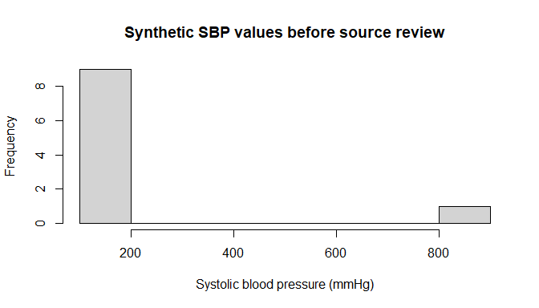
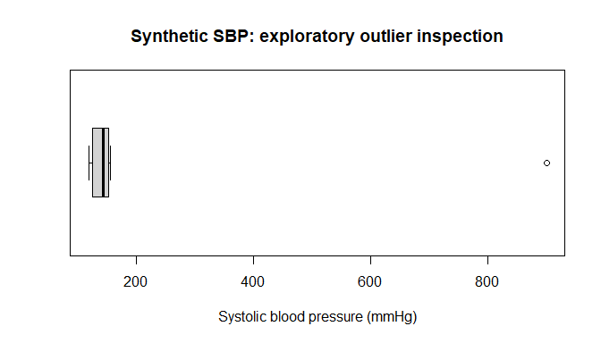
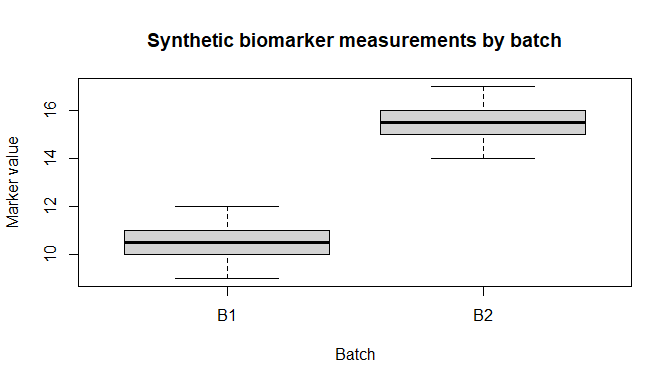

Data Cleaning and Quality Control
================
Sandeep Kumar Singh, PhD

<script type="text/javascript" async
    src="https://polyfill.io/v3/polyfill.min.js?features=es6">
</script>

<script type="text/javascript" async
    src="https://cdnjs.cloudflare.com/ajax/libs/mathjax/3.2.0/es5/tex-mml-chtml.js">
</script>

\]

In Chapters 14 and 15, we organized research files, imported data,
checked column types, and preserved provenance. Our next task is to
decide whether those imported observations are **complete, consistent,
plausible, and suitable for analysis**. This process is called **data
cleaning and quality control (QC)**.

Cleaning is not simply deleting rows that look unusual. An extreme value
might represent a genuine patient, a rare biological observation, a
data-entry error, a unit mismatch, or a sample-labeling problem. We must
distinguish those possibilities before making changes. The central rule
is **detect → investigate → document → correct or flag → verify**.

All evaluated examples in this chapter use **base R**, synthetic
records, and a temporary practice folder. We will use `we`, `our`, and
`us` throughout. The clinical thresholds and QC cutoffs are illustrative
teaching rules, not clinical diagnoses or universal genomic standards.

## 16.1 Learning objectives

By the end of this chapter, we will be able to:

1.  Distinguish validation, cleaning, QC, and exclusion.
2.  Inspect structure, types, ranges, categories, and missingness.
3.  Detect duplicate rows and duplicate participant identifiers.
4.  Standardize character fields without destroying information.
5.  Convert documented missing-value codes safely.
6.  Investigate invalid dates, units, and cross-field inconsistencies.
7.  Detect unusual observations using transparent rules.
8.  Distinguish impossible, implausible, and merely extreme values.
9.  Build reusable QC functions and reports.
10. Apply elementary QC principles to synthetic GWAS summary statistics.
11. Retain raw inputs, audit decisions, and validate outputs.
12. Create a complete, reproducible cleaning pipeline.

------------------------------------------------------------------------

## 16.2 Data cleaning versus quality control

**Data validation** tests whether data satisfy explicit requirements,
such as a unique ID or a numeric age. **Data cleaning** applies
documented transformations, such as trimming whitespace or converting a
known missing-value code. **Quality control** evaluates whether data are
reliable enough for a particular scientific purpose. **Exclusion**
removes an observation from a specified analysis, ideally without
erasing the original record.

| Activity | Example | Appropriate action |
|----|----|----|
| Validation | Age imported as text | Inspect and parse |
| Cleaning | `" north "` versus `"North"` | Standardize labels |
| QC | Systolic BP = 900 mmHg | Flag and investigate |
| Exclusion | Missing outcome for complete-case analysis | Define analysis-specific subset |

A QC flag does not necessarily mean that an observation is wrong. An
excluded row should remain traceable to its source and exclusion reason.

## 16.3 Establish a reproducible workspace

We will use a disposable location rather than modify real files.

``` r
qc_root <- file.path(tempdir(), "r_textbook_ch16")
qc_raw <- file.path(qc_root, "data", "raw")
qc_processed <- file.path(qc_root, "data", "processed")
qc_results <- file.path(qc_root, "results")
for (folder in c(qc_raw, qc_processed, qc_results)) {
  dir.create(folder, recursive = TRUE, showWarnings = FALSE)
}
stopifnot(all(dir.exists(c(qc_raw, qc_processed, qc_results))))
```

## 16.4 Our deliberately messy clinical dataset

A good teaching dataset contains mistakes we can identify and discuss.
Here, every participant is synthetic. Several issues are deliberately
introduced: repeated identifiers, inconsistent site labels, an
implausible SBP, a missing-value sentinel, an invalid date, and mixed
weight units.

``` r
clinical_raw <- data.frame(
  record_id = sprintf("R%02d", 1:12),
  patient_id = c("P001", "P002", "P003", "P004", "P005", "P006",
                 "P007", "P008", "P009", "P010", "P010", "P012"),
  site = c("North", " north ", "SOUTH", "South", "East", "east ",
           "North", "South", "East", "North", "North", "Unknown"),
  age_text = c("35", "51", "47", "NA", "62", "-9", "44", "39",
               "28", "53", "53", "41"),
  sbp_text = c("118", "152", "900", "140", "-9", "131", "125",
               "", "155", "145", "145", "122"),
  weight_value = c(68, 81, 75, 70, 165, 60, 73, 90, 62, 78, 78, 72),
  weight_unit = c("kg", "kg", "kg", "kg", "lb", "kg", "kg",
                  "kg", "kg", "kg", "kg", "kg"),
  visit_date = c("2026-01-05", "2026-01-08", "2026-01-10",
                 "2026-02-30", "2026-01-15", "2026-01-17",
                 "2026-01-19", "2026-01-21", "2026-01-22",
                 "2026-01-24", "2026-01-24", "2026-01-26"),
  stringsAsFactors = FALSE
)
clinical_raw
```

    ##    record_id patient_id    site age_text sbp_text weight_value weight_unit
    ## 1        R01       P001   North       35      118           68          kg
    ## 2        R02       P002  north        51      152           81          kg
    ## 3        R03       P003   SOUTH       47      900           75          kg
    ## 4        R04       P004   South       NA      140           70          kg
    ## 5        R05       P005    East       62       -9          165          lb
    ## 6        R06       P006   east        -9      131           60          kg
    ## 7        R07       P007   North       44      125           73          kg
    ## 8        R08       P008   South       39                    90          kg
    ## 9        R09       P009    East       28      155           62          kg
    ## 10       R10       P010   North       53      145           78          kg
    ## 11       R11       P010   North       53      145           78          kg
    ## 12       R12       P012 Unknown       41      122           72          kg
    ##    visit_date
    ## 1  2026-01-05
    ## 2  2026-01-08
    ## 3  2026-01-10
    ## 4  2026-02-30
    ## 5  2026-01-15
    ## 6  2026-01-17
    ## 7  2026-01-19
    ## 8  2026-01-21
    ## 9  2026-01-22
    ## 10 2026-01-24
    ## 11 2026-01-24
    ## 12 2026-01-26

We save the original data **before** making transformations.

``` r
raw_path <- file.path(qc_raw, "synthetic_clinical_raw.csv")
write.csv(clinical_raw, raw_path, row.names = FALSE, na = "")
stopifnot(file.exists(raw_path))
```

The original `record_id` identifies each row even when `patient_id` is
repeated. This distinction becomes important when investigating
duplicate patient identifiers.

## 16.5 First inspection: dimensions, structure, and summaries

``` r
dim(clinical_raw)
```

    ## [1] 12  8

``` r
names(clinical_raw)
```

    ## [1] "record_id"    "patient_id"   "site"         "age_text"     "sbp_text"    
    ## [6] "weight_value" "weight_unit"  "visit_date"

``` r
str(clinical_raw)
```

    ## 'data.frame':    12 obs. of  8 variables:
    ##  $ record_id   : chr  "R01" "R02" "R03" "R04" ...
    ##  $ patient_id  : chr  "P001" "P002" "P003" "P004" ...
    ##  $ site        : chr  "North" " north " "SOUTH" "South" ...
    ##  $ age_text    : chr  "35" "51" "47" "NA" ...
    ##  $ sbp_text    : chr  "118" "152" "900" "140" ...
    ##  $ weight_value: num  68 81 75 70 165 60 73 90 62 78 ...
    ##  $ weight_unit : chr  "kg" "kg" "kg" "kg" ...
    ##  $ visit_date  : chr  "2026-01-05" "2026-01-08" "2026-01-10" "2026-02-30" ...

``` r
summary(clinical_raw)
```

    ##   record_id          patient_id            site             age_text        
    ##  Length:12          Length:12          Length:12          Length:12         
    ##  Class :character   Class :character   Class :character   Class :character  
    ##  Mode  :character   Mode  :character   Mode  :character   Mode  :character  
    ##                                                                             
    ##                                                                             
    ##                                                                             
    ##    sbp_text          weight_value    weight_unit         visit_date       
    ##  Length:12          Min.   : 60.00   Length:12          Length:12         
    ##  Class :character   1st Qu.: 69.50   Class :character   Class :character  
    ##  Mode  :character   Median : 74.00   Mode  :character   Mode  :character  
    ##                     Mean   : 81.00                                        
    ##                     3rd Qu.: 78.75                                        
    ##                     Max.   :165.00

``` r
head(clinical_raw, 4)
```

    ##   record_id patient_id    site age_text sbp_text weight_value weight_unit
    ## 1       R01       P001   North       35      118           68          kg
    ## 2       R02       P002  north        51      152           81          kg
    ## 3       R03       P003   SOUTH       47      900           75          kg
    ## 4       R04       P004   South       NA      140           70          kg
    ##   visit_date
    ## 1 2026-01-05
    ## 2 2026-01-08
    ## 3 2026-01-10
    ## 4 2026-02-30

``` r
tail(clinical_raw, 3)
```

    ##    record_id patient_id    site age_text sbp_text weight_value weight_unit
    ## 10       R10       P010   North       53      145           78          kg
    ## 11       R11       P010   North       53      145           78          kg
    ## 12       R12       P012 Unknown       41      122           72          kg
    ##    visit_date
    ## 10 2026-01-24
    ## 11 2026-01-24
    ## 12 2026-01-26

A basic inspection answers: How many records are present? Which columns
are character, numeric, or date-like? Do values appear to follow the
documented coding system? Do identifiers look unique?

``` r
vapply(clinical_raw, class, character(1))
```

    ##    record_id   patient_id         site     age_text     sbp_text weight_value 
    ##  "character"  "character"  "character"  "character"  "character"    "numeric" 
    ##  weight_unit   visit_date 
    ##  "character"  "character"

Here, age and SBP were intentionally imported as text. We should not run
`mean(clinical_raw$sbp_text)`; the type is inappropriate for numeric
analysis.

## 16.6 Establish a data dictionary before changing values

A data dictionary specifies what each variable means, its expected type,
units, and allowed values. Our simplified dictionary is:

| Variable | Meaning | Expected type | Expected values / units |
|----|----|----|----|
| `record_id` | Source row ID | Character | Unique, nonmissing |
| `patient_id` | Participant ID | Character | May repeat across visits; investigate |
| `site` | Study site | Character | North, South, East; Unknown flagged |
| `age_text` | Age at visit | Numeric after parsing | Years; `-9` denotes missing |
| `sbp_text` | Systolic blood pressure | Numeric after parsing | mmHg; `-9` denotes missing |
| `weight_value` | Weight | Numeric | Interpret with `weight_unit` |
| `weight_unit` | Measurement unit | Character | kg or lb |
| `visit_date` | Visit date | Date after parsing | ISO `YYYY-MM-DD` |

**The sentinel `-9` is missing only because our synthetic dictionary
explicitly defines it that way.** In another study, negative values may
have a different meaning.

## 16.7 Never overwrite the raw object

We create a working copy and keep the original available for comparison.

``` r
clinical <- clinical_raw
stopifnot(identical(clinical, clinical_raw))
```

Our transformations will operate on `clinical`, while `clinical_raw`
remains unchanged.

## 16.8 Missing values: `NA`, empty strings, and sentinels

A blank string (`""`) is not necessarily the same as `NA`. Likewise, a
numeric-looking `"-9"` remains text until we parse it.

``` r
table(clinical$age_text, useNA = "ifany")
```

    ## 
    ## -9 28 35 39 41 44 47 51 53 62 NA 
    ##  1  1  1  1  1  1  1  1  2  1  1

``` r
table(clinical$sbp_text, useNA = "ifany")
```

    ## 
    ##      -9 118 122 125 131 140 145 152 155 900 
    ##   1   1   1   1   1   1   1   2   1   1   1

``` r
sum(is.na(clinical$sbp_text))
```

    ## [1] 0

``` r
sum(clinical$sbp_text == "")
```

    ## [1] 1

For these two variables, the dictionary defines `"-9"`, `"NA"`, and
blank strings as missing. We can convert them explicitly:

``` r
missing_tokens <- c("", "NA", "-9")
parse_measurement <- function(x) {
  stopifnot(is.character(x))
  z <- trimws(x)
  z[z %in% missing_tokens] <- NA_character_
  suppressWarnings(as.numeric(z))
}
clinical$age <- parse_measurement(clinical$age_text)
clinical$sbp <- parse_measurement(clinical$sbp_text)
clinical[, c("record_id", "age_text", "age", "sbp_text", "sbp")]
```

    ##    record_id age_text age sbp_text sbp
    ## 1        R01       35  35      118 118
    ## 2        R02       51  51      152 152
    ## 3        R03       47  47      900 900
    ## 4        R04       NA  NA      140 140
    ## 5        R05       62  62       -9  NA
    ## 6        R06       -9  NA      131 131
    ## 7        R07       44  44      125 125
    ## 8        R08       39  39           NA
    ## 9        R09       28  28      155 155
    ## 10       R10       53  53      145 145
    ## 11       R11       53  53      145 145
    ## 12       R12       41  41      122 122

**Important limitation:** `suppressWarnings(as.numeric(...))` would also
convert unrecognized text such as `"high"` to `NA`. We should identify
unexpected tokens before parsing, rather than silently discarding them.

``` r
find_unexpected_numeric <- function(x, missing = c("", "NA", "-9")) {
  z <- trimws(as.character(x))
  z <- z[!is.na(z) & !(z %in% missing)]
  unique(z[is.na(suppressWarnings(as.numeric(z)))])
}
find_unexpected_numeric(clinical$age_text)
```

    ## character(0)

``` r
find_unexpected_numeric(clinical$sbp_text)
```

    ## character(0)

No unexpected tokens appear in this synthetic example. In a real
dataset, we would stop and investigate if any were found.

## 16.9 Counting missingness correctly

``` r
selected <- clinical[, c("age", "sbp", "weight_value", "visit_date")]
missing_counts <- colSums(is.na(selected))
missing_percent <- 100 * missing_counts / nrow(selected)
missing_report <- data.frame(
  variable = names(missing_counts),
  n_missing = as.integer(missing_counts),
  pct_missing = as.numeric(missing_percent),
  row.names = NULL
)
missing_report
```

    ##       variable n_missing pct_missing
    ## 1          age         2    16.66667
    ## 2          sbp         2    16.66667
    ## 3 weight_value         0     0.00000
    ## 4   visit_date         0     0.00000

We have not yet parsed dates, so the date field is still a character
vector; invalid dates are not automatically counted as missing. This
illustrates why QC must consider *meaning*, not only `is.na()`.

For an entire data frame, `colSums(is.na(dat))` is concise. We should
avoid using `identical()` to compare integer and double count vectors
unless their types are guaranteed to match; `all.equal()` or numerical
equality is more appropriate.

## 16.10 Missingness patterns and complete cases

``` r
clinical$missing_age <- is.na(clinical$age)
clinical$missing_sbp <- is.na(clinical$sbp)
table(clinical$missing_age, clinical$missing_sbp)
```

    ##        
    ##         FALSE TRUE
    ##   FALSE     8    2
    ##   TRUE      2    0

``` r
complete.cases(clinical[, c("age", "sbp")])
```

    ##  [1]  TRUE  TRUE  TRUE FALSE FALSE FALSE  TRUE FALSE  TRUE  TRUE  TRUE  TRUE

``` r
sum(complete.cases(clinical[, c("age", "sbp")]))
```

    ## [1] 8

Complete-case analysis may reduce sample size and can introduce bias if
missingness depends on observed or unobserved factors. We should not
automatically remove incomplete records at the cleaning stage.
Missing-data mechanisms and imputation require a separate statistical
treatment.

## 16.11 Standardizing text labels

Whitespace and capitalization can create artificial categories.

``` r
unique(clinical$site)
```

    ## [1] "North"   " north " "SOUTH"   "South"   "East"    "east "   "Unknown"

``` r
table(clinical$site)
```

    ## 
    ##  north     East   east    North   South   SOUTH Unknown 
    ##       1       2       1       4       2       1       1

Normalize spaces and capitalization while retaining the original column:

``` r
clinical$site_clean <- trimws(tolower(clinical$site))
site_map <- c(north = "North", south = "South", east = "East")
clinical$site_clean <- unname(site_map[clinical$site_clean])
clinical$site_unknown <- is.na(clinical$site_clean)
table(clinical$site_clean, useNA = "ifany")
```

    ## 
    ##  East North South  <NA> 
    ##     3     5     3     1

The label `"Unknown"` does not match an approved study site. We flag it
rather than invent a site assignment.

### Why blindly changing case is not always safe

Gene symbols, sample IDs, alleles, and many genomic identifiers are
case-sensitive. Text normalization must be **variable-specific**. We may
standardize a clinic’s free-text site label, but should not
automatically lowercase every column in a genomic table.

## 16.12 Duplicate rows versus duplicate IDs

Two distinct questions must be answered:

1.  Are two rows exactly the same?
2.  Does an identifier occur more than once?

``` r
sum(duplicated(clinical_raw))
```

    ## [1] 0

``` r
sum(duplicated(clinical_raw$patient_id))
```

    ## [1] 1

``` r
clinical_raw[duplicated(clinical_raw$patient_id) |
               duplicated(clinical_raw$patient_id, fromLast = TRUE),
             c("record_id", "patient_id", "visit_date", "sbp_text")]
```

    ##    record_id patient_id visit_date sbp_text
    ## 10       R10       P010 2026-01-24      145
    ## 11       R11       P010 2026-01-24      145

A repeated patient ID may indicate repeated visits, a duplicate import,
or an error. We must consult the study design before deciding which row
to keep.

### Duplicate policy example

If the intended unit of analysis is **one record per patient**, repeated
IDs require investigation. If the intended unit is **one visit per
patient**, a patient may legitimately have multiple rows. The uniqueness
key might then be `(patient_id, visit_date)` or a unique visit ID.

``` r
key <- paste(clinical$patient_id, clinical$visit_date, sep = "|")
sum(duplicated(key))
```

    ## [1] 1

Here, the duplicated key is deliberate. We flag it; we do not delete
either row automatically.

## 16.13 Dates: parsing and invalid calendar values

Dates should be stored as `Date` objects when the data represent
calendar dates.

``` r
clinical$visit_date_parsed <- as.Date(clinical$visit_date, format = "%Y-%m-%d")
clinical[, c("record_id", "visit_date", "visit_date_parsed")]
```

    ##    record_id visit_date visit_date_parsed
    ## 1        R01 2026-01-05        2026-01-05
    ## 2        R02 2026-01-08        2026-01-08
    ## 3        R03 2026-01-10        2026-01-10
    ## 4        R04 2026-02-30              <NA>
    ## 5        R05 2026-01-15        2026-01-15
    ## 6        R06 2026-01-17        2026-01-17
    ## 7        R07 2026-01-19        2026-01-19
    ## 8        R08 2026-01-21        2026-01-21
    ## 9        R09 2026-01-22        2026-01-22
    ## 10       R10 2026-01-24        2026-01-24
    ## 11       R11 2026-01-24        2026-01-24
    ## 12       R12 2026-01-26        2026-01-26

The string `2026-02-30` is not a valid calendar date. Some R/platform
combinations may handle malformed dates differently. We therefore use a
**round-trip check**: a valid ISO date must parse and format back to
exactly the original string.

``` r
parsed <- as.Date(clinical$visit_date, format = "%Y-%m-%d")
roundtrip <- format(parsed, "%Y-%m-%d")
clinical$invalid_visit_date <- is.na(parsed) |
  is.na(roundtrip) | roundtrip != clinical$visit_date
clinical$invalid_visit_date[is.na(clinical$invalid_visit_date)] <- TRUE
clinical[, c("record_id", "visit_date", "invalid_visit_date")]
```

    ##    record_id visit_date invalid_visit_date
    ## 1        R01 2026-01-05              FALSE
    ## 2        R02 2026-01-08              FALSE
    ## 3        R03 2026-01-10              FALSE
    ## 4        R04 2026-02-30               TRUE
    ## 5        R05 2026-01-15              FALSE
    ## 6        R06 2026-01-17              FALSE
    ## 7        R07 2026-01-19              FALSE
    ## 8        R08 2026-01-21              FALSE
    ## 9        R09 2026-01-22              FALSE
    ## 10       R10 2026-01-24              FALSE
    ## 11       R11 2026-01-24              FALSE
    ## 12       R12 2026-01-26              FALSE

When a date fails validation, we should request source verification. We
should not silently replace February 30 with another date.

## 16.14 Units: pounds versus kilograms

A numeric value is meaningless without its unit. Our weight column
contains both kilograms and pounds.

``` r
table(clinical$weight_unit, useNA = "ifany")
```

    ## 
    ## kg lb 
    ## 11  1

``` r
clinical$weight_kg <- ifelse(
  clinical$weight_unit == "kg",
  clinical$weight_value,
  ifelse(clinical$weight_unit == "lb",
         clinical$weight_value * 0.45359237,
         NA_real_)
)
clinical[, c("record_id", "weight_value", "weight_unit", "weight_kg")]
```

    ##    record_id weight_value weight_unit weight_kg
    ## 1        R01           68          kg  68.00000
    ## 2        R02           81          kg  81.00000
    ## 3        R03           75          kg  75.00000
    ## 4        R04           70          kg  70.00000
    ## 5        R05          165          lb  74.84274
    ## 6        R06           60          kg  60.00000
    ## 7        R07           73          kg  73.00000
    ## 8        R08           90          kg  90.00000
    ## 9        R09           62          kg  62.00000
    ## 10       R10           78          kg  78.00000
    ## 11       R11           78          kg  78.00000
    ## 12       R12           72          kg  72.00000

We preserve the original value and unit and create a derived harmonized
column. This makes the conversion auditable.

``` r
stopifnot(
  all(clinical$weight_kg > 0, na.rm = TRUE),
  isTRUE(all.equal(clinical$weight_kg[5], 165 * 0.45359237))
)
```

## 16.15 Impossible, implausible, and extreme values

An **impossible value** violates a known physical or logical constraint,
such as negative age at enrollment. An **implausible value** is unlikely
under the study protocol but may require review. An **extreme value** is
far from the center of the observed distribution but can be valid.

Our synthetic SBP value of 900 mmHg is deliberately implausible.

``` r
clinical$age_out_of_range <- !is.na(clinical$age) &
  (clinical$age < 0 | clinical$age > 120)
clinical$sbp_review_flag <- !is.na(clinical$sbp) &
  (clinical$sbp < 60 | clinical$sbp > 300)
clinical[, c("record_id", "sbp", "sbp_review_flag")]
```

    ##    record_id sbp sbp_review_flag
    ## 1        R01 118           FALSE
    ## 2        R02 152           FALSE
    ## 3        R03 900            TRUE
    ## 4        R04 140           FALSE
    ## 5        R05  NA           FALSE
    ## 6        R06 131           FALSE
    ## 7        R07 125           FALSE
    ## 8        R08  NA           FALSE
    ## 9        R09 155           FALSE
    ## 10       R10 145           FALSE
    ## 11       R11 145           FALSE
    ## 12       R12 122           FALSE

These bounds are **teaching examples**, not validated clinical cutoffs.
The correct limits depend on age, device, measurement context, study
protocol, and clinical expertise.

### Why we should flag rather than overwrite

Replacing an extreme observation with the mean, median, or an arbitrary
cap can distort biological signals. We should inspect source documents
or laboratory metadata when possible, retain the original measurement,
and record any correction.

## 16.16 Outliers using the IQR rule

A common exploratory method flags observations outside:

$$Q_1 - 1.5\,\mathrm{IQR}
\quad   ext{or}\quad
Q_3 + 1.5\,\mathrm{IQR}.$$

The interquartile range is $Q_3-Q_1$. This rule is **descriptive**, not
a universal exclusion criterion.

``` r
flag_iqr <- function(x, multiplier = 1.5) {
  if (!is.numeric(x)) stop("x must be numeric")
  if (!is.numeric(multiplier) || length(multiplier) != 1L ||
      is.na(multiplier) || multiplier < 0) stop("invalid multiplier")
  valid <- x[is.finite(x)]
  out <- rep(FALSE, length(x))
  out[!is.finite(x)] <- NA
  if (length(valid) < 4L) return(out)
  q <- quantile(valid, c(0.25, 0.75), names = FALSE)
  spread <- q[2] - q[1]
  out[is.finite(x)] <- x[is.finite(x)] < q[1] - multiplier * spread |
    x[is.finite(x)] > q[2] + multiplier * spread
  out
}
clinical$sbp_iqr_flag <- flag_iqr(clinical$sbp)
clinical[, c("record_id", "sbp", "sbp_iqr_flag")]
```

    ##    record_id sbp sbp_iqr_flag
    ## 1        R01 118        FALSE
    ## 2        R02 152        FALSE
    ## 3        R03 900         TRUE
    ## 4        R04 140        FALSE
    ## 5        R05  NA           NA
    ## 6        R06 131        FALSE
    ## 7        R07 125        FALSE
    ## 8        R08  NA           NA
    ## 9        R09 155        FALSE
    ## 10       R10 145        FALSE
    ## 11       R11 145        FALSE
    ## 12       R12 122        FALSE

IQR flags can be unstable in very small datasets and can misclassify
observations from skewed or multimodal distributions. For biomarker
data, we should also consider transformations, stratification, batch
effects, and scientific plausibility.

## 16.17 Z-scores: useful but limited

A standard z-score is

$$z_i = rac{x_i-ar{x}}{s},$$

where $ar{x}$ is the sample mean and $s$ is the sample standard
deviation. A large absolute z-score indicates distance from the sample
mean in standard-deviation units.

``` r
observed_sbp <- clinical$sbp[!is.na(clinical$sbp)]
z <- as.numeric(scale(observed_sbp))
data.frame(sbp = observed_sbp, z_score = round(z, 2))
```

    ##    sbp z_score
    ## 1  118   -0.39
    ## 2  152   -0.25
    ## 3  900    2.84
    ## 4  140   -0.30
    ## 5  131   -0.34
    ## 6  125   -0.37
    ## 7  155   -0.24
    ## 8  145   -0.28
    ## 9  145   -0.28
    ## 10 122   -0.38

The extreme value itself changes the mean and standard deviation,
potentially masking outliers. Z-score thresholds are not reliable
universal QC rules, especially for skewed or small samples.

## 16.18 Cross-field consistency checks

Some data errors become visible only when two variables are considered
together. Examples include a discharge date before admission, a visit
date before birth, or a reported total that does not equal the sum of
its components.

We will create a separate synthetic example:

``` r
stays <- data.frame(
  id = c("S1", "S2", "S3"),
  admission = as.Date(c("2026-03-01", "2026-03-05", "2026-03-10")),
  discharge = as.Date(c("2026-03-04", "2026-03-03", "2026-03-12"))
)
stays$invalid_sequence <- !is.na(stays$admission) &
  !is.na(stays$discharge) & stays$discharge < stays$admission
stays
```

    ##   id  admission  discharge invalid_sequence
    ## 1 S1 2026-03-01 2026-03-04            FALSE
    ## 2 S2 2026-03-05 2026-03-03             TRUE
    ## 3 S3 2026-03-10 2026-03-12            FALSE

The second row violates the expected ordering. We should investigate the
source rather than automatically swap the dates.

## 16.19 Valid categories and unexpected levels

``` r
allowed_sites <- c("North", "South", "East")
clinical$invalid_site <- is.na(clinical$site_clean) |
  !(clinical$site_clean %in% allowed_sites)
table(clinical$invalid_site)
```

    ## 
    ## FALSE  TRUE 
    ##    11     1

In other projects, legitimate categories might include `"Not recorded"`,
`"Other"`, or `"Unknown"`. Whether those are invalid depends on the data
dictionary.

## 16.20 A QC report with row-level flags

We can combine flags without deleting rows.

``` r
clinical$duplicate_patient_id <- duplicated(clinical$patient_id) |
  duplicated(clinical$patient_id, fromLast = TRUE)
clinical$qc_review <- clinical$invalid_site |
  clinical$invalid_visit_date |
  clinical$age_out_of_range |
  clinical$sbp_review_flag |
  clinical$duplicate_patient_id
qc_flags <- clinical[, c(
  "record_id", "patient_id", "invalid_site", "invalid_visit_date",
  "age_out_of_range", "sbp_review_flag", "duplicate_patient_id",
  "qc_review"
)]
qc_flags
```

    ##    record_id patient_id invalid_site invalid_visit_date age_out_of_range
    ## 1        R01       P001        FALSE              FALSE            FALSE
    ## 2        R02       P002        FALSE              FALSE            FALSE
    ## 3        R03       P003        FALSE              FALSE            FALSE
    ## 4        R04       P004        FALSE               TRUE            FALSE
    ## 5        R05       P005        FALSE              FALSE            FALSE
    ## 6        R06       P006        FALSE              FALSE            FALSE
    ## 7        R07       P007        FALSE              FALSE            FALSE
    ## 8        R08       P008        FALSE              FALSE            FALSE
    ## 9        R09       P009        FALSE              FALSE            FALSE
    ## 10       R10       P010        FALSE              FALSE            FALSE
    ## 11       R11       P010        FALSE              FALSE            FALSE
    ## 12       R12       P012         TRUE              FALSE            FALSE
    ##    sbp_review_flag duplicate_patient_id qc_review
    ## 1            FALSE                FALSE     FALSE
    ## 2            FALSE                FALSE     FALSE
    ## 3             TRUE                FALSE      TRUE
    ## 4            FALSE                FALSE      TRUE
    ## 5            FALSE                FALSE     FALSE
    ## 6            FALSE                FALSE     FALSE
    ## 7            FALSE                FALSE     FALSE
    ## 8            FALSE                FALSE     FALSE
    ## 9            FALSE                FALSE     FALSE
    ## 10           FALSE                 TRUE      TRUE
    ## 11           FALSE                 TRUE      TRUE
    ## 12           FALSE                FALSE      TRUE

A flag summary helps us prioritize review:

``` r
flag_columns <- c("invalid_site", "invalid_visit_date",
                  "age_out_of_range", "sbp_review_flag",
                  "duplicate_patient_id", "qc_review")
flag_summary <- data.frame(
  flag = flag_columns,
  n_flagged = as.integer(vapply(clinical[flag_columns], sum, integer(1))),
  row.names = NULL
)
flag_summary
```

    ##                   flag n_flagged
    ## 1         invalid_site         1
    ## 2   invalid_visit_date         1
    ## 3     age_out_of_range         0
    ## 4      sbp_review_flag         1
    ## 5 duplicate_patient_id         2
    ## 6            qc_review         5

**Caution:** A participant may have more than one flag, so the sum of
individual flag counts is not the number of unique flagged participants.

## 16.21 QC decisions: retain, correct, or exclude?

A useful review log records the decision separately from the flag. For
example:

| Finding | Initial action | After verification |
|----|----|----|
| Whitespace in site name | Standardize | Retain |
| Unknown site | Flag | Resolve from source or leave missing |
| SBP = 900 | Flag | Correct only with verified source |
| Duplicate patient ID | Flag | Determine visit structure |
| Invalid date | Flag | Correct only with source documentation |
| Weight in pounds | Convert using recorded unit | Retain both original and converted values |

The decision to exclude an observation belongs to a clearly defined
analysis protocol, not an undocumented cleaning shortcut.

## 16.22 Create a transparent audit trail

An audit trail can record which transformation was applied and why. We
create a small log of **rules**, not an invented record-by-record
history.

``` r
audit_log <- data.frame(
  step = 1:5,
  variable = c("age", "sbp", "site_clean", "visit_date_parsed", "weight_kg"),
  operation = c("parse numeric", "parse numeric", "normalize categories",
                "parse ISO date", "convert units"),
  rule = c("-9/NA/blank to missing", "-9/NA/blank to missing",
           "trim, lowercase, map approved labels",
           "round-trip validate calendar dates", "lb multiplied by 0.45359237"),
  stringsAsFactors = FALSE
)
audit_log
```

    ##   step          variable            operation
    ## 1    1               age        parse numeric
    ## 2    2               sbp        parse numeric
    ## 3    3        site_clean normalize categories
    ## 4    4 visit_date_parsed       parse ISO date
    ## 5    5         weight_kg        convert units
    ##                                   rule
    ## 1               -9/NA/blank to missing
    ## 2               -9/NA/blank to missing
    ## 3 trim, lowercase, map approved labels
    ## 4   round-trip validate calendar dates
    ## 5          lb multiplied by 0.45359237

For production research, an audit log should also include data version,
run timestamp, code version, operator or automated process, and counts
of affected records. Corrections should be traceable to source evidence.

## 16.23 Export processed data and QC outputs

``` r
processed_path <- file.path(qc_processed, "synthetic_clinical_qc.rds")
flags_path <- file.path(qc_results, "qc_row_flags.csv")
summary_path <- file.path(qc_results, "qc_flag_summary.csv")
audit_path <- file.path(qc_results, "qc_rules.csv")
saveRDS(clinical, processed_path)
write.csv(qc_flags, flags_path, row.names = FALSE)
write.csv(flag_summary, summary_path, row.names = FALSE)
write.csv(audit_log, audit_path, row.names = FALSE)
stopifnot(all(file.exists(c(processed_path, flags_path,
                            summary_path, audit_path))))
```

Read back the RDS file to verify that its contents match:

``` r
restored <- readRDS(processed_path)
stopifnot(identical(restored, clinical))
```

## 16.24 Data quality metrics

Common QC metrics include completeness, uniqueness, validity, and
consistency. Their definitions should be tailored to the study.

``` r
quality_metrics <- data.frame(
  metric = c("Records", "Unique record IDs", "Missing age",
             "Missing SBP", "Rows requiring review"),
  value = c(
    nrow(clinical),
    length(unique(clinical$record_id)),
    sum(is.na(clinical$age)),
    sum(is.na(clinical$sbp)),
    sum(clinical$qc_review)
  )
)
quality_metrics
```

    ##                  metric value
    ## 1               Records    12
    ## 2     Unique record IDs    12
    ## 3           Missing age     2
    ## 4           Missing SBP     2
    ## 5 Rows requiring review     5

A completeness percentage for SBP can be calculated as:

``` r
sbp_completeness <- 100 * mean(!is.na(clinical$sbp))
sbp_completeness
```

    ## [1] 83.33333

A dataset can be complete yet wrong; completeness alone is not a measure
of accuracy.

## 16.25 Visual QC using base R

Plots can reveal distributions and extreme observations. The following
examples use base graphics and do not require external packages.

``` r
hist(clinical$sbp, breaks = 8,
     main = "Synthetic SBP values before source review",
     xlab = "Systolic blood pressure (mmHg)")
```

<!-- -->

``` r
boxplot(clinical$sbp, horizontal = TRUE,
        main = "Synthetic SBP: exploratory outlier inspection",
        xlab = "Systolic blood pressure (mmHg)")
```

<!-- -->

Plots do not establish that an extreme value is erroneous. We should
combine them with source verification and protocol-specific rules.

## 16.26 Genomics QC: what is different?

Genomic datasets introduce additional validity requirements: chromosome
notation, genome build, allele coding, effect orientation, allele
frequencies, imputation quality, sample size, and variant identity. A
syntactically valid row can still be scientifically mis-harmonized.

We will demonstrate **elementary summary-statistics QC**, not a complete
GWAS harmonization pipeline.

``` r
gwas_raw <- data.frame(
  CHROM = c("6", "6", "6", "6", "X", "6", "6", "6"),
  ID = c("rs1", "rs2", "rs3", "rs4", "rs5", "rs6", "rs7", "rs7"),
  POS = c(27509493, 28703631, 31237965, 32626565,
          1000000, 33794605, 33000000, 33000000),
  A1 = c("A", "C", "G", "A", "T", "A", "G", "G"),
  A2 = c("G", "T", "A", "A", "C", "C", "C", "C"),
  BETA = c(0.05, -0.04, 0.10, 0.02, 0.03, NA, 0.08, 0.08),
  SE = c(0.02, 0.00, 0.03, 0.01, 0.02, 0.02, 0.03, 0.03),
  PVAL = c(0.012, 0.002, 0, 0.5, 0.05, 0.2, 1.2, 1.2),
  IMPINFO = c(0.98, 0.95, 0.92, 0.91, 0.90, 0.60, 0.99, 0.99),
  stringsAsFactors = FALSE
)
gwas_raw
```

    ##   CHROM  ID      POS A1 A2  BETA   SE  PVAL IMPINFO
    ## 1     6 rs1 27509493  A  G  0.05 0.02 0.012    0.98
    ## 2     6 rs2 28703631  C  T -0.04 0.00 0.002    0.95
    ## 3     6 rs3 31237965  G  A  0.10 0.03 0.000    0.92
    ## 4     6 rs4 32626565  A  A  0.02 0.01 0.500    0.91
    ## 5     X rs5  1000000  T  C  0.03 0.02 0.050    0.90
    ## 6     6 rs6 33794605  A  C    NA 0.02 0.200    0.60
    ## 7     6 rs7 33000000  G  C  0.08 0.03 1.200    0.99
    ## 8     6 rs7 33000000  G  C  0.08 0.03 1.200    0.99

All positions are synthetic teaching examples. We must specify a
reference genome build before interpreting them as real loci.

## 16.27 GWAS column and type validation

``` r
required_gwas <- c("CHROM", "ID", "POS", "A1", "A2",
                   "BETA", "SE", "PVAL", "IMPINFO")
stopifnot(all(required_gwas %in% names(gwas_raw)))
str(gwas_raw)
```

    ## 'data.frame':    8 obs. of  9 variables:
    ##  $ CHROM  : chr  "6" "6" "6" "6" ...
    ##  $ ID     : chr  "rs1" "rs2" "rs3" "rs4" ...
    ##  $ POS    : num  27509493 28703631 31237965 32626565 1000000 ...
    ##  $ A1     : chr  "A" "C" "G" "A" ...
    ##  $ A2     : chr  "G" "T" "A" "A" ...
    ##  $ BETA   : num  0.05 -0.04 0.1 0.02 0.03 NA 0.08 0.08
    ##  $ SE     : num  0.02 0 0.03 0.01 0.02 0.02 0.03 0.03
    ##  $ PVAL   : num  0.012 0.002 0 0.5 0.05 0.2 1.2 1.2
    ##  $ IMPINFO: num  0.98 0.95 0.92 0.91 0.9 0.6 0.99 0.99

## 16.28 Flag invalid GWAS values

Examples of elementary rules:

- `POS` must be a positive finite integer-like coordinate.
- `SE` must be finite and strictly positive.
- `PVAL` must be in `(0, 1]` for ordinary finite p-values; underflowed
  zero may require specialized handling rather than deletion.
- Alleles should be recognized nucleotide strings and should differ.
- Imputation quality should fall in its documented valid range;
  filtering thresholds depend on study design.
- Duplicate IDs require investigation because the same identifier can be
  represented in different ways.

``` r
gwas <- gwas_raw
gwas$bad_pos <- is.na(gwas$POS) | !is.finite(gwas$POS) |
  gwas$POS <= 0 | gwas$POS != floor(gwas$POS)
gwas$bad_se <- is.na(gwas$SE) | !is.finite(gwas$SE) | gwas$SE <= 0
gwas$bad_p <- is.na(gwas$PVAL) | !is.finite(gwas$PVAL) |
  gwas$PVAL <= 0 | gwas$PVAL > 1
gwas$missing_beta <- is.na(gwas$BETA) | !is.finite(gwas$BETA)
gwas$bad_allele <- is.na(gwas$A1) | is.na(gwas$A2) |
  !(gwas$A1 %in% c("A", "C", "G", "T")) |
  !(gwas$A2 %in% c("A", "C", "G", "T")) |
  gwas$A1 == gwas$A2
gwas$bad_info <- is.na(gwas$IMPINFO) | !is.finite(gwas$IMPINFO) |
  gwas$IMPINFO < 0 | gwas$IMPINFO > 1
gwas$duplicate_id <- duplicated(gwas$ID) |
  duplicated(gwas$ID, fromLast = TRUE)
gwas[, c("ID", "bad_pos", "bad_se", "bad_p",
         "missing_beta", "bad_allele", "bad_info", "duplicate_id")]
```

    ##    ID bad_pos bad_se bad_p missing_beta bad_allele bad_info duplicate_id
    ## 1 rs1   FALSE  FALSE FALSE        FALSE      FALSE    FALSE        FALSE
    ## 2 rs2   FALSE   TRUE FALSE        FALSE      FALSE    FALSE        FALSE
    ## 3 rs3   FALSE  FALSE  TRUE        FALSE      FALSE    FALSE        FALSE
    ## 4 rs4   FALSE  FALSE FALSE        FALSE       TRUE    FALSE        FALSE
    ## 5 rs5   FALSE  FALSE FALSE        FALSE      FALSE    FALSE        FALSE
    ## 6 rs6   FALSE  FALSE FALSE         TRUE      FALSE    FALSE        FALSE
    ## 7 rs7   FALSE  FALSE  TRUE        FALSE      FALSE    FALSE         TRUE
    ## 8 rs7   FALSE  FALSE  TRUE        FALSE      FALSE    FALSE         TRUE

A `PVAL` of exactly zero may reflect numerical underflow for an
extremely small association p-value; it should not automatically be
interpreted as a biological error. The original pipeline, precision, and
log-p representation must be checked.

## 16.29 GWAS filtering is analysis-specific

We may define a **demonstration-only** eligibility mask for downstream
calculations:

``` r
gwas$eligible_demo <- !(
  gwas$bad_pos | gwas$bad_se | gwas$bad_p |
  gwas$missing_beta | gwas$bad_allele |
  gwas$bad_info | gwas$duplicate_id
)
gwas[, c("ID", "eligible_demo")]
```

    ##    ID eligible_demo
    ## 1 rs1          TRUE
    ## 2 rs2         FALSE
    ## 3 rs3         FALSE
    ## 4 rs4         FALSE
    ## 5 rs5          TRUE
    ## 6 rs6         FALSE
    ## 7 rs7         FALSE
    ## 8 rs7         FALSE

This mask is **not** a universal GWAS QC recipe. It does not assess
allele harmonization, strand ambiguity, genome-build concordance, allele
frequency consistency, effective sample size, ancestry-specific LD, INFO
thresholds, or reference-panel matching. The duplicate `rs7` entries are
flagged but preserved.

## 16.30 A genomic region filter

For illustration, we can select chromosome 6 positions 25–34 Mb,
inclusive:

``` r
in_region <- gwas$CHROM == "6" &
  gwas$POS >= 25000000 & gwas$POS <= 34000000
region_table <- gwas[in_region, c("CHROM", "ID", "POS", "PVAL")]
region_table
```

    ##   CHROM  ID      POS  PVAL
    ## 1     6 rs1 27509493 0.012
    ## 2     6 rs2 28703631 0.002
    ## 3     6 rs3 31237965 0.000
    ## 4     6 rs4 32626565 0.500
    ## 6     6 rs6 33794605 0.200
    ## 7     6 rs7 33000000 1.200
    ## 8     6 rs7 33000000 1.200

This filter is meaningful only when the coordinates are assigned to a
known genome build. A region filter does not substitute for statistical
or genomic QC.

## 16.31 Detecting duplicate genomic coordinates

``` r
variant_key <- paste(gwas$CHROM, gwas$POS, gwas$A1, gwas$A2,
                     sep = ":")
gwas$duplicate_variant_key <- duplicated(variant_key) |
  duplicated(variant_key, fromLast = TRUE)
gwas[, c("ID", "duplicate_variant_key")]
```

    ##    ID duplicate_variant_key
    ## 1 rs1                 FALSE
    ## 2 rs2                 FALSE
    ## 3 rs3                 FALSE
    ## 4 rs4                 FALSE
    ## 5 rs5                 FALSE
    ## 6 rs6                 FALSE
    ## 7 rs7                  TRUE
    ## 8 rs7                  TRUE

Variant identity may require normalization, reference-allele checking,
and indel representation harmonization. The simple key here is only a
starting point.

## 16.32 Batch effects and laboratory QC

Biomedical measurements may vary by laboratory, instrument, plate,
processing date, reagent lot, or sequencing batch. Apparent group
differences can arise from technical rather than biological variation.

A first diagnostic is to summarize measurements by batch:

``` r
batch_data <- data.frame(
  batch = rep(c("B1", "B2"), each = 6),
  marker = c(10, 11, 9, 12, 10, 11, 15, 16, 14, 17, 15, 16)
)
aggregate(marker ~ batch, data = batch_data, FUN = mean)
```

    ##   batch marker
    ## 1    B1   10.5
    ## 2    B2   15.5

``` r
boxplot(marker ~ batch, data = batch_data,
        main = "Synthetic biomarker measurements by batch",
        xlab = "Batch", ylab = "Marker value")
```

<!-- -->

A batch difference alone does not prove a technical artifact. We should
investigate batch assignment, biological group composition, controls,
calibration records, and study design before attempting correction.

## 16.33 A reusable QC function

We can turn repeated checks into a function. This example returns a
**report**, not a silently modified dataset.

``` r
qc_numeric <- function(x, lower = -Inf, upper = Inf) {
  if (!is.numeric(x)) stop("x must be numeric")
  if (length(lower) != 1L || length(upper) != 1L ||
      is.na(lower) || is.na(upper) || lower > upper) {
    stop("invalid bounds")
  }
  missing <- is.na(x)
  nonfinite <- !missing & !is.finite(x)
  outside <- !missing & is.finite(x) & (x < lower | x > upper)
  list(
    n = length(x),
    missing = sum(missing),
    nonfinite = sum(nonfinite),
    outside_range = sum(outside),
    flag = missing | nonfinite | outside
  )
}
qc_numeric(clinical$sbp, lower = 60, upper = 300)
```

    ## $n
    ## [1] 12
    ## 
    ## $missing
    ## [1] 2
    ## 
    ## $nonfinite
    ## [1] 0
    ## 
    ## $outside_range
    ## [1] 1
    ## 
    ## $flag
    ##  [1] FALSE FALSE  TRUE FALSE  TRUE FALSE FALSE  TRUE FALSE FALSE FALSE FALSE

Notice that missing values are counted separately. Whether they should
lead to exclusion depends on the intended analysis.

## 16.34 Testing QC code

We should test functions against small inputs with known answers,
including edge cases.

``` r
test_values <- c(100, 200, 900, NA_real_, Inf)
test_report <- qc_numeric(test_values, lower = 60, upper = 300)
stopifnot(
  test_report$n == 5L,
  test_report$missing == 1L,
  test_report$nonfinite == 1L,
  test_report$outside_range == 1L,
  identical(test_report$flag, c(FALSE, FALSE, TRUE, TRUE, TRUE))
)
```

Unit tests do not prove that clinical thresholds are scientifically
appropriate; they verify that our implementation behaves as specified.

## 16.35 Before-and-after comparison

We should be able to explain how the cleaned dataset differs from the
source.

``` r
before_after <- data.frame(
  check = c("Rows", "Unique patient IDs", "SBP missing after parsing",
            "Approved site labels after cleaning"),
  value = c(
    nrow(clinical_raw),
    length(unique(clinical_raw$patient_id)),
    sum(is.na(clinical$sbp)),
    sum(!is.na(clinical$site_clean))
  )
)
before_after
```

    ##                                 check value
    ## 1                                Rows    12
    ## 2                  Unique patient IDs    11
    ## 3           SBP missing after parsing     2
    ## 4 Approved site labels after cleaning    11

No rows were deleted. We created additional parsed, standardized, and QC
flag columns, preserving the original fields.

## 16.36 Reproducibility checklist

Before releasing a cleaned dataset or beginning statistical modeling, we
should confirm:

- [ ] The original input is preserved unchanged.
- [ ] A data dictionary defines variables, units, and missing codes.
- [ ] The cleaning script can run from a fresh session.
- [ ] Parsing failures are identified.
- [ ] Identifier uniqueness is evaluated at the correct analysis level.
- [ ] Invalid dates and cross-field inconsistencies are flagged.
- [ ] Extreme values are investigated rather than automatically
  discarded.
- [ ] Every transformation has a documented rule.
- [ ] Exclusion criteria are defined for each analysis.
- [ ] QC outputs include row-level flags and aggregate counts.
- [ ] Processed files are saved separately from raw files.
- [ ] Sensitive data are stored and shared only in approved locations.
- [ ] Genomic files have documented reference builds and allele
  conventions.

------------------------------------------------------------------------

## 16.37 Guided practical: a complete clinical QC pipeline

We will now build a shorter, self-contained pipeline that can run
independently of earlier chunks. It demonstrates the same principles on
a second synthetic dataset.

### Step 1 — Create raw observations

``` r
practice_raw <- data.frame(
  id = c("001", "002", "003", "004", "004", "006"),
  site = c("North", " north", "SOUTH", "South", "South", "East"),
  age = c("29", "41", "-9", "57", "57", "38"),
  glucose = c("95", "110", "120", "9999", "105", ""),
  stringsAsFactors = FALSE
)
practice_raw
```

    ##    id   site age glucose
    ## 1 001  North  29      95
    ## 2 002  north  41     110
    ## 3 003  SOUTH  -9     120
    ## 4 004  South  57    9999
    ## 5 004  South  57     105
    ## 6 006   East  38

### Step 2 — Save and reload

``` r
practice_path <- file.path(qc_raw, "practice_clinical.csv")
write.csv(practice_raw, practice_path, row.names = FALSE)
practice <- read.csv(practice_path, colClasses = "character")
stopifnot(identical(practice$id, practice_raw$id))
```

### Step 3 — Parse documented missing codes

``` r
parse_practice <- function(x) {
  x <- trimws(x)
  x[x %in% c("", "-9", "NA")] <- NA_character_
  as.numeric(x)
}
practice$age_num <- parse_practice(practice$age)
practice$glucose_num <- parse_practice(practice$glucose)
```

### Step 4 — Normalize categories and flag duplicates

``` r
practice$site_clean <- trimws(tolower(practice$site))
practice$duplicate_id <- duplicated(practice$id) |
  duplicated(practice$id, fromLast = TRUE)
practice$glucose_review <- !is.na(practice$glucose_num) &
  (practice$glucose_num < 0 | practice$glucose_num > 1000)
practice
```

    ##    id   site age glucose age_num glucose_num site_clean duplicate_id
    ## 1 001  North  29      95      29          95      north        FALSE
    ## 2 002  north  41     110      41         110      north        FALSE
    ## 3 003  SOUTH  -9     120      NA         120      south        FALSE
    ## 4 004  South  57    9999      57        9999      south         TRUE
    ## 5 004  South  57     105      57         105      south         TRUE
    ## 6 006   East  38              38          NA       east        FALSE
    ##   glucose_review
    ## 1          FALSE
    ## 2          FALSE
    ## 3          FALSE
    ## 4           TRUE
    ## 5          FALSE
    ## 6          FALSE

The glucose threshold is an intentionally broad teaching check for
potential data-entry problems; it is not a diagnostic reference
interval.

### Step 5 — Produce a QC summary

``` r
practice_qc <- data.frame(
  n_records = nrow(practice),
  n_duplicate_id_rows = sum(practice$duplicate_id),
  n_missing_age = sum(is.na(practice$age_num)),
  n_missing_glucose = sum(is.na(practice$glucose_num)),
  n_glucose_review = sum(practice$glucose_review)
)
practice_qc
```

    ##   n_records n_duplicate_id_rows n_missing_age n_missing_glucose
    ## 1         6                   2             1                 1
    ##   n_glucose_review
    ## 1                1

### Step 6 — Save outputs and verify

``` r
practice_processed <- file.path(qc_processed, "practice_cleaned.rds")
practice_report <- file.path(qc_results, "practice_qc_summary.csv")
saveRDS(practice, practice_processed)
write.csv(practice_qc, practice_report, row.names = FALSE)
stopifnot(
  identical(readRDS(practice_processed), practice),
  file.exists(practice_report)
)
```

### Step 7 — Interpret results

We have not erased or automatically corrected the suspicious glucose
value. Instead, we preserved it and added a flag. We have also retained
both rows with the repeated ID because we do not yet know whether they
are duplicates or legitimate repeated observations.

------------------------------------------------------------------------

## 16.38 Independent exercises: foundational cleaning

1.  Create a data frame with 15 synthetic participant records and three
    deliberately inconsistent site labels.
2.  Use `str()`, `summary()`, and `table()` to inspect it.
3.  Explain the difference between `NA`, `""`, `"NA"`, and `-9`.
4.  Convert a documented missing-value sentinel to `NA`.
5.  Identify tokens that cannot be converted to numeric values.
6.  Standardize whitespace and capitalization in a categorical field.
7.  Preserve the original field while creating the standardized field.
8.  Identify exact duplicate rows.
9.  Identify repeated participant IDs.
10. Explain when repeated participant IDs can be legitimate.
11. Parse ISO-formatted dates and flag invalid calendar dates.
12. Convert a weight variable recorded in pounds to kilograms.
13. Explain why an extreme observation should not automatically be
    removed.
14. Calculate missing counts and missing percentages by variable.
15. Create a row-level QC flag indicating whether any selected rule
    fails.

## 16.39 Independent exercises: epidemiological data

Create a synthetic cohort table with participant ID, age, sex,
recruitment site, visit date, systolic BP, and diastolic BP.

1.  Define a data dictionary and permitted codes.
2.  Detect duplicate participant-visit keys.
3.  Flag missing age, SBP, and DBP values separately.
4.  Flag values outside protocol-specific plausibility bounds.
5.  Flag SBP values lower than DBP for source review, allowing for
    context and measurement error.
6.  Detect visits before a documented enrollment date.
7.  Create a summary table of missingness by recruitment site.
8.  Compare the percentage of flagged records across sites.
9.  Export a row-level QC table without personal identifiers.
10. Explain why complete-case analysis may change the study population.
11. Propose a source-verification process for inconsistent records.
12. Record all transformations in an audit log.

## 16.40 Independent exercises: genomic summary statistics

Create a synthetic GWAS table containing chromosome, position, variant
ID, effect allele, other allele, beta, standard error, p-value, and
imputation information.

1.  Validate required columns and types.
2.  Flag missing effect estimates and standard errors.
3.  Flag zero or negative standard errors.
4.  Flag p-values outside the mathematically valid range.
5.  Explain why an exact zero p-value may result from numerical
    underflow.
6.  Flag equal effect and other alleles.
7.  Identify duplicate variant IDs.
8.  Identify duplicate chromosome-position-allele keys.
9.  Summarize QC flags by chromosome.
10. Create a demonstration eligibility flag without deleting the
    original rows.
11. Filter a defined genomic interval, explicitly stating its genome
    build.
12. Explain why allele harmonization cannot be replaced by a simple
    range check.
13. Explain the difference between variant QC and sample-level QC.
14. Explain why ancestry-specific LD reference choice matters in
    downstream analysis.
15. Save QC flags, a report, and the processed table separately.

## 16.41 Challenge project: reusable QC framework

Build a base-R function named `qc_research_table()` that accepts a data
frame and a specification list. The specification should describe
required columns, numeric ranges, missing-value codes, categorical
levels, and a uniqueness key.

The function should return a **list** containing the unmodified input, a
standardized copy, row-level flags, a variable-level summary, and a
rule-level audit table. It should not silently delete rows or overwrite
source files.

Test it against a synthetic dataset containing invalid dates, mixed-case
categories, repeated IDs, an unrecognized numeric token, and an extreme
biomarker value. Document which problems can be corrected automatically
and which require human review.

## 16.42 Complete standalone practice script

The following script is intended to be copied into a separate `.R` file
and run from a fresh session. It is not evaluated during knitting.

``` r
# ==============================================================
# Chapter 16: Data Cleaning and Quality Control in R
# Base R; synthetic research data; standalone demonstration
# ==============================================================

root <- file.path(tempdir(), "chapter16_standalone")
raw_dir <- file.path(root, "raw")
processed_dir <- file.path(root, "processed")
results_dir <- file.path(root, "results")
for (d in c(raw_dir, processed_dir, results_dir)) {
  dir.create(d, recursive = TRUE, showWarnings = FALSE)
}

# 1. Create synthetic input
raw <- data.frame(
  record_id = c("R1", "R2", "R3", "R4", "R5"),
  patient_id = c("P001", "P002", "P003", "P004", "P004"),
  site = c("North", " north ", "South", "EAST", "EAST"),
  age_text = c("32", "-9", "45", "51", "51"),
  sbp_text = c("122", "141", "900", "", ""),
  stringsAsFactors = FALSE
)
raw_path <- file.path(raw_dir, "clinical_raw.csv")
write.csv(raw, raw_path, row.names = FALSE)

# 2. Import with explicit ID types
input <- read.csv(raw_path, colClasses = "character")
stopifnot(all(c("record_id", "patient_id", "site") %in% names(input)))
stopifnot(!anyDuplicated(input$record_id))

# 3. Parse known missing codes
parse_num <- function(x) {
  z <- trimws(x)
  z[z %in% c("", "NA", "-9")] <- NA_character_
  as.numeric(z)
}
clean <- input
clean$age <- parse_num(clean$age_text)
clean$sbp <- parse_num(clean$sbp_text)
clean$site_clean <- trimws(tolower(clean$site))

# 4. Flag rather than silently remove
clean$duplicate_id <- duplicated(clean$patient_id) |
  duplicated(clean$patient_id, fromLast = TRUE)
clean$sbp_review <- !is.na(clean$sbp) &
  (clean$sbp < 60 | clean$sbp > 300)
clean$needs_review <- clean$duplicate_id | clean$sbp_review

# 5. Build reports
row_flags <- clean[, c("record_id", "patient_id",
                       "duplicate_id", "sbp_review", "needs_review")]
summary_report <- data.frame(
  n_rows = nrow(clean),
  missing_age = sum(is.na(clean$age)),
  missing_sbp = sum(is.na(clean$sbp)),
  n_review = sum(clean$needs_review)
)

# 6. Save outputs
saveRDS(clean, file.path(processed_dir, "clinical_qc.rds"))
write.csv(row_flags, file.path(results_dir, "row_flags.csv"),
          row.names = FALSE)
write.csv(summary_report, file.path(results_dir, "summary.csv"),
          row.names = FALSE)

# 7. Verify
stopifnot(identical(clean,
                    readRDS(file.path(processed_dir, "clinical_qc.rds"))))
print(summary_report)
print(list.files(root, recursive = TRUE))
```

## 16.43 Common mistakes and how to avoid them

| Mistake | Why it is risky | Better approach |
|----|----|----|
| Delete every row with an `NA` | Changes analysis population | Investigate missingness; define analysis-specific rules |
| Replace all extreme values with the mean | Can bias estimates | Flag, verify, document |
| Convert every `-9` to missing | Code may mean something else | Consult variable-specific dictionary |
| Remove repeated IDs automatically | Repeated visits may be legitimate | Identify the correct uniqueness key |
| Standardize every text column to lowercase | Can corrupt case-sensitive identifiers | Normalize selected categorical variables only |
| Treat all dates as strings | Invalid calendar dates remain hidden | Parse and round-trip validate |
| Ignore units | Can create large artificial differences | Preserve and harmonize documented units |
| Use one GWAS QC threshold for every study | QC depends on design and data | Record study-specific choices |
| Overwrite the raw input | Destroys provenance | Separate raw and processed files |
| Equate statistical outlier with error | Rare observations may be real | Investigate before exclusion |

## 16.44 Review questions

1.  How do validation, cleaning, and QC differ?
2.  Why should the original raw file remain unchanged?
3.  What is the role of a data dictionary?
4.  How do we distinguish missing text from numeric missing values?
5.  Why is a repeated ID not always a duplicate observation?
6.  What is the difference between exact duplicates and duplicate keys?
7.  Why should dates be round-trip validated?
8.  Why is unit conversion a scientific, not merely technical, step?
9.  What is the difference between an impossible and an extreme value?
10. Why is the IQR rule not a universal exclusion criterion?
11. How can a single extreme value affect a z-score calculation?
12. What is a cross-field consistency check?
13. What should a row-level QC report contain?
14. Why should cleaning rules be documented?
15. What is the difference between a QC flag and an exclusion decision?
16. What checks are appropriate for GWAS p-values and standard errors?
17. Why can p-values of zero appear in summary statistics?
18. Why must genome builds be documented?
19. Why is allele harmonization distinct from simple column validation?
20. What additional information would be needed before correcting a
    flagged clinical measurement?

## 16.45 Key takeaways

- **Data cleaning is not synonymous with deleting unusual
  observations.**
- We should preserve raw inputs and create traceable processed versions.
- Missing-value conventions must come from the data dictionary.
- Duplicate IDs must be interpreted in the context of the study design.
- Standardization of categories, dates, and units should be explicit and
  auditable.
- Statistical outlier rules are exploratory tools, not automatic
  exclusion policies.
- QC should generate both row-level flags and aggregate reports.
- Genomic QC requires scientific harmonization beyond ordinary
  data-frame checks.
- We should test cleaning functions and verify saved outputs.
- A reproducible pipeline should separate detection, review, correction,
  and analysis-specific exclusion.

> Reliable research begins with data whose origin, meaning,
> transformations, and limitations we can explain.

## 16.46 Looking ahead: Chapter 17 — Data Transformation and Feature Engineering in R

In Chapter 17, we will use our validated datasets to create derived
variables, transform distributions, recode categories, calculate group
summaries, and prepare analysis-ready tables. We will distinguish
scientifically motivated transformations from transformations that can
introduce bias or data leakage.
