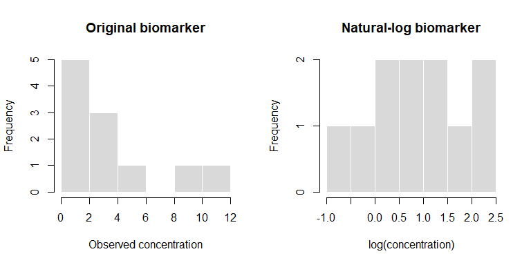

Data Transformation and Feature Engineering in R
================
Sandeep Kumar Singh, PhD

<script type="text/javascript" async
    src="https://polyfill.io/v3/polyfill.min.js?features=es6">
</script>

<script type="text/javascript" async
    src="https://cdnjs.cloudflare.com/ajax/libs/mathjax/3.2.0/es5/tex-mml-chtml.js">
</script>

In previous chapter, we learned how to inspect, clean, validate, and
document research data. We now turn to **data transformation**:
converting valid observations into variables and structures suitable for
statistical analysis, visualization, and predictive modelling. **Feature
engineering** is the deliberate construction of informative variables
from existing measurements.

In biomedical and genomic research, this might involve calculating body
mass index (BMI), deriving age at follow-up, computing log-transformed
biomarker values, grouping exposure measurements, converting a data
table from wide to long format, or constructing a standardized genomic
association statistic.

A crucial distinction runs throughout the chapter: **a mathematically
valid transformation is not automatically scientifically justified**.
Units, biological meaning, study design, missingness, and data leakage
matter.

This chapter uses **base R only**. Every dataset is synthetic. No
external packages, real patient records, or large downloads are
required.

## 17.1 Learning objectives

After completing this chapter, we should be able to:

1.  Distinguish cleaning, transformation, and feature engineering.
2.  Create new variables using vectorized arithmetic and logical
    conditions.
3.  Apply scientifically justified unit conversions and derived
    measures.
4.  Transform skewed variables using logarithms and related functions.
5.  Standardize and normalize numeric features appropriately.
6.  Create categorical variables while preserving meaningful boundaries.
7.  Encode categorical features for regression and machine learning.
8.  Extract date-based features without losing the original dates.
9.  Construct interaction, polynomial, and ratio features.
10. Reshape datasets between wide and long forms using base R.
11. Aggregate observations by participant, site, or time period.
12. Avoid target leakage and train–test contamination.
13. Document transformation parameters and verify results.
14. Build a complete biomedical feature-engineering pipeline.
15. Recognize important considerations for genomic summary statistics.

------------------------------------------------------------------------

## 17.2 Cleaning versus transformation versus feature engineering

These related activities have different purposes.

| Activity | Main question | Example |
|----|----|----|
| Cleaning | Is the recorded value trustworthy and consistently represented? | Correct a documented `"  north "` label to `"North"` |
| Transformation | How should a valid variable be represented? | Convert height from centimetres to metres |
| Feature engineering | What new variable would better represent a relevant scientific concept? | Calculate BMI from height and weight |

A workflow often follows this order:

**Import → Inspect → Clean → Validate → Transform → Engineer features →
Validate again → Analyse.**

We should retain original variables when feasible, especially when
derived features may later need to be audited.

## 17.3 Constructing our synthetic cohort

We begin with a small, reproducible cohort containing anthropometric
measurements, blood pressure, a biomarker, visit dates, and study-site
information.

``` r
options(stringsAsFactors = FALSE)

cohort <- data.frame(
  participant_id = sprintf("P%03d", 1:12),
  site = c("North", "South", "North", "East", "South", "East",
           "North", "South", "East", "North", "South", "East"),
  sex = c("F", "M", "F", "M", "F", "M", "F", "M", "F", "M", "F", "M"),
  age_years = c(28, 46, 35, 61, 54, 42, 33, 67, 49, 38, 58, 45),
  height_cm = c(158, 174, 162, 170, 155, 180, 166, 172, 160, 176, 157, 168),
  weight_kg = c(57, 83, 62, 90, 72, 78, 59, 86, 68, 75, 74, 80),
  sbp = c(118, 143, 126, 156, 149, 131, 121, 161, NA, 137, 151, 140),
  dbp = c(76, 91, 82, 95, 88, 84, 78, 97, 86, 83, 92, 87),
  biomarker = c(0.8, 2.4, 1.1, 9.5, 4.0, 1.8, 0.6, 12.0, 3.2, 1.5, NA, 5.1),
  visit_date = as.Date(c(
    "2026-01-05", "2026-01-11", "2026-02-02", "2026-02-19",
    "2026-03-04", "2026-03-17", "2026-04-09", "2026-04-21",
    "2026-05-03", "2026-05-15", "2026-06-01", "2026-06-18"
  ))
)

stopifnot(!anyDuplicated(cohort$participant_id))
str(cohort)
```

    ## 'data.frame':    12 obs. of  10 variables:
    ##  $ participant_id: chr  "P001" "P002" "P003" "P004" ...
    ##  $ site          : chr  "North" "South" "North" "East" ...
    ##  $ sex           : chr  "F" "M" "F" "M" ...
    ##  $ age_years     : num  28 46 35 61 54 42 33 67 49 38 ...
    ##  $ height_cm     : num  158 174 162 170 155 180 166 172 160 176 ...
    ##  $ weight_kg     : num  57 83 62 90 72 78 59 86 68 75 ...
    ##  $ sbp           : num  118 143 126 156 149 131 121 161 NA 137 ...
    ##  $ dbp           : num  76 91 82 95 88 84 78 97 86 83 ...
    ##  $ biomarker     : num  0.8 2.4 1.1 9.5 4 1.8 0.6 12 3.2 1.5 ...
    ##  $ visit_date    : Date, format: "2026-01-05" "2026-01-11" ...

``` r
head(cohort)
```

    ##   participant_id  site sex age_years height_cm weight_kg sbp dbp biomarker
    ## 1           P001 North   F        28       158        57 118  76       0.8
    ## 2           P002 South   M        46       174        83 143  91       2.4
    ## 3           P003 North   F        35       162        62 126  82       1.1
    ## 4           P004  East   M        61       170        90 156  95       9.5
    ## 5           P005 South   F        54       155        72 149  88       4.0
    ## 6           P006  East   M        42       180        78 131  84       1.8
    ##   visit_date
    ## 1 2026-01-05
    ## 2 2026-01-11
    ## 3 2026-02-02
    ## 4 2026-02-19
    ## 5 2026-03-04
    ## 6 2026-03-17

These values are illustrative; they do not represent a real clinical
cohort or an approved prediction model.

## 17.4 Creating columns with vectorized arithmetic

R applies arithmetic operations to corresponding elements of vectors.
This allows us to derive an entire column without writing a loop.

### Height in metres

``` r
cohort$height_m <- cohort$height_cm / 100
head(cohort[c("height_cm", "height_m")])
```

    ##   height_cm height_m
    ## 1       158     1.58
    ## 2       174     1.74
    ## 3       162     1.62
    ## 4       170     1.70
    ## 5       155     1.55
    ## 6       180     1.80

The factor of 100 is a unit conversion, not an estimated statistical
parameter.

### BMI

The formula is

$$\mathrm{BMI}=\frac{\mathrm{weight\ (kg)}}{\mathrm{height\ (m)}^2}.$$

For an individual weighing 57 kg and measuring 1.58 m:

$$\mathrm{BMI}=\frac{57}{1.58^2}\approx22.83.$$

``` r
cohort$bmi <- cohort$weight_kg / cohort$height_m^2
head(cohort[c("participant_id", "weight_kg", "height_m", "bmi")])
```

    ##   participant_id weight_kg height_m      bmi
    ## 1           P001        57     1.58 22.83288
    ## 2           P002        83     1.74 27.41445
    ## 3           P003        62     1.62 23.62445
    ## 4           P004        90     1.70 31.14187
    ## 5           P005        72     1.55 29.96878
    ## 6           P006        78     1.80 24.07407

``` r
stopifnot(isTRUE(all.equal(
  cohort$bmi[1], 57 / (1.58^2)
)))
```

**Interpretation:** BMI is a derived anthropometric index. Its use and
interpretation depend on population and clinical context; it is not a
direct measure of body fat.

### Pulse pressure and mean arterial pressure

Pulse pressure is systolic minus diastolic pressure:

$$PP=SBP-DBP.$$

An often-used approximation for mean arterial pressure is

$$MAP\approx DBP+\frac{SBP-DBP}{3}.$$

``` r
cohort$pulse_pressure <- cohort$sbp - cohort$dbp
cohort$map_approx <- cohort$dbp + cohort$pulse_pressure / 3

head(cohort[c("sbp", "dbp", "pulse_pressure", "map_approx")])
```

    ##   sbp dbp pulse_pressure map_approx
    ## 1 118  76             42   90.00000
    ## 2 143  91             52  108.33333
    ## 3 126  82             44   96.66667
    ## 4 156  95             61  115.33333
    ## 5 149  88             61  108.33333
    ## 6 131  84             47   99.66667

This MAP formula is an approximation and can be less accurate under some
physiological conditions. We must not mistake a derived calculation for
a direct measurement.

## 17.5 Missing values propagate through transformations

If an input is missing, its derived value will often also be missing.

``` r
cohort[c("participant_id", "sbp", "pulse_pressure", "map_approx")][9, ]
```

    ##   participant_id sbp pulse_pressure map_approx
    ## 9           P009  NA             NA         NA

``` r
sum(is.na(cohort$sbp))
```

    ## [1] 1

``` r
sum(is.na(cohort$pulse_pressure))
```

    ## [1] 1

This behavior is usually desirable: a derived value should not silently
appear when the underlying measurement is unavailable.

We should **not** replace missing measurements with zero simply to make
calculations run. Zero is a meaningful measurement in many scientific
settings.

### Missingness indicators

A missingness indicator records whether a value was absent:

``` r
cohort$sbp_missing <- as.integer(is.na(cohort$sbp))
table(cohort$sbp_missing)
```

    ## 
    ##  0  1 
    ## 11  1

Such indicators can support descriptive QC or certain prediction
strategies. They are not a universal solution to missing data, and their
appropriateness depends on the analysis objective and missingness
mechanism.

## 17.6 Combining logical conditions into new variables

We may create a **study-defined screening flag** from an observed
measurement:

``` r
cohort$sbp_review <- ifelse(
  is.na(cohort$sbp),
  NA,
  cohort$sbp >= 140
)

table(cohort$sbp_review, useNA = "ifany")
```

    ## 
    ## FALSE  TRUE  <NA> 
    ##     5     6     1

The threshold is used for programming practice. It is **not** a
diagnosis or treatment recommendation.

### Multiple conditions

Suppose a study protocol defines a flag for either an elevated SBP
screening value or an elevated DBP screening value.

``` r
cohort$bp_protocol_flag <- ifelse(
  is.na(cohort$sbp) | is.na(cohort$dbp),
  NA,
  cohort$sbp >= 140 | cohort$dbp >= 90
)

table(cohort$bp_protocol_flag, useNA = "ifany")
```

    ## 
    ## FALSE  TRUE  <NA> 
    ##     5     6     1

We have deliberately chosen to mark the combined flag missing if
**either** measurement is absent. Alternative protocols may allow a
positive classification when one observed measurement alone meets the
criterion. The correct rule must be documented before coding.

## 17.7 Continuous versus categorical variables

A continuous variable retains the original measurement scale. A
categorical version groups measurements into intervals.

Categorization can improve communication but loses information and may
introduce arbitrary boundaries. We should usually retain the continuous
version alongside the category.

### Using `cut()`

``` r
cohort$age_group <- cut(
  cohort$age_years,
  breaks = c(-Inf, 39, 59, Inf),
  labels = c("Under 40", "40–59", "60+"),
  right = TRUE
)

table(cohort$age_group)
```

    ## 
    ## Under 40    40–59      60+ 
    ##        4        6        2

With `right = TRUE`, intervals include their right endpoint. Therefore,
39 belongs in the first group and 59 belongs in the second.

### Checking boundaries explicitly

``` r
boundary_ages <- c(39, 40, 59, 60)
cut(
  boundary_ages,
  breaks = c(-Inf, 39, 59, Inf),
  labels = c("Under 40", "40–59", "60+"),
  right = TRUE
)
```

    ## [1] Under 40 40–59    40–59    60+     
    ## Levels: Under 40 40–59 60+

A boundary error can change group membership and downstream estimates.
Always test edge cases.

### Quantile-based grouping

``` r
quantile(cohort$biomarker, probs = c(0, 0.25, 0.5, 0.75, 1), na.rm = TRUE)
```

    ##    0%   25%   50%   75%  100% 
    ##  0.60  1.30  2.40  4.55 12.00

Quantile boundaries can repeat when many observations share the same
value. Repeated breaks make `cut()` fail. A safe implementation must
check that breakpoints are distinct.

``` r
quantile_breaks <- unique(as.numeric(quantile(
  cohort$biomarker,
  probs = seq(0, 1, by = 0.25),
  na.rm = TRUE
)))

if (length(quantile_breaks) >= 2L) {
  cohort$biomarker_quantile_group <- cut(
    cohort$biomarker,
    breaks = quantile_breaks,
    include.lowest = TRUE
  )
} else {
  cohort$biomarker_quantile_group <- factor(rep(NA_character_, nrow(cohort)))
}

table(cohort$biomarker_quantile_group, useNA = "ifany")
```

    ## 
    ##  [0.6,1.3]  (1.3,2.4] (2.4,4.55]  (4.55,12]       <NA> 
    ##          3          3          2          3          1

Quantile categories estimated from a training set should not be
recalculated independently on test data when we require consistent
feature definitions.

## 17.8 Transforming skewed measurements

Many biomarkers and exposure variables are right-skewed. A small number
of high measurements can dominate the scale.

### Natural logarithm

$$y=\log(x),\qquad x>0.$$

``` r
positive_values <- c(0.5, 1, 2, 4, 8, 16)
data.frame(
  original = positive_values,
  log_value = log(positive_values)
)
```

    ##   original  log_value
    ## 1      0.5 -0.6931472
    ## 2      1.0  0.0000000
    ## 3      2.0  0.6931472
    ## 4      4.0  1.3862944
    ## 5      8.0  2.0794415
    ## 6     16.0  2.7725887

Logarithms compress multiplicative differences: increasing a value from
1 to 2 produces the same log difference as increasing it from 4 to 8.

### Apply a log transformation to the biomarker

``` r
stopifnot(all(cohort$biomarker[!is.na(cohort$biomarker)] > 0))
cohort$log_biomarker <- log(cohort$biomarker)

head(cohort[c("biomarker", "log_biomarker")])
```

    ##   biomarker log_biomarker
    ## 1       0.8   -0.22314355
    ## 2       2.4    0.87546874
    ## 3       1.1    0.09531018
    ## 4       9.5    2.25129180
    ## 5       4.0    1.38629436
    ## 6       1.8    0.58778666

The transformation is appropriate mathematically because all observed
values are positive. Whether it is scientifically helpful requires
distributional inspection and consideration of the statistical model.

### What if zero values occur?

`log(0)` is negative infinity. Negative values are outside the
real-valued logarithm’s domain.

``` r
log(c(0.1, 1, 10))
```

    ## [1] -2.302585  0.000000  2.302585

We can consider `log1p(x)`, which computes $\log(1+x)$ accurately for
small `x`, when values are nonnegative and the scientific interpretation
is suitable.

``` r
log1p(c(0, 0.1, 1, 10))
```

    ## [1] 0.00000000 0.09531018 0.69314718 2.39789527

**Caution:** Adding an arbitrary constant to measurements changes their
scale and interpretation. A pseudocount should be justified, recorded,
and consistently applied.

### Base-10 and base-2 logarithms

``` r
log10(c(1, 10, 100))
```

    ## [1] 0 1 2

``` r
log2(c(1, 2, 4, 8))
```

    ## [1] 0 1 2 3

In genomics, `-log10(p)` is commonly used for visualizing association
significance. Expression values may be shown on a log2 scale, but the
appropriate transformation depends on the assay and preprocessing
pipeline.

## 17.9 Standardization: z-scores

Standardization places a numeric feature on a scale measured in standard
deviations from its mean.

$$z_i=\frac{x_i-\bar{x}}{s},$$

where $\bar{x}$ is the sample mean and $s$ is the sample standard
deviation.

``` r
age_mean <- mean(cohort$age_years)
age_sd <- sd(cohort$age_years)

cohort$age_z <- (cohort$age_years - age_mean) / age_sd

mean(cohort$age_z)
```

    ## [1] -2.046974e-16

``` r
sd(cohort$age_z)
```

    ## [1] 1

The standardized variable has mean approximately zero and sample
standard deviation approximately one.

### The role of `scale()`

``` r
age_scaled <- scale(cohort$age_years)

head(age_scaled)
```

    ##            [,1]
    ## [1,] -1.5313266
    ## [2,] -0.0278423
    ## [3,] -0.9466383
    ## [4,]  1.2250613
    ## [5,]  0.6403730
    ## [6,] -0.3619499

``` r
attributes(age_scaled)[c("scaled:center", "scaled:scale")]
```

    ## $`scaled:center`
    ## [1] 46.33333
    ## 
    ## $`scaled:scale`
    ## [1] 11.97219

`scale()` returns a matrix even when given one vector. If a numeric
vector is required:

``` r
age_scaled_vector <- as.numeric(scale(cohort$age_years))
stopifnot(isTRUE(all.equal(age_scaled_vector, cohort$age_z)))
```

### A zero-variance feature

A constant variable has standard deviation zero. Dividing by zero does
not produce useful standardized values.

``` r
constant_feature <- rep(5, 6)
sd(constant_feature)
```

    ## [1] 0

We should detect constant features before standardizing.

## 17.10 Min–max scaling

Min–max scaling maps values to a chosen range, commonly 0–1:

$$x_i^*=\frac{x_i-\min(x)}{\max(x)-\min(x)}.$$

``` r
minimum_age <- min(cohort$age_years)
maximum_age <- max(cohort$age_years)

cohort$age_minmax <- (
  cohort$age_years - minimum_age
) / (maximum_age - minimum_age)

range(cohort$age_minmax)
```

    ## [1] 0 1

Unlike z-score standardization, min–max scaling is especially sensitive
to extreme values. New observations outside the original training range
can produce scaled values below 0 or above 1; this is not necessarily an
error.

## 17.11 Robust scaling using the median and IQR

When a distribution contains extreme values, we may use robust location
and spread estimates:

$$x_i^*=\frac{x_i-\mathrm{median}(x)}{\mathrm{IQR}(x)}.$$

``` r
biomarker_median <- median(cohort$biomarker, na.rm = TRUE)
biomarker_iqr <- IQR(cohort$biomarker, na.rm = TRUE)

stopifnot(biomarker_iqr > 0)

cohort$biomarker_robust <- (
  cohort$biomarker - biomarker_median
) / biomarker_iqr

head(cohort[c("biomarker", "biomarker_robust")])
```

    ##   biomarker biomarker_robust
    ## 1       0.8       -0.4923077
    ## 2       2.4        0.0000000
    ## 3       1.1       -0.4000000
    ## 4       9.5        2.1846154
    ## 5       4.0        0.4923077
    ## 6       1.8       -0.1846154

Robust scaling changes the feature’s representation; it does not remove
outliers or prove that unusual measurements are erroneous.

## 17.12 Comparing transformations visually

A basic visualization can help us inspect how a transformation changes
the distribution.

``` r
old_par <- par(mfrow = c(1, 2))

hist(
  cohort$biomarker,
  main = "Original biomarker",
  xlab = "Observed concentration",
  col = "gray85",
  border = "white"
)

hist(
  cohort$log_biomarker,
  main = "Natural-log biomarker",
  xlab = "log(concentration)",
  col = "gray85",
  border = "white"
)
```

<!-- -->

``` r
par(old_par)
```

A more symmetric histogram does not automatically establish normality,
nor does every statistical method require normally distributed
predictors.

## 17.13 Categorical variables and factor levels

R factors represent categories with an explicit set of levels.

``` r
cohort$site_factor <- factor(
  cohort$site,
  levels = c("North", "South", "East")
)

levels(cohort$site_factor)
```

    ## [1] "North" "South" "East"

``` r
table(cohort$site_factor)
```

    ## 
    ## North South  East 
    ##     4     4     4

The order of levels can affect the reference category in regression
models.

### Ordered factors

``` r
cohort$age_group_ordered <- factor(
  as.character(cohort$age_group),
  levels = c("Under 40", "40–59", "60+"),
  ordered = TRUE
)

is.ordered(cohort$age_group_ordered)
```

    ## [1] TRUE

An ordered factor encodes an ordering of categories; it does not imply
that the distance between adjacent categories is equal.

## 17.14 Dummy variables and model matrices

Statistical models often require categorical predictors to be
represented numerically.

``` r
site_design <- model.matrix(~ site_factor, data = cohort)
head(site_design)
```

    ##   (Intercept) site_factorSouth site_factorEast
    ## 1           1                0               0
    ## 2           1                1               0
    ## 3           1                0               0
    ## 4           1                0               1
    ## 5           1                1               0
    ## 6           1                0               1

``` r
colnames(site_design)
```

    ## [1] "(Intercept)"      "site_factorSouth" "site_factorEast"

With an intercept and treatment contrasts, a factor with three levels
generally yields two indicator columns. The reference level is
represented by zeros in those indicator columns.

### Explicit one-hot indicators

``` r
site_indicators <- model.matrix(~ site_factor - 1, data = cohort)
head(site_indicators)
```

    ##   site_factorNorth site_factorSouth site_factorEast
    ## 1                1                0               0
    ## 2                0                1               0
    ## 3                1                0               0
    ## 4                0                0               1
    ## 5                0                1               0
    ## 6                0                0               1

This produces one indicator column for each observed factor level. The
appropriate encoding depends on the model and its intercept convention.

### Why we should not use arbitrary category numbers

Coding sites as North = 1, South = 2, East = 3 may introduce a false
numerical ordering. Factor-based encoding is safer for nominal
categories.

## 17.15 Date transformations

Dates are meaningful objects, not ordinary character strings.

``` r
class(cohort$visit_date)
```

    ## [1] "Date"

### Extract year, month, and day

``` r
cohort$visit_year <- as.integer(format(cohort$visit_date, "%Y"))
cohort$visit_month <- as.integer(format(cohort$visit_date, "%m"))
cohort$visit_day <- as.integer(format(cohort$visit_date, "%d"))

head(cohort[c("visit_date", "visit_year", "visit_month", "visit_day")])
```

    ##   visit_date visit_year visit_month visit_day
    ## 1 2026-01-05       2026           1         5
    ## 2 2026-01-11       2026           1        11
    ## 3 2026-02-02       2026           2         2
    ## 4 2026-02-19       2026           2        19
    ## 5 2026-03-04       2026           3         4
    ## 6 2026-03-17       2026           3        17

### Elapsed time since a study reference date

``` r
study_start <- as.Date("2026-01-01")
cohort$days_since_start <- as.numeric(cohort$visit_date - study_start)

head(cohort[c("visit_date", "days_since_start")])
```

    ##   visit_date days_since_start
    ## 1 2026-01-05                4
    ## 2 2026-01-11               10
    ## 3 2026-02-02               32
    ## 4 2026-02-19               49
    ## 5 2026-03-04               62
    ## 6 2026-03-17               75

Elapsed days and calendar months answer different questions. We should
not assume that every month contains 30 days.

### Day of week

``` r
cohort$weekday <- weekdays(cohort$visit_date)
head(cohort[c("visit_date", "weekday")])
```

    ##   visit_date   weekday
    ## 1 2026-01-05    Monday
    ## 2 2026-01-11    Sunday
    ## 3 2026-02-02    Monday
    ## 4 2026-02-19  Thursday
    ## 5 2026-03-04 Wednesday
    ## 6 2026-03-17   Tuesday

Weekday labels depend on locale. For reproducible categorical coding
across systems, numeric weekday conventions or explicitly controlled
locale settings may be preferable.

## 17.16 Ratios, differences, and percent change

Ratios and differences are common in biomedical data, but denominators
require careful checking.

### A ratio feature

``` r
cohort$sbp_dbp_ratio <- cohort$sbp / cohort$dbp
head(cohort[c("sbp", "dbp", "sbp_dbp_ratio")])
```

    ##   sbp dbp sbp_dbp_ratio
    ## 1 118  76      1.552632
    ## 2 143  91      1.571429
    ## 3 126  82      1.536585
    ## 4 156  95      1.642105
    ## 5 149  88      1.693182
    ## 6 131  84      1.559524

A ratio is meaningful only if its denominator is nonzero and the ratio
has a justified interpretation.

### Percentage change

$$\%\mathrm{change}=100\times\frac{\mathrm{followup}-\mathrm{baseline}}{\mathrm{baseline}}.$$

``` r
baseline <- c(100, 80, 120, 95)
followup <- c(110, 76, 114, 95)

percent_change <- 100 * (followup - baseline) / baseline
percent_change
```

    ## [1] 10 -5 -5  0

If baseline is zero, the conventional percent-change formula is
undefined. We must define how such cases are handled rather than
silently accepting infinite values.

## 17.17 Interaction features

An interaction allows the association between one predictor and an
outcome to depend on another predictor.

For example, a linear model might contain:

$$Y=\beta_0+\beta_1 X+\beta_2 Z+\beta_3 XZ+\varepsilon.$$

The term $XZ$ is the interaction feature.

``` r
cohort$age_sex_interaction <- cohort$age_years * as.integer(cohort$sex == "M")
head(cohort[c("age_years", "sex", "age_sex_interaction")])
```

    ##   age_years sex age_sex_interaction
    ## 1        28   F                   0
    ## 2        46   M                  46
    ## 3        35   F                   0
    ## 4        61   M                  61
    ## 5        54   F                   0
    ## 6        42   M                  42

In base R modelling syntax, interactions can be specified directly:

``` r
interaction_model <- lm(bmi ~ age_years * sex, data = cohort)
coef(interaction_model)
```

    ##    (Intercept)      age_years           sexM age_years:sexM 
    ##    13.54016400     0.28474736     4.03312758    -0.08803372

The formula `age_years * sex` expands to the main effects and their
interaction. An interaction term is not automatically biologically
meaningful; its inclusion should follow a scientific question and
analysis plan.

## 17.18 Polynomial features and nonlinearity

A linear regression model can represent a curved relationship by
including polynomial terms.

$$Y=\beta_0+\beta_1X+\beta_2X^2+\varepsilon.$$

``` r
cohort$age_squared <- cohort$age_years^2
head(cohort[c("age_years", "age_squared")])
```

    ##   age_years age_squared
    ## 1        28         784
    ## 2        46        2116
    ## 3        35        1225
    ## 4        61        3721
    ## 5        54        2916
    ## 6        42        1764

We can fit a model using the squared term:

``` r
quadratic_model <- lm(bmi ~ age_years + I(age_years^2), data = cohort)
coef(quadratic_model)
```

    ##    (Intercept)      age_years I(age_years^2) 
    ##    6.500159070    0.637125397   -0.004154124

The `I()` wrapper tells R to interpret the square as arithmetic within
the formula.

**Caution:** With only 12 synthetic observations, the fitted
coefficients are for demonstration, not substantive inference.
Polynomial terms can also cause multicollinearity and unstable
extrapolation.

## 17.19 Centering predictors

Centering subtracts a reference value, often the mean:

$$x_{c,i}=x_i-\bar{x}.$$

``` r
cohort$age_centered <- cohort$age_years - mean(cohort$age_years)
mean(cohort$age_centered)
```

    ## [1] -2.368358e-15

Centering changes the interpretation of a model intercept and may
improve numerical behavior for interaction or polynomial models. It does
not, by itself, eliminate confounding.

## 17.20 Wide and long data: the conceptual difference

Repeated-measures research commonly uses two representations.

**Wide format:** one row per participant, with separate columns for each
visit.

| id  | sbp_baseline | sbp_followup |
|-----|-------------:|-------------:|
| P1  |          120 |          126 |
| P2  |          138 |          132 |

**Long format:** one row per participant-visit combination.

| id  | visit    | sbp |
|-----|----------|----:|
| P1  | baseline | 120 |
| P1  | followup | 126 |
| P2  | baseline | 138 |
| P2  | followup | 132 |

Neither format is universally superior. Long format is often convenient
for repeated-measures modelling, while wide format is convenient for
participant-level derived changes.

## 17.21 Reshaping wide to long with base R

``` r
wide_bp <- data.frame(
  id = c("P1", "P2", "P3"),
  sbp_baseline = c(120, 138, 145),
  sbp_followup = c(126, 132, 150)
)

wide_bp
```

    ##   id sbp_baseline sbp_followup
    ## 1 P1          120          126
    ## 2 P2          138          132
    ## 3 P3          145          150

Use `reshape()`:

``` r
long_bp <- reshape(
  wide_bp,
  varying = c("sbp_baseline", "sbp_followup"),
  v.names = "sbp",
  timevar = "visit",
  times = c("baseline", "followup"),
  idvar = "id",
  direction = "long"
)

long_bp <- long_bp[order(long_bp$id, long_bp$visit), ]
row.names(long_bp) <- NULL
long_bp
```

    ##   id    visit sbp
    ## 1 P1 baseline 120
    ## 2 P1 followup 126
    ## 3 P2 baseline 138
    ## 4 P2 followup 132
    ## 5 P3 baseline 145
    ## 6 P3 followup 150

We should verify the expected number of observations:

``` r
stopifnot(
  nrow(long_bp) == 2L * nrow(wide_bp),
  !anyDuplicated(long_bp[c("id", "visit")])
)
```

## 17.22 Reshaping long to wide

``` r
wide_again <- reshape(
  long_bp,
  idvar = "id",
  timevar = "visit",
  direction = "wide"
)

wide_again <- wide_again[order(wide_again$id), ]
row.names(wide_again) <- NULL
wide_again
```

    ##   id sbp.baseline sbp.followup
    ## 1 P1          120          126
    ## 2 P2          138          132
    ## 3 P3          145          150

Column order and names can differ from the original. We should compare
values after aligning corresponding columns rather than assuming a
byte-for-byte identical table.

``` r
stopifnot(
  isTRUE(all.equal(wide_again$sbp.baseline, wide_bp$sbp_baseline)),
  isTRUE(all.equal(wide_again$sbp.followup, wide_bp$sbp_followup))
)
```

## 17.23 Creating longitudinal change features

With a wide table, follow-up minus baseline is straightforward:

``` r
wide_bp$sbp_change <- wide_bp$sbp_followup - wide_bp$sbp_baseline
wide_bp
```

    ##   id sbp_baseline sbp_followup sbp_change
    ## 1 P1          120          126          6
    ## 2 P2          138          132         -6
    ## 3 P3          145          150          5

A negative value means the follow-up measurement is lower than baseline;
a positive value means it is higher.

### Why visit timing matters

If participants have different follow-up durations, raw change may not
be directly comparable. We may need to include time since baseline or
model the longitudinal trajectory explicitly.

## 17.24 Aggregating observations by group

Group summaries are often needed before modelling or reporting.

``` r
aggregate(
  bmi ~ site,
  data = cohort,
  FUN = mean
)
```

    ##    site      bmi
    ## 1  East 27.53078
    ## 2 North 23.02014
    ## 3 South 29.11863

### Handling missing values

``` r
aggregate(
  sbp ~ site,
  data = cohort,
  FUN = function(x) mean(x, na.rm = TRUE),
  na.action = na.pass
)
```

    ##    site      sbp
    ## 1  East 142.3333
    ## 2 North 125.5000
    ## 3 South 151.0000

The `na.action = na.pass` setting preserves rows for the grouping
operation; the summary function explicitly ignores missing SBP
measurements.

### Group-specific sample sizes

``` r
aggregate(
  sbp ~ site,
  data = cohort,
  FUN = function(x) sum(!is.na(x)),
  na.action = na.pass
)
```

    ##    site sbp
    ## 1  East   3
    ## 2 North   4
    ## 3 South   4

Reporting the denominator alongside a mean is essential when groups have
different missing-data patterns.

## 17.25 Participant-level aggregation from repeated visits

Consider a synthetic repeated-measures dataset:

``` r
repeated <- data.frame(
  id = c("P1", "P1", "P2", "P2", "P3", "P3"),
  visit = c(1, 2, 1, 2, 1, 2),
  biomarker = c(1.2, 1.8, 2.1, NA, 0.9, 1.0)
)

repeated
```

    ##   id visit biomarker
    ## 1 P1     1       1.2
    ## 2 P1     2       1.8
    ## 3 P2     1       2.1
    ## 4 P2     2        NA
    ## 5 P3     1       0.9
    ## 6 P3     2       1.0

Calculate the participant mean:

``` r
participant_means <- aggregate(
  biomarker ~ id,
  data = repeated,
  FUN = function(x) mean(x, na.rm = TRUE),
  na.action = na.pass
)

participant_means
```

    ##   id biomarker
    ## 1 P1      1.50
    ## 2 P2      2.10
    ## 3 P3      0.95

A participant mean summarizes a trajectory but discards information
about timing, variability, and direction of change. It should be used
only when it represents the intended estimand or prediction feature.

## 17.26 Feature engineering for GWAS summary statistics

GWAS summary statistics commonly include effect estimates, standard
errors, p-values, alleles, and positions. We can derive useful
**diagnostic** variables, but must respect the original analysis scale
and conventions.

``` r
gwas <- data.frame(
  CHROM = c("6", "6", "6", "1", "2", "6"),
  ID = c("rsA", "rsB", "rsC", "rsD", "rsE", "rsF"),
  POS = c(26295926, 31298240, 32626565, 1500000, 3000000, 33794605),
  A1 = c("A", "C", "G", "T", "A", "C"),
  A2 = c("G", "T", "A", "C", "G", "T"),
  BETA = c(0.05, -0.08, 0.12, 0.01, -0.03, 0.06),
  SE = c(0.01, 0.02, 0.02, 0.01, 0.015, 0.02),
  PVAL = c(2e-8, 3e-9, 5e-12, 0.30, 0.04, 1e-4),
  stringsAsFactors = FALSE
)

gwas
```

    ##   CHROM  ID      POS A1 A2  BETA    SE  PVAL
    ## 1     6 rsA 26295926  A  G  0.05 0.010 2e-08
    ## 2     6 rsB 31298240  C  T -0.08 0.020 3e-09
    ## 3     6 rsC 32626565  G  A  0.12 0.020 5e-12
    ## 4     1 rsD  1500000  T  C  0.01 0.010 3e-01
    ## 5     2 rsE  3000000  A  G -0.03 0.015 4e-02
    ## 6     6 rsF 33794605  C  T  0.06 0.020 1e-04

All variants and associations in this table are synthetic; IDs such as
`rsA` are placeholders, not real dbSNP identifiers.

### Z-statistics

For an estimated effect and its standard error,

$$Z=\frac{\widehat\beta}{SE(\widehat\beta)}.$$

``` r
stopifnot(all(is.finite(gwas$SE) & gwas$SE > 0))
gwas$Z <- gwas$BETA / gwas$SE

gwas[c("ID", "BETA", "SE", "Z")]
```

    ##    ID  BETA    SE  Z
    ## 1 rsA  0.05 0.010  5
    ## 2 rsB -0.08 0.020 -4
    ## 3 rsC  0.12 0.020  6
    ## 4 rsD  0.01 0.010  1
    ## 5 rsE -0.03 0.015 -2
    ## 6 rsF  0.06 0.020  3

The Z-statistic assumes that the reported BETA and SE refer to the same
effect estimate and compatible analysis model.

### Negative log10 p-values

``` r
stopifnot(all(is.finite(gwas$PVAL) & gwas$PVAL > 0 & gwas$PVAL <= 1))
gwas$neg_log10_p <- -log10(gwas$PVAL)

gwas[c("ID", "PVAL", "neg_log10_p")]
```

    ##    ID  PVAL neg_log10_p
    ## 1 rsA 2e-08   7.6989700
    ## 2 rsB 3e-09   8.5228787
    ## 3 rsC 5e-12  11.3010300
    ## 4 rsD 3e-01   0.5228787
    ## 5 rsE 4e-02   1.3979400
    ## 6 rsF 1e-04   4.0000000

If a reported p-value is exactly zero because of numerical underflow,
`-log10(0)` is infinite. We must not treat an underflowed zero as a
scientifically exact zero probability. When appropriate, we can use a
reliable log-p representation or calculate from the test statistic.

### Two-sided p-value derived from Z

Under a standard normal approximation:

$$p=2\Phi(-|Z|).$$

``` r
gwas$p_from_z <- 2 * pnorm(-abs(gwas$Z))
gwas[c("ID", "PVAL", "p_from_z")]
```

    ##    ID  PVAL     p_from_z
    ## 1 rsA 2e-08 5.733031e-07
    ## 2 rsB 3e-09 6.334248e-05
    ## 3 rsC 5e-12 1.973175e-09
    ## 4 rsD 3e-01 3.173105e-01
    ## 5 rsE 4e-02 4.550026e-02
    ## 6 rsF 1e-04 2.699796e-03

Here, `PVAL` was supplied independently for illustration, so it does not
necessarily match `p_from_z`. In real data, discrepancies can arise from
rounding, model choice, test statistics, or inconsistent columns and
warrant investigation.

### Regional indicator

The following example uses an hg19-style xMHC interval. Coordinate
interpretation requires an explicitly documented genome build.

``` r
gwas$in_xmhc <- (
  gwas$CHROM == "6" &
  gwas$POS >= 25000000 &
  gwas$POS <= 34000000
)

table(gwas$in_xmhc)
```

    ## 
    ## FALSE  TRUE 
    ##     2     4

### Genome-wide significance flag

``` r
gwas$genomewide_sig <- gwas$PVAL < 5e-8

gwas[c("ID", "PVAL", "genomewide_sig")]
```

    ##    ID  PVAL genomewide_sig
    ## 1 rsA 2e-08           TRUE
    ## 2 rsB 3e-09           TRUE
    ## 3 rsC 5e-12           TRUE
    ## 4 rsD 3e-01          FALSE
    ## 5 rsE 4e-02          FALSE
    ## 6 rsF 1e-04          FALSE

This commonly used threshold is context-dependent; it does not establish
causality or clinical significance.

### An important caution about allele harmonization

Effect alleles and other alleles must be aligned before combining
summary statistics across studies. Deriving Z-scores and regional flags
does **not** perform allele harmonization, strand resolution, LD
matching, genome-build conversion, or full GWAS QC.

## 17.27 The central ML issue: data leakage

**Data leakage** occurs when information unavailable at the intended
prediction time, or information from evaluation data, influences model
training.

Common examples include:

- Computing normalization parameters on the entire dataset before
  splitting into training and test sets.
- Selecting features using outcome associations computed on the test
  set.
- Imputing missing values using the combined training and test data.
- Using post-outcome measurements to predict an earlier event.
- Allowing measurements from the same participant to appear in both
  training and test sets when the intended evaluation is on new
  participants.

Leakage can make performance look better than it will be in deployment.

## 17.28 Correct train–test standardization

We will demonstrate the principle with a small synthetic feature vector.
The **training data alone** determine the mean and standard deviation.

``` r
train_age <- c(28, 35, 42, 46, 54, 61)
test_age <- c(33, 49, 67)

train_mean <- mean(train_age)
train_sd <- sd(train_age)

stopifnot(is.finite(train_sd), train_sd > 0)

train_age_z <- (train_age - train_mean) / train_sd
test_age_z <- (test_age - train_mean) / train_sd

train_age_z
```

    ## [1] -1.3486806 -0.7706746 -0.1926687  0.1376205  0.7981987  1.3762047

``` r
test_age_z
```

    ## [1] -0.9358192  0.3853373  1.8716384

Notice that we do **not** calculate a separate mean or standard
deviation for the test set. The same learned transformation must be
applied consistently.

### Reusable scaling functions

``` r
fit_z_scaler <- function(x) {
  if (!is.numeric(x)) {
    stop("Training input must be numeric.")
  }

  observed <- x[is.finite(x)]

  if (length(observed) < 2L) {
    stop("At least two finite training observations are required.")
  }

  center <- mean(observed)
  spread <- sd(observed)

  if (!is.finite(spread) || spread <= 0) {
    stop("Training feature must have nonzero finite standard deviation.")
  }

  list(center = center, scale = spread)
}

apply_z_scaler <- function(x, scaler) {
  if (!is.numeric(x)) {
    stop("Input must be numeric.")
  }

  (x - scaler$center) / scaler$scale
}
```

``` r
scaler <- fit_z_scaler(train_age)

scaled_train <- apply_z_scaler(train_age, scaler)
scaled_test <- apply_z_scaler(test_age, scaler)

stopifnot(
  isTRUE(all.equal(scaled_train, train_age_z)),
  isTRUE(all.equal(scaled_test, test_age_z))
)
```

### Cross-validation

Within cross-validation, the scaler and any learned preprocessing must
be fitted separately inside each training fold. Fitting once before
cross-validation leaks information from held-out folds.

## 17.29 Imputation is also a learned transformation

Consider a training feature with missing observations.

``` r
train_marker <- c(1.2, NA, 2.5, 3.0, 1.8)
test_marker <- c(NA, 2.1)

training_median <- median(train_marker, na.rm = TRUE)

train_marker_imp <- ifelse(
  is.na(train_marker), training_median, train_marker
)

test_marker_imp <- ifelse(
  is.na(test_marker), training_median, test_marker
)

train_marker_imp
```

    ## [1] 1.20 2.15 2.50 3.00 1.80

``` r
test_marker_imp
```

    ## [1] 2.15 2.10

We use the training median for both datasets. Median imputation is
simple but changes the distribution and can underestimate variability;
it is not appropriate for every analysis.

## 17.30 Outcome leakage and timing

Suppose the intended task is to predict a clinical outcome at baseline.
A biomarker collected six months **after** the outcome cannot
legitimately serve as a baseline predictor, even if it is highly
correlated with the outcome.

Before engineering a feature, we should ask:

1.  When was this variable measured?
2.  Would it be available at the intended prediction time?
3.  Was it affected by the outcome or subsequent treatment?
4.  Does it incorporate information from other participants in the test
    set?
5.  Was the transformation defined before model evaluation?

These questions are especially important in longitudinal cohort studies,
electronic health records, and machine learning.

## 17.31 Scientific interpretation of transformed effects

Transformations change coefficient interpretation.

### Log outcome

For a model

$$\log(Y)=\beta_0+\beta_1X+\varepsilon,$$

an increase of one unit in $X$ is associated with a multiplicative
factor of $e^{\beta_1}$ in the modelled outcome on the original scale
under the relevant model assumptions. The exact interpretation of
arithmetic means requires additional care.

### Log predictor

For

$$Y=\beta_0+\beta_1\log(X)+\varepsilon,$$

multiplying $X$ by $e$ changes the fitted value of $Y$ by $\beta_1$,
holding other variables constant.

### Standardized predictor

A coefficient for a z-scored predictor represents the expected change in
the outcome per one standard deviation of the original predictor,
holding other variables constant.

### Categorical predictor

A dummy-variable coefficient compares a category with the reference
category, conditional on the other terms in the model.

We should record transformations in the methods section because they
directly affect interpretation.

## 17.32 A reproducible feature-engineering function

We now combine several transformations into one function.

``` r
engineer_clinical_features <- function(dat) {
  required <- c(
    "participant_id", "age_years", "height_cm", "weight_kg",
    "sbp", "dbp", "biomarker", "visit_date"
  )

  missing_cols <- setdiff(required, names(dat))

  if (length(missing_cols) > 0L) {
    stop("Missing required columns: ", paste(missing_cols, collapse = ", "))
  }

  if (!inherits(dat$visit_date, "Date")) {
    stop("visit_date must have Date class.")
  }

  if (!is.numeric(dat$height_cm) || !is.numeric(dat$weight_kg)) {
    stop("Height and weight must be numeric.")
  }

  if (any(!is.finite(dat$height_cm) | dat$height_cm <= 0)) {
    stop("Height must contain positive finite measurements.")
  }

  if (any(!is.finite(dat$weight_kg) | dat$weight_kg <= 0)) {
    stop("Weight must contain positive finite measurements.")
  }

  observed_biomarker <- dat$biomarker[!is.na(dat$biomarker)]
  if (any(!is.finite(observed_biomarker) | observed_biomarker <= 0)) {
    stop("Observed biomarker values must be positive and finite.")
  }

  result <- dat
  result$height_m <- result$height_cm / 100
  result$bmi <- result$weight_kg / result$height_m^2
  result$pulse_pressure <- result$sbp - result$dbp
  result$log_biomarker <- log(result$biomarker)
  result$visit_year <- as.integer(format(result$visit_date, "%Y"))
  result$visit_month <- as.integer(format(result$visit_date, "%m"))
  result$sbp_missing <- as.integer(is.na(result$sbp))

  result
}
```

Apply the function:

``` r
engineered <- engineer_clinical_features(cohort)

head(engineered[c(
  "participant_id", "bmi", "pulse_pressure",
  "log_biomarker", "visit_month"
)])
```

    ##   participant_id      bmi pulse_pressure log_biomarker visit_month
    ## 1           P001 22.83288             42   -0.22314355           1
    ## 2           P002 27.41445             52    0.87546874           1
    ## 3           P003 23.62445             44    0.09531018           2
    ## 4           P004 31.14187             61    2.25129180           2
    ## 5           P005 29.96878             61    1.38629436           3
    ## 6           P006 24.07407             47    0.58778666           3

### Unit tests

``` r
stopifnot(
  nrow(engineered) == nrow(cohort),
  !anyDuplicated(engineered$participant_id),
  all(engineered$bmi > 0),
  sum(is.na(engineered$log_biomarker)) == sum(is.na(cohort$biomarker)),
  isTRUE(all.equal(engineered$bmi[1], 57 / (1.58^2)))
)
```

### Avoiding unintended modification

The function creates `result <- dat` and adds derived columns to the
result. In ordinary base R use, copy-on-modify semantics mean that
adding these columns does not unexpectedly change the caller’s original
data frame.

## 17.33 Building a compact feature dictionary

A feature dictionary documents how derived variables were created.

``` r
feature_dictionary <- data.frame(
  feature = c(
    "height_m", "bmi", "pulse_pressure",
    "log_biomarker", "visit_month", "sbp_missing"
  ),
  source = c(
    "height_cm", "weight_kg + height_cm", "sbp + dbp",
    "biomarker", "visit_date", "sbp"
  ),
  rule = c(
    "height_cm / 100",
    "weight_kg / height_m^2",
    "sbp - dbp",
    "natural logarithm",
    "calendar month (1–12)",
    "1 if SBP is missing, otherwise 0"
  ),
  stringsAsFactors = FALSE
)

feature_dictionary
```

    ##          feature                source                             rule
    ## 1       height_m             height_cm                  height_cm / 100
    ## 2            bmi weight_kg + height_cm           weight_kg / height_m^2
    ## 3 pulse_pressure             sbp + dbp                        sbp - dbp
    ## 4  log_biomarker             biomarker                natural logarithm
    ## 5    visit_month            visit_date            calendar month (1–12)
    ## 6    sbp_missing                   sbp 1 if SBP is missing, otherwise 0

In real research, we should also record units, coding rules, allowable
ranges, reference genome builds where relevant, version information, and
the reason each feature is included.

## 17.34 Exporting engineered data safely

We will write outputs to a temporary practice directory, keeping raw and
derived data separate.

``` r
chapter17_dir <- file.path(tempdir(), "r_book_chapter17")
raw_dir <- file.path(chapter17_dir, "data", "raw")
processed_dir <- file.path(chapter17_dir, "data", "processed")
results_dir <- file.path(chapter17_dir, "results")

for (folder in c(raw_dir, processed_dir, results_dir)) {
  dir.create(folder, recursive = TRUE, showWarnings = FALSE)
}

stopifnot(all(dir.exists(c(raw_dir, processed_dir, results_dir))))
```

Save a raw synthetic cohort:

``` r
raw_path <- file.path(raw_dir, "synthetic_cohort.rds")
saveRDS(cohort, raw_path)
```

Save processed features:

``` r
processed_path <- file.path(processed_dir, "engineered_cohort.rds")
saveRDS(engineered, processed_path)

feature_dictionary_path <- file.path(results_dir, "feature_dictionary.csv")
write.csv(feature_dictionary, feature_dictionary_path, row.names = FALSE)

stopifnot(
  file.exists(raw_path),
  file.exists(processed_path),
  file.exists(feature_dictionary_path)
)
```

Verify round-trip integrity:

``` r
restored_features <- readRDS(processed_path)
stopifnot(identical(engineered, restored_features))
```

RDS preserves R-specific classes better than CSV, although
cross-language sharing may require a documented interchange format.

## 17.35 A practical transformation audit

Before accepting an engineered dataset, we can compare its dimensions,
identifiers, missingness, and selected calculations with the original.

``` r
audit <- data.frame(
  check = c(
    "Same row count",
    "Same participant order",
    "No duplicate participant IDs",
    "BMI finite",
    "Biomarker missingness preserved"
  ),
  passed = c(
    nrow(engineered) == nrow(cohort),
    identical(engineered$participant_id, cohort$participant_id),
    !anyDuplicated(engineered$participant_id),
    all(is.finite(engineered$bmi)),
    identical(is.na(engineered$log_biomarker), is.na(cohort$biomarker))
  )
)

audit
```

    ##                             check passed
    ## 1                  Same row count   TRUE
    ## 2          Same participant order   TRUE
    ## 3    No duplicate participant IDs   TRUE
    ## 4                      BMI finite   TRUE
    ## 5 Biomarker missingness preserved   TRUE

``` r
stopifnot(all(audit$passed))
```

The audit checks selected properties, not every possible scientific or
data-quality concern.

## 17.36 Common mistakes and how to prevent them

### Mistake 1: Incorrect units

Computing BMI with height in centimetres rather than metres yields an
incorrect scale. Verify unit conversions with a hand-calculated example.

### Mistake 2: Silent missing-value replacement

Replacing `NA` with zero changes the meaning of a variable. Use a
documented missing-data strategy.

### Mistake 3: Log-transforming zero or negative values

Check the domain before applying `log()`. If a pseudocount is used,
justify it.

### Mistake 4: Treating numeric category codes as continuous

Use factors for nominal categories unless a numerical ordering is
scientifically justified.

### Mistake 5: Recomputing scaling on test data

Fit preprocessing parameters on training data only and reuse them for
validation and test sets.

### Mistake 6: Categorizing without checking boundaries

Test values exactly at each interval boundary.

### Mistake 7: Ignoring the denominator in ratios

Zero or missing denominators can create infinite or missing derived
values.

### Mistake 8: Losing participant identity during reshaping

After reshaping, verify participant-visit keys and expected row counts.

### Mistake 9: Mixing genomic reference builds

Regional indicators must be computed using coordinates from the same
documented genome build.

### Mistake 10: Confusing feature engineering with causal discovery

A predictive feature can be useful without representing a causal
mechanism. Derived associations do not prove causality.

### Mistake 11: Using post-outcome information

Check measurement timing relative to the prediction target or study
endpoint.

### Mistake 12: Failing to preserve transformation parameters

Record training means, standard deviations, medians, factor levels, bin
boundaries, and any other learned parameters required for future
reproducibility.

## 17.37 Guided project: a clinical feature table

We will create a feature table containing anthropometric, biomarker, and
date-derived variables. We will also produce a concise QC summary.

``` r
clinical_features <- engineer_clinical_features(cohort)

clinical_features$age_group <- cut(
  clinical_features$age_years,
  breaks = c(-Inf, 39, 59, Inf),
  labels = c("Under 40", "40–59", "60+")
)

clinical_features$site <- factor(
  clinical_features$site,
  levels = c("North", "South", "East")
)

clinical_features$sbp_review <- ifelse(
  is.na(clinical_features$sbp),
  NA,
  clinical_features$sbp >= 140
)

clinical_features[c(
  "participant_id", "site", "age_group", "bmi",
  "pulse_pressure", "log_biomarker", "sbp_review"
)]
```

    ##    participant_id  site age_group      bmi pulse_pressure log_biomarker
    ## 1            P001 North  Under 40 22.83288             42   -0.22314355
    ## 2            P002 South     40–59 27.41445             52    0.87546874
    ## 3            P003 North  Under 40 23.62445             44    0.09531018
    ## 4            P004  East       60+ 31.14187             61    2.25129180
    ## 5            P005 South     40–59 29.96878             61    1.38629436
    ## 6            P006  East     40–59 24.07407             47    0.58778666
    ## 7            P007 North  Under 40 21.41094             43   -0.51082562
    ## 8            P008 South       60+ 29.06977             64    2.48490665
    ## 9            P009  East     40–59 26.56250             NA    1.16315081
    ## 10           P010 North  Under 40 24.21229             54    0.40546511
    ## 11           P011 South     40–59 30.02150             59            NA
    ## 12           P012  East     40–59 28.34467             53    1.62924054
    ##    sbp_review
    ## 1       FALSE
    ## 2        TRUE
    ## 3       FALSE
    ## 4        TRUE
    ## 5        TRUE
    ## 6       FALSE
    ## 7       FALSE
    ## 8        TRUE
    ## 9          NA
    ## 10      FALSE
    ## 11       TRUE
    ## 12       TRUE

Build a site summary:

``` r
site_levels <- levels(clinical_features$site)

site_report <- do.call(rbind, lapply(site_levels, function(s) {
  subset_data <- clinical_features[clinical_features$site == s, , drop = FALSE]

  data.frame(
    site = s,
    n = nrow(subset_data),
    n_missing_sbp = sum(is.na(subset_data$sbp)),
    mean_bmi = mean(subset_data$bmi),
    n_sbp_review = sum(subset_data$sbp_review, na.rm = TRUE)
  )
}))

row.names(site_report) <- NULL
site_report
```

    ##    site n n_missing_sbp mean_bmi n_sbp_review
    ## 1 North 4             0 23.02014            0
    ## 2 South 4             0 29.11863            4
    ## 3  East 4             1 27.53078            2

Validate the aggregation:

``` r
stopifnot(
  sum(site_report$n) == nrow(clinical_features),
  sum(site_report$n_missing_sbp) == sum(is.na(clinical_features$sbp)),
  sum(site_report$n_sbp_review) == sum(clinical_features$sbp_review, na.rm = TRUE)
)
```

Save outputs:

``` r
saveRDS(
  clinical_features,
  file.path(processed_dir, "clinical_features_final.rds")
)

write.csv(
  site_report,
  file.path(results_dir, "site_feature_summary.csv"),
  row.names = FALSE
)
```

**Interpretation:** We have moved from a cleaned source table to a
documented feature table and a reproducible summary. This is a
foundational workflow for epidemiological analysis and supervised
learning.

## 17.38 Independent exercises: fundamentals

1.  Explain the difference between data cleaning and feature
    engineering.
2.  Convert heights of 150, 165, and 180 cm into metres.
3.  Calculate BMI for three synthetic participants using vectorized
    arithmetic.
4.  Calculate pulse pressure from paired SBP and DBP values.
5.  Create a missingness indicator for a laboratory measurement.
6.  Explain why missing values should not automatically be replaced with
    zero.
7.  Use `ifelse()` to construct a study-defined binary screening flag.
8.  Create age groups with `cut()` and test the exact boundaries.
9.  Explain why categorization loses information.
10. Compare `log()`, `log2()`, and `log10()` using simple numbers.
11. Explain what happens when `log(0)` is evaluated.
12. Standardize a numeric vector manually and using `scale()`.
13. Explain why a constant feature cannot be z-scored conventionally.
14. Apply min–max scaling to a vector and verify the resulting range.
15. Calculate a median/IQR-scaled biomarker feature.

## 17.39 Independent exercises: biomedical and epidemiological applications

1.  Construct a data frame containing participant ID, sex, age, height,
    weight, SBP, DBP, and visit date.
2.  Create BMI, pulse pressure, and approximate MAP columns.
3.  Construct a factor for study site with an explicit reference
    category.
4.  Use `model.matrix()` to create site indicators.
5.  Extract visit year and month from a `Date` column.
6.  Calculate elapsed days since a documented study start date.
7.  Construct an age-by-sex interaction feature.
8.  Add a quadratic age feature and explain when it might be useful.
9.  Reshape a wide repeated-measures table to long format.
10. Verify that each participant-visit pair occurs only once.
11. Calculate participant-level follow-up minus baseline changes.
12. Aggregate observed SBP values by site and report denominators.
13. Create a feature dictionary containing names, units, and formulas.
14. Write unit tests for two derived variables.
15. Export the engineered data as RDS and verify that it can be
    restored.

## 17.40 Independent exercises: genomics

1.  Create a synthetic GWAS table containing `CHROM`, `POS`, `ID`,
    `BETA`, `SE`, and `PVAL`.
2.  Calculate $Z=\mathrm{BETA}/\mathrm{SE}$ after verifying positive
    standard errors.
3.  Calculate `-log10(PVAL)` after validating p-values.
4.  Derive a two-sided normal-approximation p-value from Z.
5.  Compare the supplied and derived p-values and investigate
    differences.
6.  Create a chromosome 6 xMHC regional indicator for a documented
    build.
7.  Create a genome-wide significance indicator.
8.  Explain why effect-allele alignment matters when combining studies.
9.  Explain why converting hg19 and hg38 positions requires an explicit
    mapping process.
10. Describe why LD information cannot be inferred from a table of
    marginal effect estimates alone.
11. Explain the difference between a statistical association feature and
    a causal variant claim.
12. Create a concise QC table reporting invalid SE values, missing
    p-values, and duplicate variant IDs.

## 17.41 Challenge: a leakage-safe modelling dataset

Build a synthetic prediction dataset with a binary outcome and several
predictors. Divide participants into training and test sets **before
fitting any data-dependent transformations**.

The pipeline should:

1.  Check participant identifiers and measurement types.
2.  Preserve original input columns.
3.  Create two scientifically interpretable derived variables.
4.  Fit imputation values using the training subset only.
5.  Fit standardization parameters using the training subset only.
6.  Apply the same transformations to the test subset.
7.  Encode nominal categories consistently across both subsets.
8.  Record every learned preprocessing parameter.
9.  Verify that no participant appears in both subsets.
10. Save the transformed datasets and the preprocessing specification.
11. Explain which features would be unavailable at the prediction time.
12. Describe how the entire procedure must be repeated inside
    cross-validation folds.

**Advanced extension:** Compare a model trained with leakage-free
preprocessing to one trained using deliberately leaked preprocessing,
and discuss why the latter evaluation is invalid. Do not use leaked
results as a legitimate performance estimate.

## 17.42 Complete standalone practice script

The following script consolidates the main ideas. It is provided as a
standalone example and is not executed during knitting.

``` r
# ============================================================
# Chapter 17: Data Transformation and Feature Engineering
# Base R only; synthetic biomedical data
# ============================================================

set.seed(17)

patients <- data.frame(
  id = sprintf("P%03d", 1:10),
  age = c(29, 35, 42, 48, 53, 60, 33, 44, 57, 65),
  height_cm = c(158, 170, 162, 175, 165, 180, 160, 168, 172, 176),
  weight_kg = c(55, 78, 63, 85, 72, 92, 61, 75, 81, 88),
  sbp = c(118, 130, 142, 150, NA, 155, 121, 137, 148, 160),
  dbp = c(75, 82, 90, 93, 85, 96, 77, 84, 91, 98),
  site = rep(c("North", "South"), 5)
)

stopifnot(!anyDuplicated(patients$id))

# Derive interpretable variables
patients$height_m <- patients$height_cm / 100
patients$bmi <- patients$weight_kg / patients$height_m^2
patients$pulse_pressure <- patients$sbp - patients$dbp
patients$sbp_missing <- as.integer(is.na(patients$sbp))
patients$age_group <- cut(
  patients$age,
  breaks = c(-Inf, 39, 59, Inf),
  labels = c("Under 40", "40–59", "60+")
)

# Participant-level train/test split
train_index <- c(1, 2, 3, 4, 5, 6, 7)
test_index <- setdiff(seq_len(nrow(patients)), train_index)

train <- patients[train_index, , drop = FALSE]
test <- patients[test_index, , drop = FALSE]

stopifnot(length(intersect(train$id, test$id)) == 0L)

# Learn training-only imputation and scaling
sbp_median <- median(train$sbp, na.rm = TRUE)
age_center <- mean(train$age)
age_scale <- sd(train$age)
stopifnot(age_scale > 0)

train$sbp_imputed <- ifelse(is.na(train$sbp), sbp_median, train$sbp)
test$sbp_imputed <- ifelse(is.na(test$sbp), sbp_median, test$sbp)

train$age_z <- (train$age - age_center) / age_scale
test$age_z <- (test$age - age_center) / age_scale

# Save the transformation specification
preprocessing <- list(
  sbp_median = sbp_median,
  age_center = age_center,
  age_scale = age_scale,
  training_ids = train$id
)

# Export to a disposable temporary directory
outdir <- file.path(tempdir(), "chapter17_standalone")
dir.create(outdir, recursive = TRUE, showWarnings = FALSE)

saveRDS(train, file.path(outdir, "train.rds"))
saveRDS(test, file.path(outdir, "test.rds"))
saveRDS(preprocessing, file.path(outdir, "preprocessing.rds"))

# Verify restored output
restored <- readRDS(file.path(outdir, "train.rds"))
stopifnot(identical(train, restored))

print(head(train))
print(test)
print(preprocessing)
```

## 17.43 Essential base R functions

| Function                     | Purpose                                  |
|------------------------------|------------------------------------------|
| `ifelse()`                   | Vectorized conditional feature creation  |
| `is.na()`                    | Detect missing values                    |
| `cut()`                      | Bin numeric values into intervals        |
| `factor()`                   | Define categorical variables and levels  |
| `model.matrix()`             | Create model design matrices             |
| `log()`, `log2()`, `log10()` | Logarithmic transformations              |
| `log1p()`                    | Compute $\log(1+x)$ accurately           |
| `scale()`                    | Center and/or standardize numeric data   |
| `mean()`, `sd()`             | Compute mean and standard deviation      |
| `median()`, `IQR()`          | Compute robust location and spread       |
| `format()`                   | Extract formatted date components        |
| `as.Date()`                  | Construct Date objects                   |
| `reshape()`                  | Convert wide and long representations    |
| `aggregate()`                | Summarize by groups                      |
| `model.matrix()`             | Encode predictors for modelling          |
| `lm()`                       | Fit linear models for demonstrations     |
| `pnorm()`                    | Evaluate normal probabilities            |
| `saveRDS()`, `readRDS()`     | Save and restore R objects               |
| `stopifnot()`                | Assert expected properties               |
| `all.equal()`                | Compare numerical results with tolerance |

## 17.44 Chapter review questions

1.  What distinguishes transformation from feature engineering?
2.  Why should original measurements often be retained?
3.  Why must height be converted to metres before calculating BMI?
4.  How do missing input values affect derived columns?
5.  When is categorizing a continuous variable potentially harmful?
6.  What do `right` and `include.lowest` mean in `cut()`?
7.  Why can quantile-based cutpoints be duplicated?
8.  What is the domain of the natural logarithm?
9.  How does `log1p()` differ from `log()`?
10. What does a z-score represent?
11. Why does a constant variable cause scaling problems?
12. How does min–max scaling respond to outliers?
13. Why might median/IQR scaling be preferable for some features?
14. What is the difference between nominal and ordered factors?
15. How do model matrices represent categorical variables?
16. Why should date variables be stored as `Date` objects?
17. What is the difference between wide and long data?
18. Why must participant-visit keys be checked after reshaping?
19. What information is lost by averaging repeated measures?
20. What does an interaction term represent?
21. What is the purpose of a polynomial feature?
22. What does centering change in a regression model?
23. How is a GWAS Z-statistic calculated?
24. Why may a reported GWAS p-value differ from a p-value derived from
    BETA/SE?
25. Why must the reference genome build accompany genomic coordinates?
26. What is data leakage?
27. Why must scaling parameters be learned from training data only?
28. How does preprocessing change during cross-validation?
29. Why should transformation parameters be saved?
30. How can we verify that feature engineering preserved participant
    identity?

## 17.45 Key takeaways

- Feature engineering creates variables that represent meaningful
  scientific quantities or improve the representation of existing data.
- Vectorized arithmetic makes many transformations concise and efficient
  in R.
- Unit conversions and derived formulas require explicit scientific
  validation.
- Log transformations, standardization, and normalization have different
  mathematical and interpretive consequences.
- Categorical features require deliberate boundary and reference-level
  choices.
- Wide and long representations serve different research purposes;
  reshaping must preserve identifiers.
- Group summaries must report appropriate denominators and missingness.
- GWAS transformations require attention to effect conventions,
  p-values, alleles, and reference genome builds.
- **Data-dependent preprocessing must be fitted on training data only**,
  including within cross-validation.
- Reproducible feature engineering includes documentation, saved
  parameters, checks, and separate raw and processed datasets.

> Feature engineering is strongest when every new variable has a clear
> definition, a scientific rationale, and a reproducible calculation.

## 17.46 Looking ahead: Chapter 18 — Exploratory Data Analysis in R

In Chapter 18, we will use descriptive summaries and graphics to
investigate distributions, missingness, associations, subgroup
differences, and unusual observations before selecting statistical
models.
