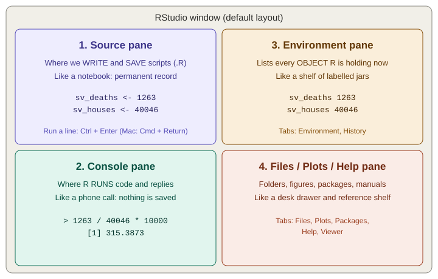

Lesson 1: Getting Started with R and RStudio
================
Dr. Sandeep Kumar Singh

> **The real question for today:** In 1854, a doctor named John Snow
> counted cholera deaths in London house by house, with pen and paper.
> Today the same kind of counting is done on millions of records. How do
> researchers do that? With a tool like R. In this lesson we install it
> and say our first word to it.

------------------------------------------------------------------------

## 1. Why this lesson matters

Before we can cook, we need a kitchen. This lesson builds our kitchen.
By the end, we will have:

| We will… | So that… |
|----|----|
| install **R** | our computer can understand R instructions |
| install **RStudio** | we have a comfortable place to write them |
| recognise the **four panes** | we always know where to type and where to look |
| run our **first command** | we see R reply to us |
| change **one important setting** | our future work stays clean and repeatable |

We will not write any real analysis today. That is on purpose. A calm
start makes every later lesson easier.

------------------------------------------------------------------------

## 2. The ideas, in plain words

### 2.1 What is R?

**R** is a free programming language made for working with data. A
*programming language* is simply a way of giving a computer precise
instructions, written as text.

Health researchers use R every day to read data files, clean them,
calculate summaries, draw figures and write reports. Because the
instructions are written down, anyone can run them again and get the
same answer. That is called **reproducibility**, and it is one of the
main reasons public-health and genomics researchers choose R.

### 2.2 What is RStudio?

**RStudio** is a free program that makes R easier to use. It is an *IDE*
(integrated development environment), which just means “a workspace with
all the tools in one window”.

A simple way to remember the difference:

> **R is the engine of a car. RStudio is the dashboard.** The engine
> does the real work. The dashboard gives us a steering wheel, a speed
> meter and a map. We can drive with only an engine, but it is not
> pleasant.

So we always install **both**, and we always **open RStudio** (it starts
R for us in the background).

### 2.3 Why not just use Excel?

Excel is excellent for looking at a small table. But when we click and
drag in Excel, nobody can see later exactly what we did. In R, every
step is a line of text that we can save, share, check and re-run. If a
new month of surveillance data arrives, we run the same script again,
and the whole analysis updates in seconds.

------------------------------------------------------------------------

## 3. Installing R and RStudio

Install **R first**, then RStudio. Both are free.

| Step | What to do | Notes |
|----|----|----|
| 1 | Go to <https://cran.r-project.org> | CRAN is the official home of R |
| 2 | Choose “Download R for Windows”, “macOS” or “Linux” | Windows: click **base**, then the download link |
| 3 | Run the installer and accept the default options | Defaults are fine for this course |
| 4 | Go to <https://posit.co/download/rstudio-desktop/> | Posit is the company that makes RStudio |
| 5 | Download **RStudio Desktop** (free) and install it |  |
| 6 | Open **RStudio** (not R) from your programs list | RStudio finds R automatically |

> **Tip for Mac users:** download the R installer that matches your
> chip. Newer Macs use “Apple silicon (arm64)”, older ones use “Intel
> (x86_64)”. You can check under Apple menu → About This Mac.

------------------------------------------------------------------------

## 4. A tour of the four panes

When RStudio opens, the window is divided into four areas called
**panes**. Learning these now saves a lot of confusion later.

<figure>

<figcaption aria-hidden="true">The four panes of RStudio</figcaption>
</figure>

*Figure 1.1. The default RStudio layout. If you only see three panes,
the Source pane is hidden: go to File → New File → R Script and it
appears.*

| Pane | What it is for | Everyday analogy |
|----|----|----|
| **1. Source** (top left) | Writing and saving scripts (`.R` files) | A lab notebook: a permanent record |
| **2. Console** (bottom left) | Where R actually runs code and prints results | A phone call: you hear the answer, but nothing is written down |
| **3. Environment** (top right) | Shows every object R is currently holding | A shelf of labelled jars |
| **4. Files / Plots / Packages / Help** (bottom right) | Folders, figures, installed packages and help pages | A desk drawer and a reference shelf |

The most important habit of the whole course starts here: **we write in
the Source pane and run from there.** The Console is for quick
experiments only.

------------------------------------------------------------------------

## 5. Our first commands

We will now type in the **Console** (bottom left). Click inside it. You
will see a `>` sign. This is the **prompt**: R is saying “I am ready,
give me an instruction”.

### 5.1 Say hello with arithmetic

``` r
1 + 1
```

    ## [1] 2

**What it does:** asks R to add one and one.

**Why we do it:** it proves that R is installed and listening.

**How to read the output:** the answer is `2`. The `[1]` in front is not
part of the answer. It is R’s way of numbering results. It means “this
is result number 1”. When R prints a long list of values, each new line
starts with the position number of its first value, which helps us
count. For a single answer, it is always `[1]`.

> Note: on this website, R’s output is shown after `##`. In your own
> Console you will see only `[1] 2`.

### 5.2 Ask R which version we have

``` r
R.version.string
```

    ## [1] "R version 4.5.3 (2026-03-11 ucrt)"

**What it does:** prints the version of R installed on the computer.

**Why we do it:** when we ask someone for help, or write the methods
section of a paper, we report the R version. Different versions can
occasionally behave differently. (Your version will likely be newer than
the one shown here.)

### 5.3 A real number from 1854

Let us do our first real calculation. John Snow recorded **1,263**
cholera deaths among the houses supplied by the Southwark and Vauxhall
water company, and **98** deaths among houses supplied by the Lambeth
company. How many deaths in total?

``` r
1263 + 98
```

    ## [1] 1361

**What it does:** adds the two published death counts.

**Why we do it:** it shows that R works with real numbers in exactly the
way we would expect. Note that we type `1263`, **not** `1,263`. In R, a
comma separates things (we will see this in Lesson 4), so it can never
be used inside a number.

### 5.4 When the prompt changes to `+`

Type this and press Enter, **without** finishing it:

``` r
1263 +
```

R does not answer. Instead the prompt changes from `>` to `+`. This
means: “your instruction is not finished, please continue”. Type `98`
and press Enter, and R answers `1361`.

If you get stuck on a `+` and do not know why, press **Esc** (on a Mac
or Windows) to cancel and get your `>` back. This is one of the most
common beginner moments, so it is good to see it on day one.

------------------------------------------------------------------------

## 6. One important setting (do this once)

By default, RStudio offers to save everything in memory when we close it
and reload it next time. That sounds helpful but causes problems: old
objects quietly come back, and our results may depend on things that are
not written in our script.

Turn it off:

1.  Go to **Tools → Global Options → General**.
2.  **Untick** “Restore .RData into workspace at startup”.
3.  Set “Save workspace to .RData on exit” to **Never**.
4.  Click **OK**.

From now on, our **script** is the only record of our work. If the
script runs from top to bottom and gives the result, the work is
reproducible. This habit will protect us in every lesson.

------------------------------------------------------------------------

## 7. Common beginner problems

| What happens | Why | Fix |
|----|----|----|
| RStudio says it cannot find R | R was not installed, or installed after RStudio | Install R, then restart RStudio |
| Typed `1,263 + 98` and got an error | Commas are not allowed inside numbers | Type `1263 + 98` |
| The prompt shows `+` and nothing happens | The instruction is unfinished | Finish it, or press **Esc** |
| Only three panes are visible | No script is open yet | File → New File → R Script |
| Opened “R” instead of “RStudio” | Both are installed with similar icons | Close it and open **RStudio** |

------------------------------------------------------------------------

## 8. Practice

Type these in the Console and check the answers.

1.  Snow recorded 40,046 houses supplied by Southwark and Vauxhall and
    26,107 supplied by Lambeth. How many houses in total?
2.  Type `40046 +`, press Enter, and notice the prompt. Then finish the
    sum with `26107`.
3.  Find where the four panes are, and open a new R Script so that all
    four are visible.

<details>

<summary>

Show answers
</summary>

``` r
40046 + 26107
```

    ## [1] 66153

For question 2, the prompt changes to `+` until you type `26107` and
press Enter. The answer is the same.

</details>

------------------------------------------------------------------------

## 9. Recap

R is the engine and RStudio is the dashboard. We write in the **Source**
pane, R runs code in the **Console**, objects appear in the
**Environment**, and files, plots and help live in the fourth pane. The
`>` prompt means R is ready, `+` means it is waiting for us to finish,
and `[1]` simply numbers the answer. We also switched off saving the
workspace so that our scripts stay the true record of our work.

## 10. What comes next

In **Lesson 2** we use R as a calculator on John Snow’s real 1854 data
and answer the question that started modern epidemiology: did the water
company make a difference to the death rate?
