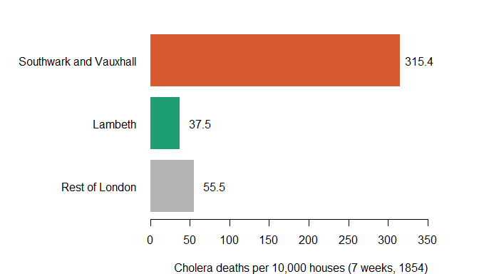

Lesson 2: R as a Calculator
================
Dr. Sandeep Kumar Singh

<script type="text/javascript" async
    src="https://cdnjs.cloudflare.com/ajax/libs/mathjax/3.2.0/es5/tex-mml-chtml.js">
</script>

> **The real question for today:** In the London cholera epidemic of
> 1854, were people who drank water from the Southwark and Vauxhall
> company more likely to die than people who drank Lambeth water? We
> will answer it with nothing more than R’s arithmetic.

------------------------------------------------------------------------

## 1. Why this lesson matters

Every analysis, however advanced, is built from small calculations:
adding, dividing, multiplying. Before learning anything else, we need to
be sure R does these the way we expect, and we need to know the few
rules that surprise beginners (order of operations, and very small
numbers written like `5e-08`).

------------------------------------------------------------------------

## 2. The data: John Snow’s Table IX

In 1854, the south of London got its water from two companies. The
Southwark and Vauxhall company took water from the Thames downstream,
where sewage entered the river. The Lambeth company had moved its intake
upstream, to cleaner water. In many streets, houses side by side were
supplied by different companies. Snow saw this as a natural experiment
and counted the deaths in the first seven weeks of the epidemic.

| Water company | Houses | Cholera deaths | Deaths per 10,000 houses (Snow’s table) |
|----|---:|---:|---:|
| Southwark and Vauxhall | 40,046 | 1,263 | 315 |
| Lambeth | 26,107 | 98 | 37 |
| Rest of London | 256,423 | 1,422 | 59 |

*Source: Snow J. On the Mode of Communication of Cholera, 2nd ed.,
London: John Churchill, 1855, Table IX.*

Our job is to reproduce the last column with R and compare the
companies.

------------------------------------------------------------------------

## 3. The idea, in plain words

### 3.1 R’s arithmetic symbols

R uses the same symbols as a calculator, plus one for powers:

| Symbol | Meaning                   | Example     | Answer |
|--------|---------------------------|-------------|--------|
| `+`    | add                       | `1263 + 98` | 1361   |
| `-`    | subtract                  | `1263 - 98` | 1165   |
| `*`    | multiply                  | `98 * 2`    | 196    |
| `/`    | divide                    | `98 / 2`    | 49     |
| `^`    | power (“to the power of”) | `10^4`      | 10000  |

### 3.2 What is a “rate per 10,000”?

Comparing 1,263 deaths with 98 deaths is unfair, because the two
companies supplied different numbers of houses. So we turn each count
into a **rate**: how many deaths there would be for every 10,000 houses.

$$\text{Deaths per 10,000 houses} = \frac{\text{number of deaths}}{\text{number of houses}} \times 10{,}000$$

Let us work it once by hand for Lambeth so we know what R should give:

$$\frac{98}{26{,}107} = 0.003754\ldots \quad\text{and}\quad 0.003754 \times 10{,}000 \approx 37.5$$

So in Lambeth houses, about 37.5 people died for every 10,000 houses.
Now R can do the same, faster and without mistakes.

------------------------------------------------------------------------

## 4. Code, step by step

Type each line in the **Console** and press Enter.

### 4.1 The death rate for Southwark and Vauxhall

``` r
1263 / 40046 * 10000
```

    ## [1] 315.3873

**What it does:** divides deaths by houses, then multiplies by 10,000.

**Why:** it turns the raw count into a fair, comparable rate.

**How to read the output:** about **315.4** deaths per 10,000 houses.
Snow printed 315, so R agrees with him. R shows several decimals by
default; in Lesson 4 we learn to round them.

### 4.2 The death rate for Lambeth

``` r
98 / 26107 * 10000
```

    ## [1] 37.53783

**What it does:** the same calculation with the Lambeth numbers.

**How to read the output:** about **37.5**, the same as our hand
calculation, and Snow’s 37.

### 4.3 How many times higher? The rate ratio

To compare two rates, epidemiologists divide one by the other. This is
called a **rate ratio**.

``` r
(1263 / 40046 * 10000) / (98 / 26107 * 10000)
```

    ## [1] 8.401853

**What it does:** divides the Southwark and Vauxhall rate by the Lambeth
rate.

**Why the brackets:** each bracket is calculated first, so R finishes
both rates *before* dividing one by the other. Without them, R would
work strictly left to right through the `/` and `*` signs and give a
wrong answer (see section 5).

**How to read the output:** about **8.4**. Houses supplied with
downstream Thames water had a cholera death rate roughly eight times
higher than houses with Lambeth water. With one line of R, we have
reproduced the core finding of one of the most famous studies in public
health.

<figure>

<figcaption aria-hidden="true">Cholera deaths per 10,000 houses by water
company</figcaption>
</figure>

*Figure 2.1. Snow’s three rates, calculated in R. (We learn to draw
plots like this in Lesson 16; for now, just look at the difference.)*

### 4.4 A check on the “Rest of London” row

``` r
1422 / 256423 * 10000
```

    ## [1] 55.45524

**How to read the output:** about **55.5**. Snow’s printed table shows
59 for this row. Whatever the reason for the difference, this is a
useful lesson: once numbers are in R, checking a published table takes
seconds. Being able to re-calculate other people’s numbers is one of the
quiet superpowers of R.

### 4.5 Powers and the order of operations

``` r
10^4
```

    ## [1] 10000

``` r
2 + 3 * 4
```

    ## [1] 14

``` r
(2 + 3) * 4
```

    ## [1] 20

**What they do:** `10^4` is 10 × 10 × 10 × 10. The second and third
lines show that R follows the usual school rule (often called BODMAS or
PEMDAS): **brackets first, then powers, then multiply and divide, then
add and subtract.** `2 + 3 * 4` is 14, because the multiplication
happens first. Brackets change the order and give 20.

**Why it matters:** most “my answer is wrong” problems at this stage are
missing brackets. When in doubt, add brackets; they never hurt.

### 4.6 Very small numbers: scientific notation

In genetics, results are often extremely small numbers. A famous one is
the **genome-wide significance threshold**, 5 × 10⁻⁸, the cut-off
commonly used to call a genetic finding convincing. Let us type it:

``` r
5 * 10^-8
```

    ## [1] 5e-08

**How to read the output:** `5e-08` is R’s short way of writing 5 ×
10⁻⁸, which is 0.00000005. The `e` means “times ten to the power of”. So
`e-08` means “move the decimal point 8 places to the left”. We can also
type numbers this way ourselves:

``` r
5e-8
```

    ## [1] 5e-08

``` r
1.5e6
```

    ## [1] 1500000

`1.5e6` is 1,500,000 (1.5 million). We will meet `e` again whenever we
handle p-values, so it is worth getting comfortable with it now.

------------------------------------------------------------------------

## 5. Common errors

### Forgetting brackets in a ratio

``` r
1263 / 40046 * 10000 / 98 / 26107 * 10000
```

    ## [1] 1.232711

This is not 8.4. Without brackets R simply works left to right through
all the `/` and `*` signs, which is not what we meant. Put each rate in
its own brackets, as in section 4.3.

### Using commas inside numbers

``` r
1,263 / 40046
```

    ## Error in parse(text = input): <text>:1:2: unexpected ','
    ## 1: 1,
    ##      ^

R reads the comma as a separator and complains. Type `1263`, never
`1,263`.

### Dividing by zero

``` r
98 / 0
```

    ## [1] Inf

R does not crash. It returns `Inf` (infinity). If you ever see `Inf` in
your results, check whether a denominator, such as a number of houses or
people, was zero.

------------------------------------------------------------------------

## 6. Practice

1.  Calculate the Lambeth death rate per **1,000** houses instead of per
    10,000.
2.  In total, 1,263 + 98 deaths occurred in 40,046 + 26,107 houses.
    Calculate the combined rate per 10,000 houses in one line (you will
    need brackets).
3.  A GWAS reports a p-value of `3.2e-12`. Is it smaller than the
    genome-wide threshold of `5e-8`? (Hint: R can answer with
    `3.2e-12 < 5e-8`, which we study properly in Lesson 8.)

<details>

<summary>

Show answers
</summary>

``` r
98 / 26107 * 1000
```

    ## [1] 3.753783

``` r
(1263 + 98) / (40046 + 26107) * 10000
```

    ## [1] 205.7352

``` r
3.2e-12 < 5e-8
```

    ## [1] TRUE

Question 1: about 3.75 deaths per 1,000 houses. Question 2: about 205.7
per 10,000. Question 3: `TRUE`, the p-value is far below the threshold.

</details>

------------------------------------------------------------------------

## 7. Recap

R does arithmetic with `+ - * / ^` and follows the usual order of
operations, so brackets are our best friend. We turned Snow’s raw counts
into rates per 10,000 houses and found that the Southwark and Vauxhall
rate was about 8.4 times the Lambeth rate. We also learned that `5e-08`
is scientific notation for a very small number.

## 8. What comes next

We typed the same numbers (1263, 40046, 98, 26107) again and again. That
is slow and easy to get wrong. In **Lesson 3** we store them once, under
clear names, and write our first saved script.
