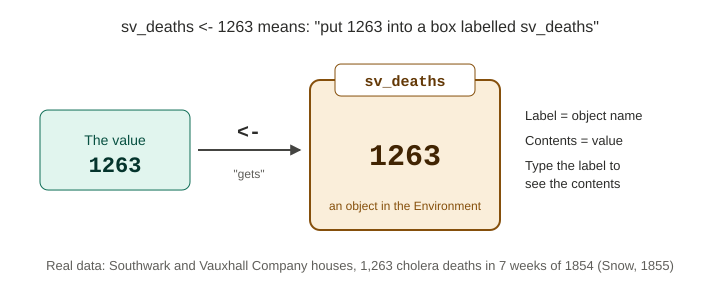

Lesson 3: Objects, Scripts and Comments
================
Dr. Sandeep Kumar Singh

> **The real question for today:** In Lesson 2 we typed Snow’s numbers
> again and again. Suppose we find a typing mistake in one of them. How
> do we fix it in one place and have every result update? The answer is
> objects, kept in a saved script.

------------------------------------------------------------------------

## 1. Why this lesson matters

Real analyses reuse the same values many times: a population size, a
number of cases, a significance threshold. If we type a value by hand
each time, sooner or later we type it wrong. Storing it once, under a
clear name, removes that risk. Saving the steps in a **script** means
we, or a colleague, can run the whole analysis again tomorrow.

------------------------------------------------------------------------

## 2. The ideas, in plain words

### 2.1 An object is a labelled box

An **object** is a value that R stores in memory under a **name**. Think
of a box with a label on the front. The label is the object’s name; the
contents are its value. Whenever we write the label, R opens the box and
uses what is inside.

<figure>

<figcaption aria-hidden="true">An object as a labelled box</figcaption>
</figure>

*Figure 3.1. `sv_deaths <- 1263` puts the value 1263 into a box labelled
`sv_deaths`.*

### 2.2 The assignment arrow `<-`

We create an object with the **assignment operator** `<-`, a “less than”
sign followed by a minus sign. Read it aloud as **“gets”**:
`sv_deaths <- 1263` means “sv_deaths gets 1263”. The arrow points from
the value into the name.

### 2.3 A script is our lab notebook

A **script** is a plain text file, ending in `.R`, that holds our R
instructions in order. The Console forgets; the script remembers. Our
rule from now on: **write in a script, run from the script, save the
script.**

### 2.4 A comment is a note to humans

Anything after a `#` on a line is a **comment**. R ignores it
completely. Comments explain *why* we did something, for our future
selves and for anyone reading our work.

------------------------------------------------------------------------

## 3. Setting up our first script

1.  In RStudio, go to **File → New File → R Script**. A blank page opens
    in the Source pane.
2.  Save it straight away with **File → Save** (or Ctrl + S / Cmd + S).
    Call it `snow_cholera_1854.R`.
3.  To run a line, put the cursor on it and press **Ctrl + Enter** (Mac:
    **Cmd + Return**). The line is sent to the Console and the result
    appears there.

To type the arrow quickly, RStudio has a shortcut: **Alt + -** (Mac:
**Option + -**). It types `<-` with spaces around it.

------------------------------------------------------------------------

## 4. Code, step by step

Type each block into the script and run it line by line.

### 4.1 Storing the counts

``` r
# Snow (1855), Table IX: first seven weeks of the 1854 epidemic
sv_deaths <- 1263      # deaths, Southwark and Vauxhall houses
sv_houses <- 40046     # houses supplied by Southwark and Vauxhall
lam_deaths <- 98       # deaths, Lambeth houses
lam_houses <- 26107    # houses supplied by Lambeth
```

**What it does:** creates four objects, one for each published number.

**Why:** each number is now typed exactly once. If we ever find a
mistake, we fix it here and everything below follows.

**How to read the output:** there is none, and that is normal.
Assignment stores a value quietly. Look at the **Environment** pane: the
four objects now appear there with their values.

### 4.2 Looking inside an object

``` r
sv_deaths
```

    ## [1] 1263

**What it does:** typing an object’s name on its own prints its value.

**Why:** this is how we check what a box contains, at any time.

### 4.3 Calculating with objects

``` r
sv_rate <- sv_deaths / sv_houses * 10000
lam_rate <- lam_deaths / lam_houses * 10000
sv_rate
```

    ## [1] 315.3873

``` r
lam_rate
```

    ## [1] 37.53783

**What it does:** calculates each rate using the stored numbers, and
saves the results in two new objects, `sv_rate` and `lam_rate`.

**Why:** the calculation now reads almost like English (“deaths divided
by houses”), which makes mistakes much easier to spot. The results are
the same as in Lesson 2.

### 4.4 The rate ratio, now readable

``` r
rate_ratio <- sv_rate / lam_rate
rate_ratio
```

    ## [1] 8.401853

**What it does:** divides one stored rate by the other.

**Why:** compare this with Lesson 2’s long line full of brackets. With
objects, no brackets are needed, because each rate is already finished
and stored.

**How to read the output:** about 8.4, exactly as before.

### 4.5 Objects can be replaced (overwritten)

``` r
lam_deaths
```

    ## [1] 98

``` r
lam_deaths <- 100
lam_deaths
```

    ## [1] 100

``` r
lam_deaths <- 98
```

**What it does:** gives `lam_deaths` a new value (100), then puts the
correct value (98) back.

**Why it matters:** R does not warn us when we replace a value. The old
value is simply gone. Notice too that `lam_rate` does **not** change on
its own: it was calculated with the old value and stays as it was until
we run its line again. This is why we always run our script from top to
bottom.

### 4.6 Listing and removing objects

``` r
ls()
```

    ## [1] "lam_deaths" "lam_houses" "lam_rate"   "rate_ratio" "sv_deaths" 
    ## [6] "sv_houses"  "sv_rate"

**What it does:** `ls()` lists the names of all objects currently in
memory (the same names we see in the Environment pane).

``` r
rm(rate_ratio)
ls()
```

    ## [1] "lam_deaths" "lam_houses" "lam_rate"   "sv_deaths"  "sv_houses" 
    ## [6] "sv_rate"

**What it does:** `rm()` removes an object. `rate_ratio` is no longer in
the list.

**Why:** occasionally we want a clean slate. To remove everything, we
can use the broom icon in the Environment pane, or better, restart R
with **Session → Restart R** and re-run the script.

### 4.7 Organising a script with section headings

A comment line that ends with four or more dashes becomes a **section
heading** in RStudio, which we can jump to from the outline:

``` r
# ---- 1. Data from Snow (1855) ----
sv_deaths  <- 1263
sv_houses  <- 40046
lam_deaths <- 98
lam_houses <- 26107

# ---- 2. Death rates per 10,000 houses ----
sv_rate  <- sv_deaths / sv_houses * 10000
lam_rate <- lam_deaths / lam_houses * 10000

# ---- 3. Comparison ----
rate_ratio <- sv_rate / lam_rate
rate_ratio
```

This is our **first complete research script**. Save it. Restart R, open
the script and run every line from the top (Ctrl + Shift + Enter runs
the whole file). If it reproduces 8.4 on a fresh start, our work is
reproducible.

------------------------------------------------------------------------

## 5. Rules for naming objects

| Rule | Good | Not allowed / avoid |
|----|----|----|
| Start with a letter | `deaths_1854` | `1854_deaths` (error) |
| Use letters, numbers, `_` and `.` only | `sv_rate` | `sv rate`, `sv-rate` (error) |
| Upper and lower case are different | `sv_rate` | `SV_rate` is a *different* object |
| Be descriptive but short | `lam_houses` | `x`, `a1`, `the_number_of_houses_supplied_by_lambeth` |
| Avoid names R already uses | `n_cases` | `c`, `T`, `F`, `mean`, `sum` |

In this course we use **snake_case**: lower-case words joined by
underscores (`lam_deaths`, `rate_ratio`). Pick one style and keep it.

------------------------------------------------------------------------

## 6. Common errors

### Object not found

``` r
SV_deaths
```

    ## Error:
    ## ! object 'SV_deaths' not found

**Why:** we created `sv_deaths` in lower case. R treats `SV_deaths` as a
completely different name, which does not exist. Check the spelling and
the case, or look in the Environment pane.

### Using an object before creating it

``` r
rest_rate <- rest_deaths / rest_houses * 10000
```

    ## Error:
    ## ! object 'rest_deaths' not found

**Why:** `rest_deaths` was never created. In a script, lines run in
order, so an object must be created **above** the line that uses it.

### A space inside the arrow

``` r
lam_deaths < - 98
```

    ## [1] FALSE

**Why:** with a space, `< -` is no longer an arrow. R reads it as “is
`lam_deaths` smaller than minus 98?” and answers `FALSE`, and nothing is
stored. Always type `<-` with no space inside it (the Alt + - shortcut
prevents this).

------------------------------------------------------------------------

## 7. Practice

1.  Create `rest_deaths` (1422) and `rest_houses` (256423), and
    calculate `rest_rate`, the “Rest of London” rate per 10,000 houses.
2.  Calculate how many times higher the Southwark and Vauxhall rate is
    than the rest of London. Store it as `sv_vs_rest`.
3.  Add a comment above each line explaining what it does, then save,
    restart R and run the whole script.

<details>

<summary>

Show answers
</summary>

``` r
# Rest of London, Snow (1855) Table IX
rest_deaths <- 1422
rest_houses <- 256423

# Death rate per 10,000 houses
rest_rate <- rest_deaths / rest_houses * 10000
rest_rate
```

    ## [1] 55.45524

``` r
# How many times higher is the Southwark and Vauxhall rate?
sv_vs_rest <- sv_rate / rest_rate
sv_vs_rest
```

    ## [1] 5.68724

The Southwark and Vauxhall rate was about 5.7 times the rate in the rest
of London.

</details>

------------------------------------------------------------------------

## 8. Recap

An object is a labelled box: `name <- value` stores a value, and typing
the name shows it. Objects make calculations readable and let us fix a
number in one place. R replaces values silently and never updates other
objects by itself, so we keep our work in a saved script, with comments
and section headings, and run it from top to bottom on a fresh session.

## 9. What comes next

We have already used two small tools, `ls()` and `rm()`. These are
**functions**. In **Lesson 4** we learn what functions are, how to give
them inputs, and how to read R’s help pages, starting with rounding
Snow’s rates to a sensible number of decimals.
