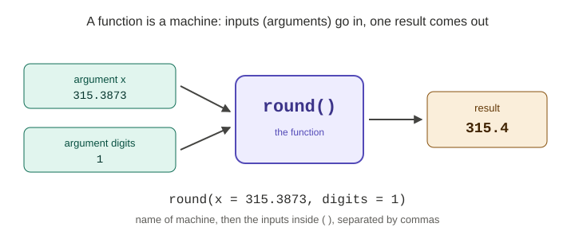

Lesson 4: Functions, Arguments and Help
================
Dr. Sandeep Kumar Singh

> **The real question for today:** A report should say “315.4 deaths per
> 10,000 houses”, not “315.3873”. And a genetics paper plots p-values
> such as 5 × 10⁻⁸ on a “−log10” scale. How do we ask R to do these jobs
> for us? With functions.

------------------------------------------------------------------------

## 1. Why this lesson matters

Almost everything we do in R is done by **functions**: rounding, adding
up, reading a file, drawing a plot, fitting a model. Once we understand
how one function works, we understand how thousands of them work,
because they all follow the same pattern. And once we can read a help
page, we never need to memorise a function’s details.

------------------------------------------------------------------------

## 2. The ideas, in plain words

### 2.1 A function is a machine

A **function** is a ready-made tool that takes some input, does a job,
and gives back a result. Think of a machine in a lab: we put a sample
in, set a dial, and a result comes out.

<figure>

<figcaption aria-hidden="true">A function as a machine</figcaption>
</figure>

*Figure 4.1. `round()` takes a number and a “digits” setting, and gives
back the rounded number.*

### 2.2 How a function call is written

We **call** (use) a function by writing its name followed by round
brackets. The inputs go inside the brackets:

``` r
function_name(input_1, input_2)
```

The inputs are called **arguments**. Each argument has a **name**, such
as `x` or `digits`, and we give it a **value** with a single `=` sign.
Arguments are separated by **commas**. (This is why we could not use
commas inside numbers in Lesson 2.)

### 2.3 Default values

Many arguments have a **default**: a value the function uses if we do
not give one. For example, `round()` rounds to 0 decimal places unless
we say otherwise. Defaults are why many functions work with just one
input.

------------------------------------------------------------------------

## 3. Code, step by step

We start from our Snow script. Run these lines first if they are not
already in memory:

``` r
sv_deaths  <- 1263
sv_houses  <- 40046
lam_deaths <- 98
lam_houses <- 26107
sv_rate  <- sv_deaths / sv_houses * 10000
lam_rate <- lam_deaths / lam_houses * 10000
```

### 3.1 Our first function: `round()`

``` r
round(sv_rate)
```

    ## [1] 315

**What it does:** rounds `sv_rate` to a whole number.

**Why only one input:** we gave a value for the first argument, `x` (the
number to round). We did not give `digits`, so R used its default, 0.

``` r
round(sv_rate, digits = 1)
```

    ## [1] 315.4

``` r
round(lam_rate, digits = 1)
```

    ## [1] 37.5

**What it does:** rounds each rate to one decimal place.

**Why:** one decimal is a sensible precision for a death rate in a
report. Showing four decimals would suggest a precision that the data do
not have.

### 3.2 Arguments by name and by position

All three lines below give the same answer:

``` r
round(x = sv_rate, digits = 1)
```

    ## [1] 315.4

``` r
round(sv_rate, digits = 1)
```

    ## [1] 315.4

``` r
round(sv_rate, 1)
```

    ## [1] 315.4

**What it shows:** if we write arguments in the order the function
expects (`x` first, then `digits`), we may leave out the names. R
matches them by **position**.

**Our habit in this course:** leave out the name of the first, obvious
argument, but **write the names of the others** (`digits = 1`). The code
is then readable by anyone, including us in six months.

### 3.3 Functions inside functions

``` r
round(sv_rate / lam_rate, digits = 1)
```

    ## [1] 8.4

**What it does:** R first calculates `sv_rate / lam_rate` (the inside),
then rounds that result (the outside). We read nested calls **from the
inside out**.

**How to read the output:** the rate ratio, 8.4, ready for a report.

### 3.4 Functions that take many inputs: `sum()`

``` r
sum(sv_deaths, lam_deaths)
```

    ## [1] 1361

``` r
sum(sv_houses, lam_houses)
```

    ## [1] 66153

**What it does:** `sum()` adds up all the values we give it.

**Why:** some functions accept any number of inputs. `sum()` will be
much more useful in Lesson 7, when one object holds many values at once.

### 3.5 A genomics example: `log10()`

In genetics, p-values are so small that we usually show them on a
**−log10 scale**. The logarithm turns “how many zeros after the decimal
point” into an ordinary number: 0.01 becomes 2, and 0.00000005 becomes
about 7.3. On this scale, bigger means stronger evidence.

``` r
gws_threshold <- 5e-8      # genome-wide significance threshold
-log10(gws_threshold)
```

    ## [1] 7.30103

``` r
-log10(0.05)
```

    ## [1] 1.30103

**What it does:** `log10()` gives the base-10 logarithm, and the minus
sign in front turns it positive.

**How to read the output:** the genome-wide threshold, 5 × 10⁻⁸, is
about **7.3** on the −log10 scale; the familiar 0.05 is about **1.3**.
When you see a horizontal line at 7.3 on a “Manhattan plot” in a
genetics paper, this is the number behind it.

### 3.6 A few more useful number functions

| Function | What it does | Example | Answer |
|----|----|----|----|
| `sqrt(x)` | square root | `sqrt(16)` | 4 |
| `abs(x)` | removes the minus sign | `abs(-2.5)` | 2.5 |
| `exp(x)` | e to the power x | `exp(0)` | 1 |
| `log(x)` | natural logarithm | `log(exp(2))` | 2 |
| `signif(x, digits = 2)` | keeps 2 significant figures | `signif(315.3873, digits = 2)` | 320 |

------------------------------------------------------------------------

## 4. Getting help

No one remembers every argument. Professionals look things up
constantly. R has a help page for every function.

### 4.1 Opening a help page

``` r
?round
help("round")
```

**What it does:** both open the help page for `round()` in the Help pane
(bottom right).

### 4.2 Reading a help page

Every help page has the same sections. These four are the ones we need:

| Section | What it tells us |
|----|----|
| **Description** | What the function does, in one or two sentences |
| **Usage** | How to call it, with every argument and its default (`digits = 0`) |
| **Arguments** | What each argument means and what values it accepts |
| **Examples** | Code we can copy into the Console and run |

The Examples section, at the bottom, is the most useful part for
beginners. Copy one example, run it, then change one thing.

### 4.3 Seeing the arguments quickly

``` r
args(round)
```

    ## function (x, digits = 0, ...) 
    ## NULL

**What it does:** shows the arguments and their defaults, without
opening the whole page. Here we see `digits = 0`, the default we met
earlier.

### 4.4 When we do not know the function’s name

``` r
??logarithm
```

**What it does:** searches all help pages for the word. Two question
marks mean “search”, one means “open this exact function”. A web search
such as “R round to 2 decimal places” also works very well.

------------------------------------------------------------------------

## 5. Common errors

### Misspelling a function name

``` r
Round(sv_rate, digits = 1)
```

    ## Error in `Round()`:
    ## ! could not find function "Round"

R is case-sensitive: the function is `round`, with a lower-case “r”.

### Using an argument name that does not exist

``` r
round(sv_rate, decimals = 1)
```

    ## Error in `round()`:
    ## ! unused argument (decimals = 1)

“Unused argument” means the function has no argument with that name.
Check the real names with `args(round)` or `?round`.

### Forgetting the closing bracket

``` r
round(sv_rate, digits = 1
```

R shows the `+` prompt and waits. Type `)` and press Enter, or press
**Esc** and fix the line in the script. RStudio helps by highlighting
the matching bracket when the cursor is next to one.

------------------------------------------------------------------------

## 6. Practice

1.  Round `lam_rate` to **two** decimal places.
2.  Using `round()` and the objects from section 3, calculate the
    combined death rate per 10,000 houses for both companies, rounded to
    one decimal place, in one line.
3.  A genetic variant has p = 2e-10. What is its −log10 p-value, rounded
    to one decimal place? Is it above the 7.3 line?
4.  Open `?sum` and find out what the `na.rm` argument is for. (We will
    need it in Lesson 9.)

<details>

<summary>

Show answers
</summary>

``` r
round(lam_rate, digits = 2)
```

    ## [1] 37.54

``` r
round(sum(sv_deaths, lam_deaths) / sum(sv_houses, lam_houses) * 10000, digits = 1)
```

    ## [1] 205.7

``` r
round(-log10(2e-10), digits = 1)
```

    ## [1] 9.7

Question 3: about 9.7, well above the 7.3 line. Question 4: `na.rm`
decides whether missing values are removed before adding up; its default
is `FALSE`.

</details>

------------------------------------------------------------------------

## 7. Recap

A function is a machine: `name(arguments)`. Arguments have names and can
have defaults; we usually name every argument except the first. Nested
calls are read from the inside out. `?name` opens help, `args()` shows
the arguments, and `??word` searches. With `round()` we made Snow’s
rates report-ready, and with `-log10()` we met the number behind the
genome-wide significance line.

## 8. What comes next

R comes with many functions built in, but thousands more, and many real
datasets, come in **packages**. In **Lesson 5** we install our first
packages and open a real dataset of 189 births from a US hospital.
