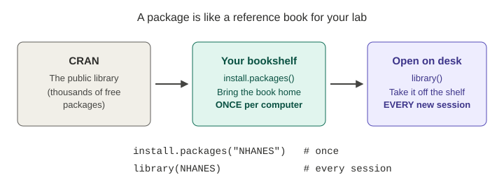

Lesson 5: Packages and Built-in Datasets
================
Dr. Sandeep Kumar Singh

> **The real question for today:** Researchers do not start every
> project by typing numbers by hand. They load real datasets. Where do
> those datasets come from, and how do we open one? Today we open the
> records of 189 real births from a US hospital in 1986, collected to
> study why some babies are born too small.

------------------------------------------------------------------------

## 1. Why this lesson matters

R on its own (called **base R**) already has hundreds of functions. But
much of R’s power comes from **packages**, written by researchers all
over the world and shared for free. Packages add new functions, and many
also contain **real datasets**, ready to use. From this lesson on, every
lesson in the course works with real data loaded from a package or a
file.

------------------------------------------------------------------------

## 2. The ideas, in plain words

### 2.1 What is a package?

A **package** is a bundle of functions, data and help pages that someone
has written and shared. If base R is a kitchen with the basic utensils,
a package is a specialist appliance we add when we need it.

### 2.2 Where do packages come from?

Most packages live on **CRAN** (the Comprehensive R Archive Network),
the same site we downloaded R from. Packages for genomics and molecular
biology mostly live on **Bioconductor**, a separate collection built for
that field.

### 2.3 Install once, load every time

There are two separate steps, and confusing them is the most common
beginner mistake of this lesson.

<figure>

<figcaption aria-hidden="true">install.packages() versus
library()</figcaption>
</figure>

*Figure 5.1. Installing a package is like bringing a book home from the
library: we do it once. Loading it is like taking it off our shelf: we
do it in every new R session.*

| Step | Function | How often | Analogy |
|----|----|----|----|
| Install | `install.packages()` | **once** per computer | bring the book home |
| Load | `library()` | **every** time we restart R | open the book on our desk |

### 2.4 Our dataset: `birthwt`

The `MASS` package contains a dataset called `birthwt`. It holds the
records of **189 births** at Baystate Medical Center, Springfield,
Massachusetts, in **1986**, collected to study risk factors for **low
birth weight** (a baby weighing less than 2,500 grams). Low birth weight
is one of the most important predictors of a newborn’s health, so this
is exactly the kind of question public-health researchers ask.

`MASS` is one of a small set of “recommended” packages that come
**already installed** with R, so we can load it straight away.

------------------------------------------------------------------------

## 3. Code, step by step

### 3.1 Loading a package

``` r
library(MASS)
```

**What it does:** loads the `MASS` package into the current R session,
so that its functions and datasets become available.

**Why no quotes:** `library()` accepts the package name without
quotation marks. (`install.packages()`, below, needs them.)

**How to read the output:** usually nothing appears. Silence means
success.

### 3.2 Reading about the dataset first

``` r
?birthwt
```

**What it does:** opens the help page for the dataset, just as `?round`
did for a function in Lesson 4.

**Why this comes first:** before analysing any data, a good researcher
reads its documentation: who collected it, when, and what each column
means. The help page tells us, for example, that `bwt` is birth weight
in grams, `lwt` is the mother’s weight in **pounds**, and `smoke`
records smoking during pregnancy. We will rely on these details in the
next lessons.

### 3.3 Taking a first look

``` r
head(birthwt)
```

    ##    low age lwt race smoke ptl ht ui ftv  bwt
    ## 85   0  19 182    2     0   0  0  1   0 2523
    ## 86   0  33 155    3     0   0  0  0   3 2551
    ## 87   0  20 105    1     1   0  0  0   1 2557
    ## 88   0  21 108    1     1   0  0  1   2 2594
    ## 89   0  18 107    1     1   0  0  1   0 2600
    ## 91   0  21 124    3     0   0  0  0   0 2622

**What it does:** `head()` shows the first six rows of a dataset.

**Why:** a dataset can have thousands of rows. `head()` lets us glance
at its shape without flooding the Console.

**How to read the output:** each **row** is one baby (and its mother),
each **column** is one piece of information. The numbers on the far left
(85, 86, …) are row labels carried over from the original study; they
are not part of the data. We will learn to work with tables like this
properly in Lesson 14. For now, just notice that it is a real table of
real people.

### 3.4 How big is it?

``` r
nrow(birthwt)
```

    ## [1] 189

``` r
ncol(birthwt)
```

    ## [1] 10

**What they do:** `nrow()` counts the rows, `ncol()` counts the columns.

**How to read the output:** 189 births and 10 pieces of information
about each. This matches the help page, a good first quality check.

### 3.5 Which datasets does a package contain?

``` r
data(package = "MASS")
```

**What it does:** lists every dataset inside `MASS` in a new tab, with a
one-line description of each.

**Why:** a quick way to discover what real data a package offers.
Running `data()` with nothing inside lists the datasets in all loaded
packages.

### 3.6 Using a dataset without loading the whole package

``` r
nrow(MASS::birthwt)
```

    ## [1] 189

**What it does:** `package::name` reaches inside a package for one
object, without calling `library()`.

**Why:** it makes code very clear about where things come from. We will
see `::` often in other people’s code.

### 3.7 Installing a new package: `NHANES`

For later lessons we need a package that is **not** installed with R:
`NHANES`. It contains data from the US National Health and Nutrition
Examination Survey (2009–2012), a large national survey of health, body
measurements and lifestyle.

``` r
install.packages("NHANES")
```

**What it does:** downloads the package from CRAN and installs it on our
computer.

**Why the quotation marks:** here we are giving R the *name* of
something that is not yet on our computer, as a piece of text, so it
must be in quotes.

**How to read the output:** R prints download and installation messages.
Text in red is not always an error; look for the word “Error”. A message
like *“package ‘NHANES’ successfully unpacked”* or *“DONE (NHANES)”*
means it worked.

Then, in this and every later session:

``` r
library(NHANES)
```

We can install several packages at once with `c()`, which combines names
into one list (we study `c()` properly in Lesson 7):

``` r
install.packages(c("NHANES", "outbreaks", "readxl"))
```

### 3.8 A note on Bioconductor (for genomics, later)

Bioconductor packages are installed with a helper package instead of
`install.packages()`. We will not need this until the advanced level,
but it is good to recognise it:

``` r
install.packages("BiocManager")         # once
BiocManager::install("biomaRt")         # a Bioconductor package
```

### 3.9 Recording what we used

``` r
packageVersion("MASS")
```

    ## [1] '7.3.65'

**What it does:** shows the installed version of a package.

**Why:** packages are updated over time. Writing down the versions we
used (or printing them all with `sessionInfo()` at the end of a script)
lets others reproduce our exact results.

------------------------------------------------------------------------

## 4. Common errors

### Loading a package that is not installed

``` r
library(NHANESS)
```

    ## Error in `library()`:
    ## ! there is no package called 'NHANESS'

**Why:** either the package is not installed yet, or the name is
misspelled (here, an extra “S”). Check the spelling; if it is correct,
run `install.packages("NHANES")` once.

### Forgetting the quotes when installing

``` r
install.packages(NHANES)
```

**Why it fails:** without quotes, R looks for an *object* called
`NHANES`, which does not exist. Use `install.packages("NHANES")`.

### Putting `install.packages()` inside a shared script

If a script runs `install.packages()` every time, it reinstalls the
package on every run, which is slow and can surprise colleagues. Keep
installation lines in the Console, or comment them out in the script:

``` r
# install.packages("NHANES")   # run once if not installed
library(NHANES)
```

### “Object not found” for a dataset

``` r
head(birthwt)
## Error: object 'birthwt' not found
```

**Why:** after restarting R, packages are no longer loaded. Run
`library(MASS)` first. This is why `library()` lines always go at the
**top** of a script.

------------------------------------------------------------------------

## 5. Practice

1.  Restart R (Session → Restart R). Try `head(birthwt)` and read the
    error. Then fix it.
2.  Use `?birthwt` to find out what the column `ftv` records.
3.  `MASS` also contains a dataset called `Pima.tr`, about diabetes in
    Pima Indian women. How many women (rows) does it contain?
4.  Install the `NHANES` package and load it.

<details>

<summary>

Show answers
</summary>

Question 1: run `library(MASS)` first, then `head(birthwt)`.

Question 2: `ftv` is the number of physician visits during the first
trimester of pregnancy.

``` r
library(MASS)
nrow(Pima.tr)
```

    ## [1] 200

Question 3: 200 women. (Read `?Pima.tr` to see what each column means.)

Question 4: `install.packages("NHANES")` once, then `library(NHANES)`.

</details>

------------------------------------------------------------------------

## 6. Recap

A package is a shareable bundle of functions, data and help pages. We
**install** a package once with `install.packages("name")` (with quotes)
and **load** it in every session with `library(name)` (no quotes). `::`
reaches into a package directly. We opened our first real dataset,
`birthwt`, read its help page, and checked its size: 189 births and 10
columns.

## 7. What comes next

This ends **Module 1: Meeting R**. In **Module 2** we look inside the
data. **Lesson 6** asks a question every analyst must ask first: what
*type* of information is in each column? Is a value a number, a piece of
text, or a yes/no answer? Getting this right is the foundation of
everything that follows.
