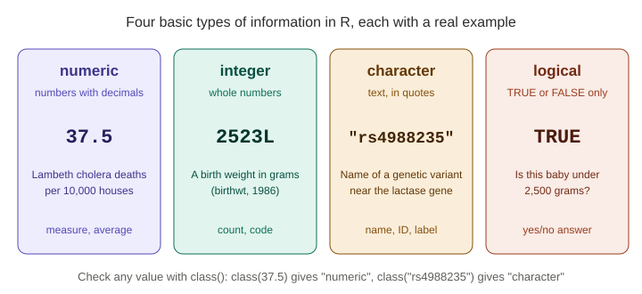

Lesson 6: Data Types
================
Dr. Sandeep Kumar Singh

> **The real question for today:** A hospital sends us a spreadsheet of
> birth weights. Before calculating anything, we must know: did the
> weights arrive as **numbers**, or as **text that looks like numbers**?
> If R thinks “2523” is text, it cannot calculate an average. Today we
> learn how R classifies information, and how to check it.

------------------------------------------------------------------------

## 1. Why this lesson matters

Every value in R has a **type**. The type decides what we are allowed to
do with it. We can average numbers but not names; we can count
TRUE/FALSE answers but not add up gene IDs. A large share of real-world
data problems, from “the mean is NA” to “the numbers will not sort
properly”, turn out to be type problems. Checking types is the first
thing an experienced analyst does with new data.

------------------------------------------------------------------------

## 2. The ideas, in plain words

### 2.1 Four basic types

R has four types we use every day. Think of them as four kinds of answer
on a hospital form: a measurement, a count, a written note and a tick
box.

<figure>

<figcaption aria-hidden="true">The four basic data types</figcaption>
</figure>

*Figure 6.1. The four everyday data types, each with a real example from
this course.*

| Type | Holds | Written as | Real example |
|----|----|----|----|
| **numeric** | numbers, possibly with decimals | `37.5` | a death rate per 10,000 houses |
| **integer** | whole numbers only | `2523L` (with an L) | a birth weight in grams |
| **character** | text | `"rs4988235"` (in quotes) | the name of a genetic variant |
| **logical** | only `TRUE` or `FALSE` | `TRUE`, `FALSE` | “is this baby under 2,500 g?” |

Two small notes. Numeric values are sometimes called **double** (short
for “double-precision number”, the way computers store decimals); for
us, numeric and double mean the same thing. And the `L` after an integer
is just R’s way of saying “store this as a whole number”.

### 2.2 A column is a collection of one type

So far, each object held a single value. A column of a dataset holds
**many values of the same type**: 189 birth weights, all integers. R
calls such a collection a **vector**. We study vectors fully in Lesson
7; today we only need to know that every value in one vector has the
same type.

### 2.3 Taking one column out: `$`

To get one column out of a dataset, we write the dataset’s name, a
dollar sign, and the column’s name:

``` r
birthwt$bwt
```

Read `$` as **“take the column called…”**. So `birthwt$bwt` means “from
`birthwt`, take the column called `bwt`”. We learn everything else about
datasets (data frames) in Lesson 14; `$` is all we need until then.

------------------------------------------------------------------------

## 3. Code, step by step

### 3.1 Checking the type of single values

``` r
class(37.5)
```

    ## [1] "numeric"

``` r
class(2523L)
```

    ## [1] "integer"

``` r
class("rs4988235")
```

    ## [1] "character"

``` r
class(TRUE)
```

    ## [1] "logical"

**What it does:** `class()` tells us the type of whatever we give it.

**Why:** this is our “type detector”. Whenever something behaves
strangely, `class()` is the first function to run.

**How to read the output:** each answer is the type name in quotes,
exactly matching the table in section 2.1. (`rs4988235` is a real
variant near the lactase gene, *LCT*, linked to whether adults can
digest milk. Its name is text, so it is character.)

### 3.2 Numbers without the L are numeric

``` r
class(2523)
```

    ## [1] "numeric"

**What it shows:** when we type a whole number ourselves, R stores it as
numeric unless we add `L`. In practice this almost never matters:
numeric and integer values both work in all calculations. But we will
see `integer` often, because many datasets store whole-number columns
that way.

### 3.3 The type of a real column

``` r
library(MASS)
head(birthwt$bwt)
```

    ## [1] 2523 2551 2557 2594 2600 2622

``` r
class(birthwt$bwt)
```

    ## [1] "integer"

**What it does:** loads `MASS` (Lesson 5), shows the first six birth
weights, and asks for the type of the whole `bwt` column.

**How to read the output:** the weights are stored as **integer**: whole
grams, which makes sense for a weighing scale that reads to the nearest
gram.

``` r
class(birthwt$lwt)
```

    ## [1] "integer"

``` r
class(birthwt$smoke)
```

    ## [1] "integer"

**What it shows:** the mother’s weight (`lwt`, in pounds) and smoking
status (`smoke`) are also integers. But wait: smoking is a yes/no
question, yet it is stored as `0` and `1`. This is very common in real
research data. R does not know that `1` means “smoked”; only the help
page (`?birthwt`) tells us. In Lesson 11 we will turn such codes into
clear labels.

### 3.4 Creating logical values with a comparison

A **comparison** asks a yes/no question and always answers with a
logical value.

| Symbol | Means                       |
|--------|-----------------------------|
| `<`    | less than                   |
| `>`    | greater than                |
| `<=`   | less than or equal to       |
| `>=`   | greater than or equal to    |
| `==`   | equal to (two equals signs) |
| `!=`   | not equal to                |

``` r
2523 < 2500
```

    ## [1] FALSE

``` r
709 < 2500
```

    ## [1] TRUE

``` r
class(709 < 2500)
```

    ## [1] "logical"

**What it does:** asks whether each weight is below the 2,500 g cut-off
for low birth weight.

**How to read the output:** the first baby (2,523 g) is not low birth
weight (`FALSE`); a baby of 709 g is (`TRUE`). The answer itself is of
type logical. In Lesson 8 we will ask this question of all 189 babies at
once.

> **Watch out:** “equal to” is `==` (two signs). A single `=` is used
> for arguments inside functions, as in `round(x, digits = 1)`.

### 3.5 Testing for a type: the `is.` functions

``` r
is.numeric(birthwt$bwt)
```

    ## [1] TRUE

``` r
is.character(birthwt$bwt)
```

    ## [1] FALSE

``` r
is.character("rs4988235")
```

    ## [1] TRUE

**What they do:** each `is.` function answers a yes/no question about
type, so it returns `TRUE` or `FALSE`.

**Why:** `class()` is for us to read; `is.` functions are for code that
must make decisions, which we will write in Lesson 19. Note that
`is.numeric()` is `TRUE` for integers too, because integers are numbers.

### 3.6 Changing a type: the `as.` functions (coercion)

Changing a value from one type to another is called **coercion**.

``` r
as.numeric("2523")
```

    ## [1] 2523

``` r
as.character(2523)
```

    ## [1] "2523"

``` r
as.integer(2.9)
```

    ## [1] 2

**What they do:** `as.numeric()` turns the text `"2523"` into the number
2523. `as.character()` does the reverse. `as.integer()` turns a decimal
into a whole number.

**How to read the output:** notice the quotes in `"2523"` from
`as.character()`: that tells us it is now text. And notice that
`as.integer(2.9)` gives **2**, not 3. It **cuts off** the decimals; it
does not round. To round properly, use `round()` from Lesson 4.

### 3.7 When text cannot become a number

This is the type problem that real data causes most often. Imagine a
weight was typed into a spreadsheet with a comma, or a missing weight
was written as the word “unknown”:

``` r
as.numeric("2,523")
```

    ## Warning: NAs introduced by coercion

    ## [1] NA

``` r
as.numeric("unknown")
```

    ## Warning: NAs introduced by coercion

    ## [1] NA

**What happens:** R cannot read either as a number, so it gives `NA` and
a **warning**.

**How to read the output:** `NA` means “not available”, R’s symbol for a
missing value (the whole of Lesson 9 is about it). The warning “NAs
introduced by coercion” is R telling us: “some values could not be
converted, and I replaced them with NA”. **Never ignore this warning.**
It usually means our data contain typing errors or text codes that we
must clean.

### 3.8 TRUE and FALSE are secretly 1 and 0

``` r
as.numeric(TRUE)
```

    ## [1] 1

``` r
as.numeric(FALSE)
```

    ## [1] 0

``` r
TRUE + TRUE + FALSE
```

    ## [1] 2

**What it shows:** when R needs a number, it treats `TRUE` as 1 and
`FALSE` as 0. So adding up TRUE/FALSE answers **counts the TRUEs**.

**Why it matters:** this small fact is one of the most useful tricks in
R. In Lesson 8 we use it to count how many of the 189 babies had low
birth weight, in one short line.

------------------------------------------------------------------------

## 4. Common errors

### Doing arithmetic on text

``` r
"2523" + 1
```

    ## Error in `"2523" + 1`:
    ## ! non-numeric argument to binary operator

“Non-numeric argument” means one of the values is not a number. Here,
the quotes make `"2523"` text. In real work this happens when a number
column was imported as character; fix it with `as.numeric()` and check
for the warning.

### Forgetting the quotes around text

``` r
class(rs4988235)
```

    ## Error:
    ## ! object 'rs4988235' not found

Without quotes, R thinks `rs4988235` is the name of an object and looks
for it. Text values always need quotes.

### Writing `true` instead of `TRUE`

``` r
class(true)
```

    ## Error:
    ## ! object 'true' not found

Logical values must be written in capitals: `TRUE` and `FALSE`.

------------------------------------------------------------------------

## 5. Practice

1.  What type is the `age` column of `birthwt`? What type is
    `"Lambeth"`?
2.  Is a baby weighing 2,500 g exactly “low birth weight” under the rule
    “less than 2,500 g”? Answer with one comparison.
3.  A laboratory file stores a glucose value as the text `"5.6"`. Turn
    it into a number and add 1.
4.  What does `as.numeric("<0.01")` give, and why? (Laboratory results
    below a detection limit are often written like this.)

<details>

<summary>

Show answers
</summary>

``` r
class(birthwt$age)
```

    ## [1] "integer"

``` r
class("Lambeth")
```

    ## [1] "character"

``` r
2500 < 2500
```

    ## [1] FALSE

``` r
as.numeric("5.6") + 1
```

    ## [1] 6.6

``` r
as.numeric("<0.01")
```

    ## Warning: NAs introduced by coercion

    ## [1] NA

Question 2: `FALSE`. With the rule “less than 2,500 g”, a baby of
exactly 2,500 g is not low birth weight; `2500 <= 2500` would be `TRUE`.
Question 4: `NA` with a warning, because `<` is not part of a number.
Such values need a decision (for example, record them as 0.01 or as
missing) before analysis.

</details>

------------------------------------------------------------------------

## 6. Recap

R stores every value as a type: **numeric**, **integer**, **character**
or **logical**. `class()` tells us the type, `is.` functions test it and
`as.` functions change it. Comparisons such as `<` and `==` create
logical values. Text that cannot become a number turns into `NA` with a
warning that we must never ignore. Finally, `TRUE` counts as 1 and
`FALSE` as 0, which lets us count.

## 7. What comes next

We have met columns as collections of values. In **Lesson 7** we build
our own collections, called **vectors**, and discover R’s most powerful
habit: doing a calculation on every value at once. We will calculate all
three of Snow’s death rates in one line, and convert 189 birth weights
to kilograms in another.
