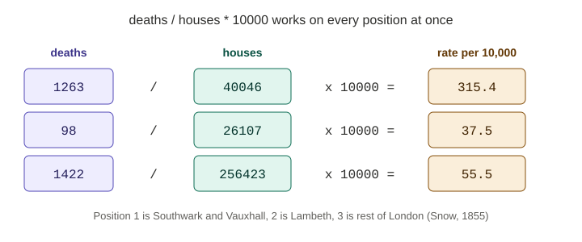

Lesson 7: Creating Vectors and Vectorised Maths
================
Dr. Sandeep Kumar Singh

> **The real question for today:** In Lesson 3 we calculated Snow’s
> death rates one company at a time, with one object per number. What if
> there were 30 water companies, or 189 babies? We need a way to hold
> many values in one object and calculate on all of them at once.

------------------------------------------------------------------------

## 1. Why this lesson matters

The **vector** is the foundation of R. Every column of every dataset is
a vector. Most R functions take vectors in and give vectors out. Once we
are comfortable creating vectors and calculating with them, the rest of
R becomes much simpler, because the same ideas repeat everywhere.

------------------------------------------------------------------------

## 2. The ideas, in plain words

### 2.1 What is a vector?

A **vector** is an ordered row of values, all of the same type (Lesson
6). Think of a rack of test tubes in a lab: each tube holds one sample,
the tubes stand in a fixed order, and we can refer to “tube 1”, “tube 2”
and so on. That position number is how R keeps track of each value.

A single number such as `1263` is simply a vector of length one. That is
why R printed `[1]` in front of every answer: “position 1”.

### 2.2 Vectorised maths

When we do arithmetic with two vectors of the same length, R works
**position by position**: the first value with the first, the second
with the second, and so on. This is called **vectorisation**.

<figure>

<figcaption aria-hidden="true">Vectorised maths with Snow’s
data</figcaption>
</figure>

*Figure 7.1. One line of R calculates all three of Snow’s death rates,
because division and multiplication happen at every position.*

In many other languages we would write a loop to do this. In R we
usually do not need to, which makes code shorter, easier to read, and
faster.

------------------------------------------------------------------------

## 3. Code, step by step

### 3.1 Creating a vector with `c()`

``` r
deaths <- c(1263, 98, 1422)
houses <- c(40046, 26107, 256423)
deaths
```

    ## [1] 1263   98 1422

``` r
houses
```

    ## [1]  40046  26107 256423

**What it does:** `c()` stands for **combine**. It joins values into one
vector. We store Snow’s three death counts in `deaths` and the three
house counts in `houses`, in the same order: Southwark and Vauxhall,
Lambeth, rest of London.

**Why:** three objects from Lesson 3 become one. The **order** is now
important: position 1 in `deaths` must belong to the same company as
position 1 in `houses`.

### 3.2 How many values? `length()`

``` r
length(deaths)
```

    ## [1] 3

**What it does:** counts the values in a vector.

### 3.3 Calculating on every value at once

``` r
rates <- deaths / houses * 10000
rates
```

    ## [1] 315.38730  37.53783  55.45524

``` r
round(rates, digits = 1)
```

    ## [1] 315.4  37.5  55.5

**What it does:** divides each death count by the matching house count
and multiplies by 10,000, exactly as in Figure 7.1.

**How to read the output:** three rates in one answer: 315.4, 37.5 and
55.5, the same numbers we calculated one at a time in Lesson 2.
`round()` also works on the whole vector at once.

### 3.4 Giving positions names

``` r
names(rates) <- c("Southwark_Vauxhall", "Lambeth", "Rest_of_London")
round(rates, digits = 1)
```

    ## Southwark_Vauxhall            Lambeth     Rest_of_London 
    ##              315.4               37.5               55.5

**What it does:** `names()` attaches a label to each position. We give
it a character vector of three names, one for each rate.

**Why:** a number without a label is easy to misread. Now the output
tells us which rate belongs to which company. (We use underscores
instead of spaces to keep names easy to type.)

### 3.5 Working with a real 189-value vector

``` r
library(MASS)
```

    ## 
    ## Attaching package: 'MASS'

    ## The following object is masked _by_ '.GlobalEnv':
    ## 
    ##     deaths

``` r
bw <- birthwt$bwt
length(bw)
```

    ## [1] 189

``` r
head(bw)
```

    ## [1] 2523 2551 2557 2594 2600 2622

**What it does:** stores the birth-weight column as a vector called `bw`
(a short name, because we will type it often), then counts and previews
it.

**How to read the output:** 189 values, in grams.

**About the message “The following object is masked”:** `MASS` happens
to contain its own dataset called `deaths` (monthly UK deaths from lung
diseases, 1974–1979). Our Snow vector, also called `deaths`, was created
first, so R tells us that when we type `deaths` it will use **ours**,
which is “masking” (hiding) the one in the package. Nothing is wrong. It
is simply R being open about a name clash. Messages like this are
information, not errors, and it is good to read them rather than skip
past them.

### 3.6 Converting units for every baby

``` r
bw_kg <- bw / 1000
head(bw_kg)
```

    ## [1] 2.523 2.551 2.557 2.594 2.600 2.622

**What it does:** divides every birth weight by 1,000, turning grams
into kilograms.

**Why:** one short line converted 189 values. This is vectorisation at
work on real data.

The mothers’ weights (`lwt`) were recorded in **pounds**. One pound is
0.45359237 kg:

``` r
mother_kg <- birthwt$lwt * 0.45359237
head(round(mother_kg, digits = 1))
```

    ## [1] 82.6 70.3 47.6 49.0 48.5 56.2

**What it does:** converts all 189 mothers’ weights to kilograms, then
shows the first six, rounded. Notice we can put one function inside
another, as in Lesson 4: `round()` works first, then `head()`.

### 3.7 A single number with a vector: recycling

In `bw / 1000`, the vector `bw` has 189 values but `1000` has only one.
R handles this by **recycling**: it re-uses the single value at every
position. That is exactly what we want for unit conversions and
thresholds.

If the two lengths do not fit together, R warns us:

``` r
c(1263, 98, 1422) / c(40046, 26107)
```

    ## Warning in c(1263, 98, 1422)/c(40046, 26107): longer object length is not a
    ## multiple of shorter object length

    ## [1] 0.031538730 0.003753783 0.035509164

**How to read the output:** R re-used 40046 for the third position,
which is meaningless, and warned that the lengths did not match. If you
see this warning, check that your vectors line up.

### 3.8 Sequences: `:` and `seq()`

``` r
1:10
```

    ##  [1]  1  2  3  4  5  6  7  8  9 10

``` r
seq(from = 15, to = 45, by = 5)
```

    ## [1] 15 20 25 30 35 40 45

**What they do:** `1:10` makes the whole numbers 1 to 10. `seq()` makes
any regular sequence: here, age-group boundaries from 15 to 45 in steps
of 5, the kind of bands used for mothers’ ages in maternal health
reports.

``` r
seq(from = 0, to = 5000, length.out = 6)
```

    ## [1]    0 1000 2000 3000 4000 5000

**What it does:** `length.out` asks for a fixed number of values, evenly
spaced. Here, six cut-points across the range of birth weights.

### 3.9 Repeating values: `rep()`

``` r
rep("Lambeth", times = 3)
```

    ## [1] "Lambeth" "Lambeth" "Lambeth"

``` r
rep(c("case", "control"), times = 3)
```

    ## [1] "case"    "control" "case"    "control" "case"    "control"

``` r
rep(c("case", "control"), each = 3)
```

    ## [1] "case"    "case"    "case"    "control" "control" "control"

**What they do:** `rep()` repeats a value or a vector. `times` repeats
the whole thing; `each` repeats every value before moving to the next.

**Why:** `rep()` is handy for building labels, such as group names for a
study table.

### 3.10 Combining vectors

``` r
first_two <- c(1263, 98)
all_three <- c(first_two, 1422)
all_three
```

    ## [1] 1263   98 1422

**What it does:** `c()` can join vectors as well as single values.

### 3.11 Mixing types: R picks one

``` r
c(1263, "Lambeth", TRUE)
```

    ## [1] "1263"    "Lambeth" "TRUE"

**What happens:** because a vector holds only one type (section 2.1), R
converts everything to the most flexible type that can hold all the
values, here character. The numbers are now text, shown in quotes, and
we can no longer calculate with them. This is the coercion from Lesson
6, happening automatically.

------------------------------------------------------------------------

## 4. Common errors

### Forgetting `c()`

``` r
deaths <- 1263, 98, 1422
```

    ## Error in parse(text = input): <text>:1:15: unexpected ','
    ## 1: deaths <- 1263,
    ##                   ^

Without `c()`, R does not know the values belong together. Always wrap
several values in `c( )`.

### Vectors in a different order

If we had typed `houses <- c(26107, 40046, 256423)` (Lambeth first), R
would still divide position by position and give **wrong rates without
any warning**. R cannot know what our positions mean. Keep related
vectors in the same order, and add names to check.

### Lengths that do not match

As in section 3.7: a warning about “longer object length is not a
multiple of shorter object length” means two vectors do not line up.

------------------------------------------------------------------------

## 5. Practice

1.  Snow’s rates per **1,000** houses: calculate them for all three
    groups in one line.
2.  Convert all 189 birth weights to **pounds** (divide grams by
    453.59237) and show the first six, rounded to 1 decimal.
3.  Create the vector of 10-year age-band boundaries starting at 20 and
    ending at 70.
4.  Create the labels `"SNP1"`, `"SNP1"`, `"SNP2"`, `"SNP2"` with
    `rep()`.

<details>

<summary>

Show answers
</summary>

``` r
deaths / houses * 1000
```

    ## [1] 31.538730  3.753783  5.545524

``` r
head(round(bw / 453.59237, digits = 1))
```

    ## [1] 5.6 5.6 5.6 5.7 5.7 5.8

``` r
seq(from = 20, to = 70, by = 10)
```

    ## [1] 20 30 40 50 60 70

``` r
rep(c("SNP1", "SNP2"), each = 2)
```

    ## [1] "SNP1" "SNP1" "SNP2" "SNP2"

</details>

------------------------------------------------------------------------

## 6. Recap

A vector is an ordered row of values of one type. We create vectors with
`c()`, sequences with `:` and `seq()`, and repeats with `rep()`;
`length()` counts the values and `names()` labels them. Arithmetic on
vectors happens position by position, and a single value is recycled
across a whole vector, so one line can convert 189 weights or calculate
three death rates. Order matters, and mixed types become one type.

## 7. What comes next

We can now hold all 189 birth weights in one vector. In **Lesson 8** we
learn to pick out the values we want: a single baby, the first ten, or
only the babies who weighed less than 2,500 g. Then we answer our first
real public-health question: how common was low birth weight in this
hospital?
