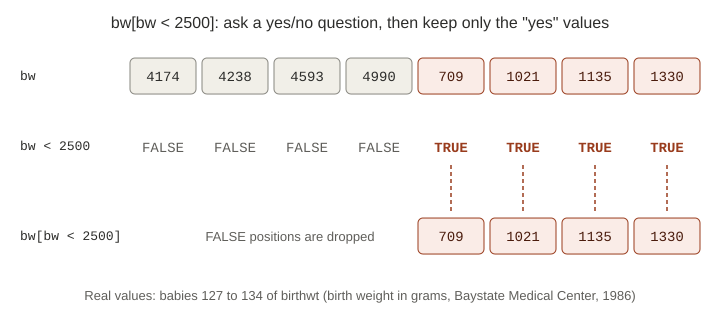

Lesson 8: Indexing and Logical Filtering
================
Dr. Sandeep Kumar Singh

<script type="text/javascript" async
    src="https://cdnjs.cloudflare.com/ajax/libs/mathjax/3.2.0/es5/tex-mml-chtml.js">
</script>

> **The real question for today:** Among the 189 babies born at Baystate
> Medical Center in 1986, how many had low birth weight (under 2,500 g)?
> And was low birth weight more common among babies of mothers who
> smoked during pregnancy?

------------------------------------------------------------------------

## 1. Why this lesson matters

Analysis is mostly about **choosing**: this patient, these variants,
only the women over 35, only the significant results. In R, choosing
values from a vector is called **indexing** (or **subsetting**). Today
we learn the two ways to do it: by **position** (“give me baby number
5”) and by **condition** (“give me every baby under 2,500 g”). The
second one is what turns R from a calculator into an analysis tool.

------------------------------------------------------------------------

## 2. The ideas, in plain words

### 2.1 Square brackets pick values

After a vector’s name, square brackets `[ ]` mean **“pick from this
vector”**. What goes inside the brackets says *which* values to pick.
Think of a pharmacist’s shelf with numbered drawers: we can ask for
“drawer 3”, “drawers 1 to 5”, or “every drawer containing antibiotics”.

| Inside the brackets | Meaning                       | Example            |
|---------------------|-------------------------------|--------------------|
| a position          | that one value                | `bw[1]`            |
| several positions   | those values, in that order   | `bw[c(1, 5)]`      |
| a minus sign        | everything **except** those   | `bw[-1]`           |
| a name              | the value with that label     | `rates["Lambeth"]` |
| a TRUE/FALSE vector | only the values marked `TRUE` | `bw[bw < 2500]`    |

### 2.2 Counting starts at 1

In R, the first value is at position **1**, not 0. (If you know Python,
this is different and worth remembering.)

### 2.3 Filtering with a question

The most powerful form is the last row of the table. We first ask a
yes/no question of every value, which gives a vector of `TRUE` and
`FALSE` (Lesson 6). Then we use that vector inside the brackets, and R
keeps only the `TRUE` positions. It works like a sieve.

<figure>

<figcaption aria-hidden="true">Filtering with a logical
vector</figcaption>
</figure>

*Figure 8.1. `bw < 2500` asks the question of every baby;
`bw[bw < 2500]` keeps only the babies whose answer was TRUE.*

------------------------------------------------------------------------

## 3. Code, step by step

We start with the birth-weight vector from Lesson 7:

``` r
library(MASS)
bw <- birthwt$bwt
```

### 3.1 Picking by position

``` r
bw[1]
```

    ## [1] 2523

``` r
bw[189]
```

    ## [1] 2495

``` r
bw[1:5]
```

    ## [1] 2523 2551 2557 2594 2600

``` r
bw[c(1, 50, 100)]
```

    ## [1] 2523 3090 3699

**What it does:** the first baby, the last baby (there are 189), the
first five, and three chosen babies.

**Why:** looking at specific records is how we check data. If a
colleague says “record 50 looks odd”, `bw[50]` shows it immediately.

### 3.2 Leaving values out with a minus sign

``` r
length(bw[-1])
```

    ## [1] 188

**What it does:** `bw[-1]` means “all babies except the first”. The
length is 188.

### 3.3 Picking by name

``` r
deaths <- c(1263, 98, 1422)
houses <- c(40046, 26107, 256423)
rates <- deaths / houses * 10000
names(rates) <- c("Southwark_Vauxhall", "Lambeth", "Rest_of_London")
rates["Lambeth"]
```

    ##  Lambeth 
    ## 37.53783

**What it does:** with named vectors (Lesson 7), we can pick by label.
The name must be in quotes, because it is text.

**Why:** names are safer than positions. If the order changes,
`"Lambeth"` still finds the right value.

### 3.4 Asking a question of every baby

``` r
low <- bw < 2500
head(low)
```

    ## [1] FALSE FALSE FALSE FALSE FALSE FALSE

``` r
low[127:134]
```

    ## [1] FALSE FALSE FALSE FALSE  TRUE  TRUE  TRUE  TRUE

**What it does:** compares all 189 weights with 2,500 g at once
(vectorisation, Lesson 7), and stores the 189 answers in `low`.

**How to read the output:** the first six babies were not low birth
weight (`FALSE`). Babies 127 to 134 show both answers, exactly as in
Figure 8.1.

### 3.5 Counting with `sum()`

``` r
sum(low)
```

    ## [1] 59

**What it does:** adds up the TRUE/FALSE vector. Because `TRUE` counts
as 1 and `FALSE` as 0 (Lesson 6), the sum is **the number of TRUEs**.

**How to read the output:** **59** babies had low birth weight.

### 3.6 The proportion with `mean()`

`mean()` calculates the **average**: add up the values and divide by how
many there are. On a TRUE/FALSE vector, that gives the **proportion** of
TRUEs, which epidemiologists call the **prevalence** when it describes
how common a condition is in a group.

$$\text{Prevalence} = \frac{\text{number with the condition}}{\text{total number of people}}$$

Let us calculate it by hand first, with the numbers we already have:

$$\text{Prevalence of low birth weight} = \frac{59}{189} = 0.3122 \approx 31.2\%$$

Now in R:

``` r
mean(low)
```

    ## [1] 0.3121693

``` r
round(mean(low) * 100, digits = 1)
```

    ## [1] 31.2

**How to read the output:** 0.312, or **31.2%**, exactly our hand
calculation. Nearly one baby in three in this hospital study weighed
less than 2,500 g. (This was a study sample chosen to investigate low
birth weight, so it is higher than the rate in a general population.)

### 3.7 Keeping only the values we want

``` r
bw_low <- bw[bw < 2500]
length(bw_low)
```

    ## [1] 59

``` r
head(bw_low)
```

    ## [1]  709 1021 1135 1330 1474 1588

**What it does:** uses the question inside the brackets, so only the 59
low-birth-weight babies are kept (Figure 8.1).

**How to read the output:** a new vector of 59 weights, all below 2,500
g.

### 3.8 Combining conditions: `&`, `|` and `!`

| Symbol | Meaning | TRUE when…                   |
|--------|---------|------------------------------|
| `&`    | AND     | **both** conditions are TRUE |
| `\|`   | OR      | **at least one** is TRUE     |
| `!`    | NOT     | reverses TRUE and FALSE      |

``` r
sum(bw >= 2500 & bw < 3000)
```

    ## [1] 38

``` r
sum(bw < 1500)
```

    ## [1] 5

``` r
sum(!low)
```

    ## [1] 130

**What it does:** the first line counts babies **between** 2,500 g and
2,999 g (both conditions must be true). The second counts babies under
1,500 g, which doctors call **very low birth weight**. The third counts
babies who were **not** low birth weight.

**How to read the output:** 38 babies in the 2,500–2,999 g band, 5
very-low-birth-weight babies, and 130 babies who were not low birth
weight (130 + 59 = 189, a good check).

### 3.9 Which positions? `which()`

``` r
which(bw < 1000)
```

    ## [1] 131

``` r
bw[which(bw < 1000)]
```

    ## [1] 709

**What it does:** `which()` returns the **positions** of the TRUE
values, rather than the values themselves.

**How to read the output:** only baby **131** weighed under 1,000 g, at
709 g. Positions are useful when we need to look up the rest of that
baby’s record later.

### 3.10 Is a value in a list? `%in%`

In `birthwt`, the mother’s race is coded 1 = white, 2 = black, 3 = other
(from `?birthwt`).

``` r
race <- birthwt$race
sum(race %in% c(2, 3))
```

    ## [1] 93

**What it does:** `%in%` asks, for each value on the left, “is it one of
these?”. It is much shorter than writing `race == 2 | race == 3`.

**How to read the output:** 93 mothers were coded 2 or 3. In genomics,
the same idea answers questions like “which of my variants are on this
list of known disease variants?”.

### 3.11 Using one vector to filter another

This is where it all comes together. Each position in `bw` and in
`birthwt$smoke` belongs to **the same baby**. So a question asked of
smoking can choose values from birth weight.

``` r
smoke <- birthwt$smoke
mean(bw[smoke == 1] < 2500)
```

    ## [1] 0.4054054

``` r
mean(bw[smoke == 0] < 2500)
```

    ## [1] 0.2521739

**What it does:** `bw[smoke == 1]` keeps the birth weights of babies
whose mothers smoked (coded 1). We then ask what proportion of those
were under 2,500 g. The second line does the same for non-smokers.

**How to read the output:** about **40.5%** of babies of smoking mothers
had low birth weight, compared with about **25.2%** of babies of
non-smoking mothers. With two lines of R, we have found a pattern that
public-health researchers have studied for decades. (Showing that
smoking *causes* the difference needs statistical methods beyond this
course; here we are describing what the data show.)

------------------------------------------------------------------------

## 4. Common errors

### Using `=` instead of `==`

``` r
bw[smoke = 1]
```

    ## [1] 2523

Inside brackets, a question needs `==`. A single `=` is not a
comparison, so R does not do what we meant. Here it simply returns the
first birth weight and gives no error, which makes this mistake easy to
miss. Always use `==` for “is equal to”.

### Asking for a position that does not exist

``` r
bw[200]
```

    ## [1] NA

There are only 189 babies, so position 200 is empty. R does not stop
with an error: it quietly returns `NA` (missing). If unexpected `NA`
values appear, check your positions.

### Forgetting the brackets are for picking

`bw(1)` (round brackets) is an error: round brackets call **functions**,
square brackets **pick values**.

------------------------------------------------------------------------

## 5. Practice

1.  Show the birth weights of babies 10 to 15.
2.  How many babies weighed **4,000 g or more** (often called
    macrosomia)?
3.  What proportion of mothers were **under 20 years old**? (Use
    `birthwt$age`.)
4.  How many babies had low birth weight **and** a mother who smoked?
5.  How many mothers had a history of hypertension (`ht == 1`) **or**
    uterine irritability (`ui == 1`)?

<details>

<summary>

Show answers
</summary>

``` r
bw[10:15]
```

    ## [1] 2665 2722 2733 2751 2750 2769

``` r
sum(bw >= 4000)
```

    ## [1] 9

``` r
round(mean(birthwt$age < 20) * 100, digits = 1)
```

    ## [1] 27

``` r
sum(bw < 2500 & smoke == 1)
```

    ## [1] 30

``` r
sum(birthwt$ht == 1 | birthwt$ui == 1)
```

    ## [1] 40

Question 3: about 27% of mothers were under 20. Question 4: 30 babies.
Question 5: 40 mothers.

</details>

------------------------------------------------------------------------

## 6. Recap

Square brackets pick values: by position (`bw[1]`), by exclusion
(`bw[-1]`), by name (`rates["Lambeth"]`) or by condition
(`bw[bw < 2500]`). Comparisons give TRUE/FALSE vectors; `sum()` counts
the TRUEs and `mean()` gives their proportion. `&`, `|` and `!` combine
conditions, `which()` gives positions, and `%in%` checks membership.
Using one vector to filter another, we found that 31.2% of babies had
low birth weight, and that it was more common among babies of mothers
who smoked.

## 7. What comes next

Every birth weight in `birthwt` is present. Real data are rarely so
kind. In **Lesson 9** we work with a real diabetes dataset in which
blood-pressure and skin-fold measurements are missing for some women,
and learn how R represents, counts and handles missing values.
