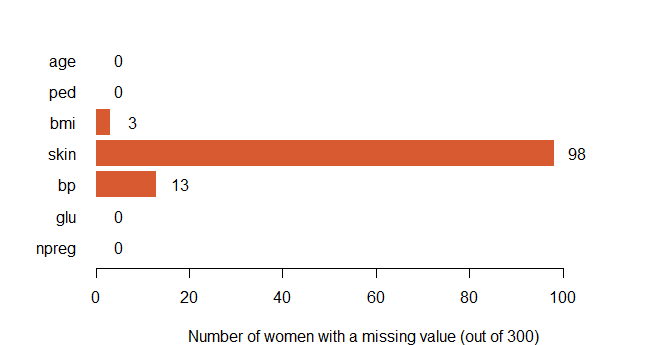

Lesson 9: Missing Values
================
Dr. Sandeep Kumar Singh

<script type="text/javascript" async
    src="https://cdnjs.cloudflare.com/ajax/libs/mathjax/3.2.0/es5/tex-mml-chtml.js">
</script>

> **The real question for today:** In a diabetes study of 300 women,
> some blood-pressure and skin-fold measurements were never recorded.
> What is the average blood pressure? How many values are missing? And
> what happens to our calculations if we forget about the gaps?

------------------------------------------------------------------------

## 1. Why this lesson matters

Missing data are everywhere in health research. Participants skip a
clinic visit, a blood sample is lost, a machine breaks, a question is
left blank. R does not hide missing values or quietly fill them in: it
marks them, and it makes us decide what to do. That can feel annoying at
first, but it protects us from reporting numbers that silently ignore
part of our sample.

------------------------------------------------------------------------

## 2. The data: diabetes in Pima Indian women

The `MASS` package contains data from a study by the US National
Institute of Diabetes and Digestive and Kidney Diseases. Women aged 21
or older, of Pima Indian heritage and living near Phoenix, Arizona, were
tested for diabetes using World Health Organization criteria. The
version called `Pima.tr2` has 300 women, and some measurements are
missing. Read `?Pima.tr2` for the full description. The columns we use
today:

| Column | Meaning                                                 |
|--------|---------------------------------------------------------|
| `bp`   | diastolic blood pressure (mm Hg)                        |
| `skin` | triceps skin-fold thickness (mm), a measure of body fat |
| `bmi`  | body mass index (kg/m²)                                 |
| `glu`  | plasma glucose in a glucose tolerance test              |

------------------------------------------------------------------------

## 3. The ideas, in plain words

### 3.1 `NA` means “not available”

R writes a missing value as **`NA`** (no quotes). Picture a paper form
with an empty box: we know a value *should* be there, but we do not know
what it is. `NA` is R’s empty box.

`NA` is not zero, and it is not the text `"NA"`. A blood pressure of 0
would mean something very serious; an empty box just means “unknown”.

### 3.2 Unknown in, unknown out

The most important rule of this lesson: **any calculation involving an
unknown value gives an unknown answer.** If we do not know one woman’s
blood pressure, we cannot know the total of all women’s blood pressures.
So R answers `NA`. This is called **propagation**: the `NA` spreads to
the result.

### 3.3 We must choose what to do

R will not guess for us. We have to say, for example, “calculate the
average using only the women who were measured”. We do this with an
argument called `na.rm`, short for **“NA remove”**. And whenever we
remove missing values, good practice is to **report how many** we
removed.

------------------------------------------------------------------------

## 4. Code, step by step

### 4.1 Loading the data and taking two columns

``` r
library(MASS)
bp <- Pima.tr2$bp
skin <- Pima.tr2$skin
length(bp)
```

    ## [1] 300

``` r
head(bp, n = 20)
```

    ##  [1] 68 70 82 76 60 76 58 50 80 78 40 78 60 62 66 76 60 94 68 62

**What it does:** stores the blood-pressure and skin-fold columns as
vectors and shows the first 20 blood pressures. `head()` has an argument
`n` for how many values to show.

**How to read the output:** 300 women. Look carefully: some positions
show `NA`. Those women’s blood pressure was not recorded.

### 4.2 Unknown in, unknown out

``` r
NA + 10
```

    ## [1] NA

``` r
NA > 80
```

    ## [1] NA

``` r
mean(bp)
```

    ## [1] NA

**What it shows:** adding to an unknown is unknown; asking whether an
unknown is above 80 is unknown; and the average of a vector containing
`NA` is `NA`.

**Why:** this is R protecting us. If it had silently ignored the gaps,
we might never notice that some women were missing.

### 4.3 Finding missing values: `is.na()`

``` r
head(is.na(bp), n = 20)
```

    ##  [1] FALSE FALSE FALSE FALSE FALSE FALSE FALSE FALSE FALSE FALSE FALSE FALSE
    ## [13] FALSE FALSE FALSE FALSE FALSE FALSE FALSE FALSE

**What it does:** `is.na()` asks of every value: “is this missing?” It
returns a TRUE/FALSE vector (Lesson 6), with `TRUE` wherever a value is
missing.

### 4.4 Counting and measuring the gaps

``` r
sum(is.na(bp))
```

    ## [1] 13

``` r
mean(is.na(bp))
```

    ## [1] 0.04333333

``` r
sum(is.na(skin))
```

    ## [1] 98

``` r
round(mean(is.na(skin)) * 100, digits = 1)
```

    ## [1] 32.7

**What it does:** the counting trick from Lesson 8. `sum()` counts the
missing values; `mean()` gives the proportion missing.

**How to read the output:** blood pressure is missing for **13** women
(about 4.3%). Skin-fold thickness is missing for **98** women, almost a
third (32.7%). That difference matters: an average based on two thirds
of the women may not represent everyone.

<!-- -->

*Figure 9.1. Missing values in each measurement of `Pima.tr2`. Three
measurements have gaps; skin-fold thickness has by far the most. (We
learn how to make plots like this in Lessons 16 and 33.)*

### 4.5 Calculating without the missing values: `na.rm = TRUE`

``` r
mean(bp, na.rm = TRUE)
```

    ## [1] 72.32056

``` r
round(mean(bp, na.rm = TRUE), digits = 1)
```

    ## [1] 72.3

**What it does:** `na.rm = TRUE` tells `mean()` to remove the `NA`
values first, then average the rest.

**How to read the output:** the average diastolic blood pressure among
the **287 women who were measured** (300 − 13) is about 72 mm Hg.

Let us check what R did, by hand, with the pieces we already know:

$$\text{Mean of observed values} = \frac{\text{sum of the observed values}}{\text{number of observed values}}$$

``` r
sum(bp, na.rm = TRUE)
```

    ## [1] 20756

``` r
sum(!is.na(bp))
```

    ## [1] 287

``` r
sum(bp, na.rm = TRUE) / sum(!is.na(bp))
```

    ## [1] 72.32056

The total of the 287 recorded blood pressures, divided by 287, gives
exactly the same answer as `mean(bp, na.rm = TRUE)`. So `na.rm = TRUE`
does not invent any data: it simply leaves the empty boxes out.

**Many functions** have the `na.rm` argument, including `sum()`,
`mean()`, `min()`, `max()` and `median()`, which we meet in Lesson 10.

### 4.6 Keeping only the observed values

``` r
bp_observed <- bp[!is.na(bp)]
length(bp_observed)
```

    ## [1] 287

**What it does:** `!is.na(bp)` means “is **not** missing” (the `!` from
Lesson 8). Using it inside the brackets keeps only the recorded values.

### 4.7 Which women are missing?

``` r
which(is.na(bp))
```

    ##  [1] 204 234 236 253 254 263 271 285 287 288 289 298 299

**What it does:** gives the positions of the missing values.

**Why:** in a real study, we would send this list back to the data
manager: “these records have no blood pressure; can they be found in the
clinic notes?”

### 4.8 Women with all three measurements

``` r
bmi <- Pima.tr2$bmi
complete <- !is.na(bp) & !is.na(skin) & !is.na(bmi)
sum(complete)
```

    ## [1] 200

**What it does:** marks a woman as `TRUE` only if her blood pressure
**and** skin fold **and** BMI are all recorded.

**How to read the output:** only **200** of the 300 women have all
three. If an analysis needs all three measurements, a third of the
sample is lost. This is a key reason to check missing values **before**
starting any analysis.

### 4.9 A quick yes/no check: `anyNA()`

``` r
anyNA(bp)
```

    ## [1] TRUE

``` r
anyNA(Pima.tr2$glu)
```

    ## [1] FALSE

**What it does:** answers one question: “is there at least one missing
value?” Glucose is complete; blood pressure is not.

------------------------------------------------------------------------

## 5. Common errors

### Checking for missing values with `==`

``` r
head(bp == NA)
```

    ## [1] NA NA NA NA NA NA

Every answer is `NA`, never `TRUE`. Why? `bp == NA` asks “is this blood
pressure equal to an unknown value?”, and the honest answer to that is
“unknown”. **Always use `is.na()`** to find missing values.

### Typing `"NA"` in quotes

`"NA"` with quotes is just two letters of text, not a missing value.
`is.na("NA")` is `FALSE`.

### Removing missing values without saying so

`na.rm = TRUE` makes the `NA` go away, but it does not tell anyone how
many women were left out. In reports, always state the number used, for
example: “mean diastolic blood pressure 72 mm Hg (n = 287; 13 missing)”.

### `NaN` is a different thing

``` r
0 / 0
```

    ## [1] NaN

`NaN` means “not a number”: the result of an impossible calculation,
such as zero divided by zero. `is.na()` also counts `NaN` as missing,
but if you see `NaN`, look for a division by zero somewhere.

------------------------------------------------------------------------

## 6. Practice

1.  How many women have a missing BMI?
2.  What is the average BMI of the women whose BMI was recorded, rounded
    to 1 decimal? How many women is it based on?
3.  What percentage of women are missing skin fold **or** blood
    pressure?
4.  What is the highest recorded blood pressure? (Use `max()` with the
    right argument.)

<details>

<summary>

Show answers
</summary>

``` r
sum(is.na(bmi))
```

    ## [1] 3

``` r
round(mean(bmi, na.rm = TRUE), digits = 1)
```

    ## [1] 32.1

``` r
sum(!is.na(bmi))
```

    ## [1] 297

``` r
round(mean(is.na(skin) | is.na(bp)) * 100, digits = 1)
```

    ## [1] 33

``` r
max(bp, na.rm = TRUE)
```

    ## [1] 114

</details>

------------------------------------------------------------------------

## 7. Recap

`NA` is R’s empty box: a value that should exist but is unknown. Any
calculation with `NA` gives `NA`, so R never hides gaps from us.
`is.na()` finds missing values; `sum(is.na(x))` counts them and
`mean(is.na(x))` gives the proportion. `na.rm = TRUE` leaves them out of
a calculation, and we always report how many were left out. Never test
for missing values with `== NA`.

## 8. What comes next

We have already met `mean()`, `sum()` and `max()`. In **Lesson 10** we
complete the toolbox of everyday vector functions: median, spread,
sorting, finding unique values and counting categories, and we work out
a standard deviation by hand so that it is never a mystery again.
