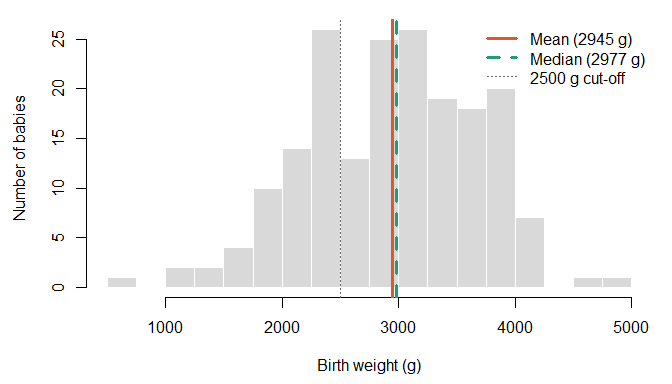

Lesson 10: Everyday Vector Functions
================
Dr. Sandeep Kumar Singh

<script type="text/javascript" async
    src="https://cdnjs.cloudflare.com/ajax/libs/mathjax/3.2.0/es5/tex-mml-chtml.js">
</script>

> **The real question for today:** If we had to describe the 189 babies
> in the Baystate study to a colleague in one sentence, what would we
> say? What was the typical birth weight, how much did weights vary, and
> how many mothers were in each group? These are the numbers that fill
> “Table 1” of almost every health research paper.

------------------------------------------------------------------------

## 1. Why this lesson matters

Before any advanced analysis, researchers **describe** their data: the
centre, the spread, the extremes and the counts in each group. R has a
small set of functions for this that we will use in nearly every lesson
from now on. Learning them now, and understanding what each number
means, is worth the time.

------------------------------------------------------------------------

## 2. The ideas, in plain words

### 2.1 Centre: mean and median

The **mean** is the ordinary average: add everything up, divide by how
many. The **median** is the middle value once everything is lined up
from smallest to largest: half the babies weigh less, half weigh more.

Think of a queue of babies sorted by weight. The median baby is the one
standing exactly in the middle of the queue. The mean is like a
see-saw’s balance point: one very light baby at the end pulls it
noticeably, while the median barely moves. That is why the median is
often preferred when data contain extreme values.

### 2.2 Spread: range, standard deviation and IQR

The **range** is simply the smallest and largest value. The **standard
deviation (SD)** measures how far values typically are from the mean:
small SD means babies were similar in weight, large SD means they varied
a lot. The **interquartile range (IQR)** is the width of the middle half
of the data, from the 25% point to the 75% point.

### 2.3 Counts: how many in each group

For categories, such as smoking status or the race code, we do not
average; we **count** how many values fall into each group.

------------------------------------------------------------------------

## 3. The maths, worked by hand

Software gives answers instantly, but we should understand them. Let us
calculate a mean and a standard deviation by hand using the **first five
real birth weights** in `birthwt`: 2523, 2551, 2557, 2594 and 2600
grams.

### 3.1 The mean

$$\bar{x} = \frac{x_1 + x_2 + \dots + x_n}{n}$$

Here $\bar{x}$ (“x-bar”) is the mean, each $x$ is one value and $n$ is
how many values there are.

$$\bar{x} = \frac{2523 + 2551 + 2557 + 2594 + 2600}{5} = \frac{12825}{5} = 2565 \text{ g}$$

### 3.2 The standard deviation

$$s = \sqrt{\frac{\sum (x_i - \bar{x})^2}{n - 1}}$$

In words: for each value, find how far it is from the mean, square that
distance, add the squares up, divide by $n - 1$, and take the square
root. The symbol $\sum$ just means “add up”.

| Baby | Weight $x_i$ | Distance from mean $x_i - \bar{x}$ | Squared $(x_i - \bar{x})^2$ |
|----|---:|---:|---:|
| 1 | 2523 | 2523 − 2565 = −42 | 1764 |
| 2 | 2551 | 2551 − 2565 = −14 | 196 |
| 3 | 2557 | 2557 − 2565 = −8 | 64 |
| 4 | 2594 | 2594 − 2565 = 29 | 841 |
| 5 | 2600 | 2600 − 2565 = 35 | 1225 |
|  |  | **Sum of squares** | **4090** |

$$s = \sqrt{\frac{4090}{5 - 1}} = \sqrt{1022.5} \approx 31.98 \text{ g}$$

Why square the distances? Because some are negative and some positive;
added up raw, they would cancel out to zero. Squaring makes them all
positive, and the square root at the end brings us back to grams. Why
divide by $n - 1$ rather than $n$? Because we are using a sample to
estimate the spread in a wider population, and dividing by $n - 1$
corrects a small tendency to underestimate it. For now, it is enough to
know that R’s `sd()` uses $n - 1$.

These five babies weighed between 2,523 and 2,600 g, so a typical
distance from their mean of only about 32 g makes sense. We will check
both numbers with R in a moment.

------------------------------------------------------------------------

## 4. Code, step by step

``` r
library(MASS)
bw <- birthwt$bwt
```

### 4.1 Checking our hand calculation

``` r
first5 <- bw[1:5]
first5
```

    ## [1] 2523 2551 2557 2594 2600

``` r
mean(first5)
```

    ## [1] 2565

``` r
sd(first5)
```

    ## [1] 31.97655

**What it does:** picks the first five weights (Lesson 8) and asks R for
their mean and standard deviation.

**How to read the output:** 2565 and 31.98, exactly what we calculated
by hand.

### 4.2 Centre for all 189 babies

``` r
mean(bw)
```

    ## [1] 2944.587

``` r
median(bw)
```

    ## [1] 2977

**What it does:** the mean and median of all 189 birth weights.

**How to read the output:** the mean is about 2,945 g and the median
2,977 g. They are close, but the mean is a little lower, pulled down by
a few very small babies (remember baby 131, at 709 g, from Lesson 8).

<!-- -->

*Figure 10.1. Birth weights of the 189 babies. The few very small babies
on the left pull the mean slightly below the median. (We draw histograms
ourselves in Lesson 16.)*

### 4.3 The extremes: `min()`, `max()` and `range()`

``` r
min(bw)
```

    ## [1] 709

``` r
max(bw)
```

    ## [1] 4990

``` r
range(bw)
```

    ## [1]  709 4990

**What it does:** the lightest and heaviest baby, and both together.

**How to read the output:** from 709 g to 4,990 g. Checking the range is
a quick quality check: a birth weight of 50 g or 50,000 g would tell us
there is a data-entry error.

### 4.4 Spread: `sd()`, `quantile()` and `IQR()`

``` r
sd(bw)
```

    ## [1] 729.2143

``` r
quantile(bw)
```

    ##   0%  25%  50%  75% 100% 
    ##  709 2414 2977 3487 4990

``` r
IQR(bw)
```

    ## [1] 1073

**What it does:** `sd()` is the standard deviation. `quantile()` gives
the values at 0%, 25%, 50%, 75% and 100% of the sorted data. `IQR()` is
the 75% value minus the 25% value.

**How to read the output:** a typical baby was about 729 g away from the
mean. A quarter of babies weighed under 2,414 g, and the middle half
weighed between 2,414 g and 3,487 g, an IQR of 1,073 g. Notice that the
50% value from `quantile()` is the median.

### 4.5 Everything at once: `summary()`

``` r
summary(bw)
```

    ##    Min. 1st Qu.  Median    Mean 3rd Qu.    Max. 
    ##     709    2414    2977    2945    3487    4990

**What it does:** gives the minimum, 25% point (1st Qu.), median, mean,
75% point (3rd Qu.) and maximum in one line.

**Why:** this is usually the first command we run on a new numeric
column. On a column with missing values, it also counts the `NA`s:

``` r
summary(Pima.tr2$bp)
```

    ##    Min. 1st Qu.  Median    Mean 3rd Qu.    Max.    NA's 
    ##   38.00   64.00   72.00   72.32   80.00  114.00      13

### 4.6 Sorting: `sort()` and `rev()`

``` r
head(sort(bw))
```

    ## [1]  709 1021 1135 1330 1474 1588

``` r
head(sort(bw, decreasing = TRUE))
```

    ## [1] 4990 4593 4238 4174 4167 4153

**What it does:** `sort()` arranges values from smallest to largest;
`decreasing = TRUE` reverses the direction.

**How to read the output:** the six lightest and the six heaviest
babies.

### 4.7 The positions in sorted order: `order()`

`sort()` gives the sorted **values**. `order()` gives the **positions**
that would sort them. That lets us sort *other* information in the same
way, because every position belongs to the same baby (Lesson 8).

``` r
lightest <- order(bw)[1:5]
lightest
```

    ## [1] 131 132 133 134 135

``` r
bw[lightest]
```

    ## [1]  709 1021 1135 1330 1474

``` r
birthwt$age[lightest]
```

    ## [1] 28 29 34 25 25

**What it does:** finds the positions of the five lightest babies, then
uses those positions to show their weights and their mothers’ ages.

**Why:** this is how we answer questions like “who were the mothers of
the smallest babies?”, and later, “which genetic variants had the
smallest p-values?”.

The same works for named vectors, such as Snow’s rates:

``` r
deaths <- c(1263, 98, 1422)
houses <- c(40046, 26107, 256423)
rates <- deaths / houses * 10000
names(rates) <- c("Southwark_Vauxhall", "Lambeth", "Rest_of_London")
round(sort(rates, decreasing = TRUE), digits = 1)
```

    ## Southwark_Vauxhall     Rest_of_London            Lambeth 
    ##              315.4               55.5               37.5

### 4.8 Distinct values: `unique()` and `duplicated()`

``` r
unique(birthwt$race)
```

    ## [1] 2 3 1

``` r
length(unique(bw))
```

    ## [1] 131

``` r
sum(duplicated(bw))
```

    ## [1] 58

**What it does:** `unique()` lists each distinct value once.
`duplicated()` marks a value `TRUE` if it has already appeared earlier
in the vector.

**How to read the output:** the race column uses three codes. Among 189
birth weights there are fewer distinct values, because some babies
weighed exactly the same; `sum(duplicated(bw))` counts the repeats. In
real studies, `duplicated()` is our tool for catching the same
participant ID entered twice.

### 4.9 Counting categories: `table()`

``` r
table(birthwt$race)
```

    ## 
    ##  1  2  3 
    ## 96 26 67

``` r
table(birthwt$smoke)
```

    ## 
    ##   0   1 
    ## 115  74

**What it does:** counts how many times each value appears.

**How to read the output:** 96 mothers were coded 1 (white), 26 coded 2
(black) and 67 coded 3 (other); 115 did not smoke (0) and 74 smoked (1).
The codes are not very readable; in Lesson 11 we turn them into proper
labels.

``` r
round(table(birthwt$smoke) / length(birthwt$smoke) * 100, digits = 1)
```

    ## 
    ##    0    1 
    ## 60.8 39.2

**What it does:** divides each count by the total to get percentages.
Vectorised maths works on tables too: 60.8% non-smokers, 39.2% smokers.

------------------------------------------------------------------------

## 5. Common errors

### Forgetting `na.rm = TRUE` on data with gaps

`mean(Pima.tr2$bp)` gives `NA`. As in Lesson 9, add `na.rm = TRUE` and
report how many values were missing.

### Expecting `sort()` to change the original vector

`sort(bw)` *returns* a sorted copy; `bw` itself is unchanged. To keep
the sorted version, store it: `bw_sorted <- sort(bw)`.

### Mixing up `sort()` and `order()`

`sort()` gives values; `order()` gives positions. If the output of
`order()` looks like small whole numbers instead of birth weights, that
is why.

### Averaging a coded category

``` r
mean(birthwt$race)
```

    ## [1] 1.846561

R happily calculates this, but it means nothing: race codes 1, 2 and 3
are labels, not quantities. For categories, use `table()`, not `mean()`.

------------------------------------------------------------------------

## 6. Practice

1.  What are the mean, median and standard deviation of the mothers’
    ages (`birthwt$age`)? Round to 1 decimal.
2.  Use `summary()` on the mothers’ weights in pounds (`birthwt$lwt`).
3.  Who were the three **heaviest** babies’ mothers: how old were they?
4.  How many first-trimester doctor visits (`birthwt$ftv`) did mothers
    have? Count them with `table()`.
5.  Calculate the mean and SD of babies 6 to 10 by hand, then check with
    18. 

<details>

<summary>

Show answers
</summary>

``` r
round(mean(birthwt$age), digits = 1)
```

    ## [1] 23.2

``` r
median(birthwt$age)
```

    ## [1] 23

``` r
round(sd(birthwt$age), digits = 1)
```

    ## [1] 5.3

``` r
summary(birthwt$lwt)
```

    ##    Min. 1st Qu.  Median    Mean 3rd Qu.    Max. 
    ##    80.0   110.0   121.0   129.8   140.0   250.0

``` r
heaviest <- order(bw, decreasing = TRUE)[1:3]
birthwt$age[heaviest]
```

    ## [1] 45 24 19

``` r
table(birthwt$ftv)
```

    ## 
    ##   0   1   2   3   4   6 
    ## 100  47  30   7   4   1

``` r
bw[6:10]
```

    ## [1] 2622 2637 2637 2663 2665

``` r
mean(bw[6:10])
```

    ## [1] 2644.8

``` r
round(sd(bw[6:10]), digits = 2)
```

    ## [1] 18.58

Question 4: most mothers (100) had no visit in the first trimester.

</details>

------------------------------------------------------------------------

## 7. Recap

`mean()` and `median()` describe the centre; the median resists extreme
values. `min()`, `max()`, `range()`, `sd()`, `quantile()` and `IQR()`
describe the extremes and spread, and `summary()` gives most of them at
once. `sort()` returns sorted values, while `order()` returns positions
that can sort other vectors too. `unique()` and `duplicated()` find
distinct and repeated values, and `table()` counts categories. We also
calculated a mean and a standard deviation by hand and saw that R
agrees.

## 8. What comes next

This completes **Module 2: Vectors with real data**. In **Module 3** we
meet R’s other ways of storing data. **Lesson 11** is about **factors**:
how to turn codes such as 0/1 and 1/2/3 into clear labels like
“non-smoker” and “smoker”, and why the order of those labels will matter
for every analysis we do later.
