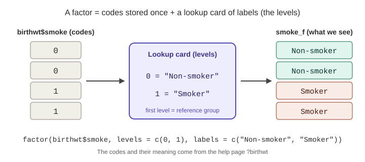

Lesson 11: Factors
================
Dr. Sandeep Kumar Singh

> **The real question for today:** In `birthwt`, smoking is stored as
> `0` and `1`, and race as `1`, `2` and `3`. A table that says “0: 115,
> 1: 74” means nothing to a reader. How do we make R understand that
> these numbers are **categories with names**, and show “Non-smoker” and
> “Smoker” instead?

------------------------------------------------------------------------

## 1. Why this lesson matters

Health data are full of **categories**: sex, smoking status, disease
stage, vaccination status, genotype (AA, AG, GG), blood group. Studies
often store them as number codes to save space and avoid typing errors.
R has a special type for categories, the **factor**. Factors make tables
and plots readable, they stop us from accidentally averaging codes, and,
later in the course, they control which group is used as the comparison
group in a table or a plot.

------------------------------------------------------------------------

## 2. The ideas, in plain words

### 2.1 Categorical versus numeric

A **numeric** variable measures an amount: birth weight in grams, age in
years. Arithmetic makes sense on it. A **categorical** variable puts
each person into a group: smoker or non-smoker. Arithmetic on a category
makes no sense, even if the group is written as a number. The “average
race code” of 1.85 we saw in Lesson 10 is meaningless.

### 2.2 What a factor is

A **factor** stores two things:

1.  the code for each person (stored once per person), and
2.  a **lookup card** listing every possible category and its label.
    These categories are called the **levels**.

Think of a hospital ward where each bed has a colour-coded wristband,
and a card at the nurses’ station says “blue = non-smoker, red =
smoker”. The wristbands are the codes; the card is the levels.

<figure>

<figcaption aria-hidden="true">A factor as codes plus a lookup
card</figcaption>
</figure>

*Figure 11.1. `factor()` combines the 0/1 codes with a lookup card of
labels. We see the labels; R keeps the codes and the card.*

### 2.3 Why the order of levels matters

The levels of a factor have an **order**. The first level is called the
**reference level**. In tables and plots, groups appear in level order.
In later statistical work, the reference level is the “baseline” that
other groups are compared against, so non-smokers (not smokers) would
normally come first. We decide the order ourselves.

### 2.4 Ordered factors

Some categories have a natural ranking: very low, low and normal birth
weight; mild, moderate and severe disease. An **ordered factor**
remembers that ranking, so R knows that “Low” comes between “Very low”
and “Normal”.

------------------------------------------------------------------------

## 3. Code, step by step

``` r
library(MASS)
```

### 3.1 The problem: codes without meaning

``` r
table(birthwt$smoke)
```

    ## 
    ##   0   1 
    ## 115  74

``` r
class(birthwt$smoke)
```

    ## [1] "integer"

**How to read the output:** the column is an integer (Lesson 6), and the
table counts 0s and 1s. Only `?birthwt` tells us that 1 means “smoked
during pregnancy”.

### 3.2 Turning codes into a labelled factor

``` r
smoke_f <- factor(birthwt$smoke,
                  levels = c(0, 1),
                  labels = c("Non-smoker", "Smoker"))
head(smoke_f)
```

    ## [1] Non-smoker Non-smoker Smoker     Smoker     Smoker     Non-smoker
    ## Levels: Non-smoker Smoker

``` r
class(smoke_f)
```

    ## [1] "factor"

**What it does:** `factor()` takes the codes. The `levels` argument
lists the codes that can occur, **in the order we want**. The `labels`
argument gives a name to each level, in the same order: 0 becomes
“Non-smoker” and 1 becomes “Smoker”.

**Why we split the call over three lines:** R ignores line breaks inside
brackets, so we can put each argument on its own line. Long function
calls become much easier to read.

**How to read the output:** the values now print as words. The last line
of `head()` lists the levels. The class is now `"factor"`.

### 3.3 Counting with labels

``` r
table(smoke_f)
```

    ## smoke_f
    ## Non-smoker     Smoker 
    ##        115         74

**How to read the output:** the same counts as before (115 and 74), but
now any reader understands them.

### 3.4 Looking at the lookup card: `levels()` and `nlevels()`

``` r
levels(smoke_f)
```

    ## [1] "Non-smoker" "Smoker"

``` r
nlevels(smoke_f)
```

    ## [1] 2

**What it does:** `levels()` shows the categories in their order;
`nlevels()` counts them.

### 3.5 A factor with three groups: race

From `?birthwt`, race is coded 1 = white, 2 = black, 3 = other.

``` r
race_f <- factor(birthwt$race,
                 levels = c(1, 2, 3),
                 labels = c("White", "Black", "Other"))
table(race_f)
```

    ## race_f
    ## White Black Other 
    ##    96    26    67

**What it does:** the same pattern with three codes and three labels.

### 3.6 Changing the reference level: `relevel()`

``` r
race_f2 <- relevel(race_f, ref = "Other")
levels(race_f2)
```

    ## [1] "Other" "White" "Black"

``` r
table(race_f2)
```

    ## race_f2
    ## Other White Black 
    ##    67    96    26

**What it does:** `relevel()` moves one level to the front, making it
the reference. Here we made “Other” first, just to see the effect.

**How to read the output:** the counts are identical; only the order
changed. In later lessons, this order decides which group appears first
in a plot and which group other groups are compared with.

### 3.7 Factors in action: one question, readable answers

``` r
bw <- birthwt$bwt
round(mean(bw[smoke_f == "Smoker"]), digits = 0)
```

    ## [1] 2772

``` r
round(mean(bw[smoke_f == "Non-smoker"]), digits = 0)
```

    ## [1] 3056

**What it does:** the filtering from Lesson 8, but now we compare with
words instead of codes.

**Why:** `smoke_f == "Smoker"` is far clearer than `smoke == 1`. Babies
of mothers who smoked weighed on average about 2,772 g; babies of
non-smoking mothers about 3,056 g.

### 3.8 Creating groups from numbers: `cut()`

Often we need to turn a numeric variable into categories. Doctors group
birth weight like this:

| Group    | Birth weight     |
|----------|------------------|
| Very low | under 1,500 g    |
| Low      | 1,500–2,499 g    |
| Normal   | 2,500 g and over |

``` r
bw_group <- cut(bw,
                breaks = c(0, 1500, 2500, Inf),
                right = FALSE,
                labels = c("Very low", "Low", "Normal"),
                ordered_result = TRUE)
table(bw_group)
```

    ## bw_group
    ## Very low      Low   Normal 
    ##        5       54      130

**What it does:** `cut()` sorts each number into a band. `breaks` gives
the edges of the bands (`Inf` means “no upper limit”). `right = FALSE`
means each band **includes its left edge and excludes its right edge**,
so a baby of exactly 2,500 g counts as “Normal”, matching the clinical
definition “under 2,500 g”. `ordered_result = TRUE` makes an ordered
factor.

**How to read the output:** 5 very-low, 54 low and 130 normal-weight
babies. (5 + 54 = 59, the low-birth-weight total from Lesson 8.)

### 3.9 Ordered factors understand ranking

``` r
head(bw_group)
```

    ## [1] Normal Normal Normal Normal Normal Normal
    ## Levels: Very low < Low < Normal

``` r
bw_group[1] > "Low"
```

    ## [1] TRUE

**What it does:** the `<` signs between levels show the ranking. Because
the factor is ordered, R can answer “is the first baby’s group above
‘Low’?” (`TRUE`: it is “Normal”).

### 3.10 A factor that came ready-made

Some datasets already store categories as factors:

``` r
class(Pima.tr2$type)
```

    ## [1] "factor"

``` r
levels(Pima.tr2$type)
```

    ## [1] "No"  "Yes"

``` r
table(Pima.tr2$type)
```

    ## 
    ##  No Yes 
    ## 194 106

**How to read the output:** in the Pima diabetes data (Lesson 9), `type`
is already a factor: 194 women without diabetes (“No”) and 106 with
(“Yes”).

------------------------------------------------------------------------

## 4. Common errors

### Labels in the wrong order

``` r
wrong <- factor(birthwt$smoke, levels = c(0, 1), labels = c("Smoker", "Non-smoker"))
table(wrong)
```

    ## wrong
    ##     Smoker Non-smoker 
    ##        115         74

R happily labels the 115 non-smokers as “Smoker”. It cannot know what
the codes mean. **Always check labels against the help page**, and
compare the counts with `table()` on the original codes.

### Turning a factor back into numbers

``` r
ftv_f <- factor(c("0", "3", "1"))
as.numeric(ftv_f)
```

    ## [1] 1 3 2

``` r
as.numeric(as.character(ftv_f))
```

    ## [1] 0 3 1

`as.numeric()` on a factor gives the **position on the lookup card**,
not the original values. The levels are sorted as “0”, “1”, “3”, so zero
visits became 1, one visit became 2, and three visits became 3 only by
luck. To get real numbers back, convert to text first with
`as.character()`, then to numbers.

### Comparing with a label that does not exist

``` r
sum(smoke_f == "smoker")
```

    ## [1] 0

The answer is 0, with no error, because “smoker” (lower case) is not a
level. When a count is unexpectedly zero, check the spelling with
`levels()`.

------------------------------------------------------------------------

## 5. Practice

1.  `birthwt$ht` records a history of hypertension (0 = no, 1 = yes).
    Make a factor `ht_f` with labels “No” and “Yes” and count it.
2.  Make `low_f` from `birthwt$low` with labels “Normal weight” and “Low
    birth weight”. Does it agree with `bw_group`?
3.  Cut the mothers’ ages into the bands “Under 20”, “20–29” and “30 and
    over”. How many mothers are in each?
4.  Make “Black” the reference level of `race_f`.

<details>

<summary>

Show answers
</summary>

``` r
ht_f <- factor(birthwt$ht, levels = c(0, 1), labels = c("No", "Yes"))
table(ht_f)
```

    ## ht_f
    ##  No Yes 
    ## 177  12

``` r
low_f <- factor(birthwt$low, levels = c(0, 1),
                labels = c("Normal weight", "Low birth weight"))
table(low_f)
```

    ## low_f
    ##    Normal weight Low birth weight 
    ##              130               59

``` r
age_group <- cut(birthwt$age, breaks = c(0, 20, 30, Inf), right = FALSE,
                 labels = c("Under 20", "20-29", "30 and over"))
table(age_group)
```

    ## age_group
    ##    Under 20       20-29 30 and over 
    ##          51         111          27

``` r
levels(relevel(race_f, ref = "Black"))
```

    ## [1] "Black" "White" "Other"

Question 2: 130 normal and 59 low, matching `bw_group` (54 + 5 = 59).

</details>

------------------------------------------------------------------------

## 6. Recap

A factor stores categories as codes plus a lookup card of **levels**.
`factor(x, levels, labels)` turns codes into readable categories, and
the order of `levels` sets the **reference level**, which `relevel()`
can change. `cut()` turns numbers into bands, and ordered factors
remember ranking. Always check labels against the documentation, and
never use `as.numeric()` directly on a factor.

## 7. What comes next

Factors label one variable at a time. In **Lesson 12** we put numbers
into a **grid of rows and columns**, called a matrix, starting with
Snow’s table and a 2 × 2 table of smoking by low birth weight, the most
common table in epidemiology.
