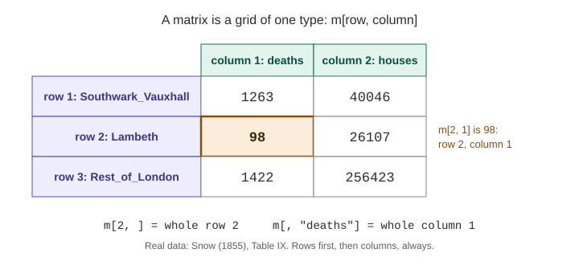

Lesson 12: Matrices
================
Dr. Sandeep Kumar Singh

> **The real question for today:** Epidemiologists love one particular
> table: a **2 × 2 table**, with exposure in the rows (smoker or not)
> and outcome in the columns (low birth weight or not). How do we hold
> such a table in R, pick numbers out of it, and add up its rows and
> columns?

------------------------------------------------------------------------

## 1. Why this lesson matters

Many health data come as **grids**: cases by exposure, deaths by water
company and year, genotype counts by population, gene expression levels
by gene and sample. A **matrix** is R’s grid for numbers. It is also the
foundation for tables, images and much of genomics, where the standard
way to store gene expression data is a large matrix of genes by samples.

------------------------------------------------------------------------

## 2. The ideas, in plain words

### 2.1 A matrix is a vector with rows and columns

A **matrix** is a set of values, **all of the same type**, arranged in
rows and columns. Think of an egg tray: every slot holds the same kind
of thing, and each slot has a row number and a column number.

<figure>

<figcaption aria-hidden="true">A matrix with row and column
positions</figcaption>
</figure>

*Figure 12.1. Snow’s data as a 3 × 2 matrix. Every value has a row
position and a column position.*

### 2.2 Rows first, then columns

To pick from a matrix we use square brackets with **two** positions,
separated by a comma: `m[row, column]`. Rows always come first. A handy
phrase: **“rows, then columns, like reading a book: down to the line,
then across.”** Leaving a position empty means “all of them”: `m[2, ]`
is the whole second row.

### 2.3 Dimensions

A matrix’s **dimensions** are its number of rows and columns. Snow’s
matrix is 3 × 2 (three rows, two columns). A 2 × 2 table has two rows
and two columns.

------------------------------------------------------------------------

## 3. Code, step by step

### 3.1 Building Snow’s matrix

``` r
snow <- matrix(c(1263, 98, 1422,
                 40046, 26107, 256423),
               nrow = 3, ncol = 2)
snow
```

    ##      [,1]   [,2]
    ## [1,] 1263  40046
    ## [2,]   98  26107
    ## [3,] 1422 256423

**What it does:** `matrix()` takes a vector of six values and arranges
it into 3 rows and 2 columns.

**How to read the output:** R fills the matrix **column by column**: the
first three values go down column 1 (deaths), the next three down column
2 (houses). The `[1,]` and `[,1]` labels around the edges are R’s row
and column positions.

### 3.2 Adding row and column names

``` r
rownames(snow) <- c("Southwark_Vauxhall", "Lambeth", "Rest_of_London")
colnames(snow) <- c("deaths", "houses")
snow
```

    ##                    deaths houses
    ## Southwark_Vauxhall   1263  40046
    ## Lambeth                98  26107
    ## Rest_of_London       1422 256423

**What it does:** gives each row and column a name, like the `names()`
of a vector in Lesson 7.

**Why:** we can now pick values by name, which is safer than by
position.

### 3.3 Size of a matrix: `dim()`, `nrow()`, `ncol()`

``` r
dim(snow)
```

    ## [1] 3 2

``` r
nrow(snow)
```

    ## [1] 3

``` r
ncol(snow)
```

    ## [1] 2

**How to read the output:** `dim()` gives rows then columns: 3 and 2.

### 3.4 Picking values: `[row, column]`

``` r
snow[2, 1]
```

    ## [1] 98

``` r
snow["Lambeth", "deaths"]
```

    ## [1] 98

``` r
snow[2, ]
```

    ## deaths houses 
    ##     98  26107

``` r
snow[, "deaths"]
```

    ## Southwark_Vauxhall            Lambeth     Rest_of_London 
    ##               1263                 98               1422

**What it does:** one cell by position, the same cell by name, the whole
Lambeth row, and the whole deaths column.

**How to read the output:** 98 twice, then a named vector for the row,
then a named vector for the column. A single row or column comes back as
an ordinary vector.

### 3.5 Calculating with columns

``` r
rates <- snow[, "deaths"] / snow[, "houses"] * 10000
round(rates, digits = 1)
```

    ## Southwark_Vauxhall            Lambeth     Rest_of_London 
    ##              315.4               37.5               55.5

**What it does:** divides the deaths column by the houses column,
position by position (Lesson 7).

**How to read the output:** Snow’s three rates again, now calculated
from a single tidy object.

### 3.6 Adding a column: `cbind()`

``` r
snow <- cbind(snow, rate = round(rates, digits = 1))
snow
```

    ##                    deaths houses  rate
    ## Southwark_Vauxhall   1263  40046 315.4
    ## Lambeth                98  26107  37.5
    ## Rest_of_London       1422 256423  55.5

**What it does:** `cbind()` means **column bind**: it joins a new column
onto the right side. Its partner `rbind()` (**row bind**) adds rows at
the bottom.

### 3.7 The 2 × 2 table: smoking by low birth weight

From Lesson 8 we know how many babies fall into each combination. Let us
type the four real counts from `birthwt` into a matrix, this time
filling **row by row**:

``` r
smoke_lbw <- matrix(c(86, 29,
                      44, 30),
                    nrow = 2, byrow = TRUE,
                    dimnames = list(c("Non-smoker", "Smoker"),
                                    c("Normal weight", "Low birth weight")))
smoke_lbw
```

    ##            Normal weight Low birth weight
    ## Non-smoker            86               29
    ## Smoker                44               30

**What it does:** `byrow = TRUE` fills across each row first, which
matches the way we read a table. `dimnames` gives the row names and
column names together (it uses a **list**, the structure of Lesson 13;
for now, read it as “first the row names, then the column names”).

**How to read the output:** 86 non-smokers had normal-weight babies and
29 had low-birth-weight babies; for smokers, 44 and 30.

### 3.8 Totals: `rowSums()` and `colSums()`

``` r
rowSums(smoke_lbw)
```

    ## Non-smoker     Smoker 
    ##        115         74

``` r
colSums(smoke_lbw)
```

    ##    Normal weight Low birth weight 
    ##              130               59

``` r
sum(smoke_lbw)
```

    ## [1] 189

**What it does:** adds up each row, each column, and the whole table.

**How to read the output:** 115 non-smokers and 74 smokers; 130
normal-weight and 59 low-birth-weight babies; 189 in total. These
“margins” are the first thing to check in any table, because they must
match what we know about the data.

### 3.9 Row percentages: what proportion in each row?

``` r
round(smoke_lbw / rowSums(smoke_lbw) * 100, digits = 1)
```

    ##            Normal weight Low birth weight
    ## Non-smoker          74.8             25.2
    ## Smoker              59.5             40.5

**What it does:** divides each count by its row total. Because R
recycles the two row totals down the columns, each row is divided by its
own total.

**How to read the output:** 25.2% of babies of non-smokers and 40.5% of
babies of smokers had low birth weight, the same numbers we found with
vectors in Lesson 8. A matrix keeps them neatly together.

### 3.10 R can build the table for us

Typing counts by hand is fine for published tables like Snow’s, but when
we have the raw data, `table()` with **two** variables builds the 2 × 2
table directly:

``` r
library(MASS)
t2 <- table(birthwt$smoke, birthwt$low)
t2
```

    ##    
    ##      0  1
    ##   0 86 29
    ##   1 44 30

**What it does:** loads `MASS` (Lesson 5) for the `birthwt` data, then
counts every combination of the two columns.

**How to read the output:** the same four counts, with the codes as
labels (rows are `smoke`, columns are `low`). In Lesson 15, with factors
in the data, these will show proper labels.

### 3.11 Turning a matrix on its side: `t()`

``` r
t(smoke_lbw)
```

    ##                  Non-smoker Smoker
    ## Normal weight            86     44
    ## Low birth weight         29     30

**What it does:** `t()` **transposes** the matrix: rows become columns
and columns become rows. Useful when a table is easier to read the other
way round.

### 3.12 Beyond two dimensions: arrays (a short note)

A matrix has two dimensions. An **array** can have more, like a stack of
matrices. For example, smoking by low birth weight **separately for each
race group** is a 2 × 2 × 3 array:

``` r
a <- table(birthwt$smoke, birthwt$low, birthwt$race)
dim(a)
```

    ## [1] 2 2 3

``` r
a[, , 1]
```

    ##    
    ##      0  1
    ##   0 40  4
    ##   1 33 19

**What it does:** `a[, , 1]` takes the first “layer” of the stack: the 2
× 2 table for race code 1 (white). We rarely build arrays by hand in
this course, but recognising them helps when a function returns one.

------------------------------------------------------------------------

## 4. Common errors

### Forgetting the comma

``` r
snow[2]
```

    ## [1] 98

With one position and no comma, R treats the matrix as one long vector
(filled column by column) and returns its second value, 98. Here that
happens to be right, but `snow[4]` would return a house count from
column 2. Always use `[row, column]`.

### Filling in the wrong direction

``` r
matrix(c(86, 29, 44, 30), nrow = 2)
```

    ##      [,1] [,2]
    ## [1,]   86   44
    ## [2,]   29   30

Without `byrow = TRUE`, R fills down the columns, so the smokers’ 29 and
the non-smokers’ 44 swap places. Compare the margins with what you know
to catch this.

### Mixing types

`matrix(c(1263, "Lambeth"), nrow = 1)` turns everything into text,
because a matrix holds one type only (Lesson 6). Tables of mixed types
are **data frames**, coming in Lesson 14.

------------------------------------------------------------------------

## 5. Practice

1.  From `snow`, show the Rest of London row.
2.  Show the deaths for Southwark and Vauxhall and for Lambeth only
    (rows 1 and 2, column “deaths”).
3.  Calculate **column** percentages of `smoke_lbw`: what proportion of
    low-birth-weight babies had a smoking mother? (Hint: divide by
    `colSums()`, and use `t()` to make the recycling go across rows.)
4.  Use `table()` to build a 2 × 2 table of hypertension (`ht`) by low
    birth weight (`low`).

<details>

<summary>

Show answers
</summary>

``` r
snow["Rest_of_London", ]
```

    ##   deaths   houses     rate 
    ##   1422.0 256423.0     55.5

``` r
snow[1:2, "deaths"]
```

    ## Southwark_Vauxhall            Lambeth 
    ##               1263                 98

``` r
round(t(t(smoke_lbw) / colSums(smoke_lbw)) * 100, digits = 1)
```

    ##            Normal weight Low birth weight
    ## Non-smoker          66.2             49.2
    ## Smoker              33.8             50.8

``` r
table(birthwt$ht, birthwt$low)
```

    ##    
    ##       0   1
    ##   0 125  52
    ##   1   5   7

Question 3: about half (50.8%) of the low-birth-weight babies had a
mother who smoked. Question 4: of the 12 mothers with hypertension, 7
had a low-birth-weight baby.

</details>

------------------------------------------------------------------------

## 6. Recap

A matrix is a grid of values of one type. `matrix()` builds one (column
by column unless `byrow = TRUE`), and `rownames()`, `colnames()` or
`dimnames` label it. We pick values with `[row, column]`, leaving a
position empty for “all”. `rowSums()`, `colSums()`, `cbind()`, `rbind()`
and `t()` work on the whole grid, and `table()` builds a matrix-like
table from raw data. Arrays extend the idea to more than two dimensions.

## 7. What comes next

A matrix holds one type in a strict grid. But a study summary contains
text, numbers and tables all at once. In **Lesson 13** we meet the
**list**, R’s most flexible container, and discover that many R
functions give their results as lists.
