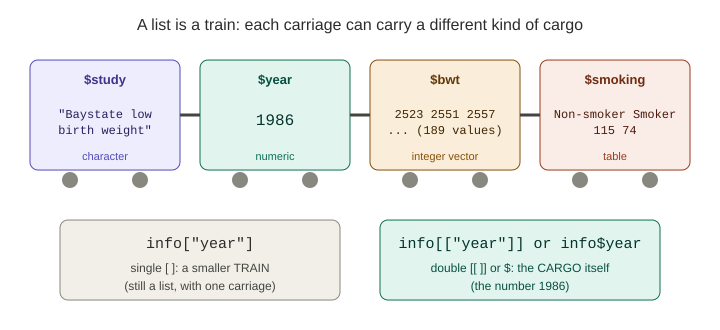

Lesson 13: Lists
================
Dr. Sandeep Kumar Singh

> **The real question for today:** A study summary holds very different
> things: the study’s name (text), its year (a number), 189 birth
> weights (a vector) and a table of smokers (a table). Vectors and
> matrices hold only one type. How do we keep all of these together in
> one object? And why does a statistical test in R print so much
> information at once?

------------------------------------------------------------------------

## 1. Why this lesson matters

The **list** is R’s most flexible container. Many functions return their
results as lists: a statistical test, a model, a file of results
downloaded from a database. If we can open a list and take out the one
piece we need, such as a p-value, we can use the result in further
calculations instead of copying numbers by hand. And in Lesson 14 we
will see that a **data frame** is itself a special kind of list.

------------------------------------------------------------------------

## 2. The ideas, in plain words

### 2.1 A list is a train of carriages

A **list** is an ordered collection of items, called **elements**, and
each element can be **anything**: a single number, a text value, a whole
vector, a table, even another list. Think of a train: each carriage can
carry a different kind of cargo, and each carriage can have a name
painted on its side.

<figure>

<figcaption aria-hidden="true">A list as a train</figcaption>
</figure>

*Figure 13.1. A list holding four different kinds of thing. Single
brackets give a smaller train; double brackets or `$` give the cargo
itself.*

### 2.2 Two ways to take things out

This is the one tricky idea in this lesson, and the figure helps:

| Code | What we get | Train analogy |
|----|----|----|
| `info["year"]` | a **list** containing year | uncouple one carriage: still a train |
| `info[["year"]]` | the **value** 1986 itself | open the carriage and take the cargo |
| `info$year` | the **value** 1986 itself | the same as `[[ ]]`, shorter to type |

Most of the time we want the cargo, so we use `$` or `[[ ]]`.

------------------------------------------------------------------------

## 3. Code, step by step

``` r
library(MASS)
smoke_f <- factor(birthwt$smoke, levels = c(0, 1),
                  labels = c("Non-smoker", "Smoker"))
```

### 3.1 Creating a list

``` r
info <- list(study = "Baystate low birth weight study",
             year = 1986,
             bwt = birthwt$bwt,
             smoking = table(smoke_f))
```

**What it does:** `list()` puts four very different things into one
object, and gives each one a name, just as we named arguments in Lesson
4.

**Why:** everything about this study is now in one place, which is easy
to pass around, save or print.

### 3.2 Seeing the structure: `str()`

``` r
str(info)
```

    ## List of 4
    ##  $ study  : chr "Baystate low birth weight study"
    ##  $ year   : num 1986
    ##  $ bwt    : int [1:189] 2523 2551 2557 2594 2600 2622 2637 2637 2663 2665 ...
    ##  $ smoking: 'table' int [1:2(1d)] 115 74
    ##   ..- attr(*, "dimnames")=List of 1
    ##   .. ..$ smoke_f: chr [1:2] "Non-smoker" "Smoker"

**What it does:** `str()` (short for **structure**) gives a compact
overview of any object: its type, its size and the first few values of
each part.

**How to read the output:** “List of 4”, then one line per element: the
name after `$`, its type (`chr` is character, `num` numeric, `int`
integer, `'table'` a table) and a preview. `str()` is one of the most
useful functions in R; we will use it on every new object we meet.

### 3.3 Names and length

``` r
names(info)
```

    ## [1] "study"   "year"    "bwt"     "smoking"

``` r
length(info)
```

    ## [1] 4

**How to read the output:** four elements with these four names.

### 3.4 Taking out the cargo: `$` and `[[ ]]`

``` r
info$year
```

    ## [1] 1986

``` r
info[["study"]]
```

    ## [1] "Baystate low birth weight study"

``` r
info$smoking
```

    ## smoke_f
    ## Non-smoker     Smoker 
    ##        115         74

**What it does:** each line takes the actual value out of one element.

### 3.5 Using what we took out

``` r
mean(info$bwt)
```

    ## [1] 2944.587

``` r
info$smoking["Smoker"]
```

    ## Smoker 
    ##     74

**What it does:** `info$bwt` is an ordinary vector of 189 values, so we
can average it. `info$smoking` is a table, so we can pick from it by
name (Lesson 8).

### 3.6 Single brackets keep it a list

``` r
info["year"]
```

    ## $year
    ## [1] 1986

``` r
class(info["year"])
```

    ## [1] "list"

``` r
class(info[["year"]])
```

    ## [1] "numeric"

**How to read the output:** `info["year"]` prints with `$year` above the
value, a sign that it is still a list. `class()` confirms it: a list
versus a number. This difference matters when we pass the result to a
function: `mean(info["bwt"])` would fail, while `mean(info$bwt)` works.

### 3.7 Adding and changing elements

``` r
info$n <- length(info$bwt)
info$lbw_percent <- round(mean(info$bwt < 2500) * 100, digits = 1)
names(info)
```

    ## [1] "study"       "year"        "bwt"         "smoking"     "n"          
    ## [6] "lbw_percent"

``` r
info$lbw_percent
```

    ## [1] 31.2

**What it does:** assigning to a new name with `$` adds an element;
assigning to an existing name replaces it.

**How to read the output:** the list now has six elements, including the
number of babies and the low-birth-weight percentage (31.2%, as in
Lesson 8).

### 3.8 Removing an element

``` r
info$bwt <- NULL
names(info)
```

    ## [1] "study"       "year"        "smoking"     "n"           "lbw_percent"

**What it does:** assigning `NULL` (R’s word for “nothing at all”)
removes the element.

### 3.9 Real results come as lists: a t-test

Statistical tests are beyond this course, but they are perfect for
learning to read lists. Let us compare the birth weights of babies of
smoking and non-smoking mothers with a **t-test**, a standard test of
whether two group averages differ. We only want to see what R gives
back.

``` r
bw <- birthwt$bwt
result <- t.test(bw[smoke_f == "Non-smoker"], bw[smoke_f == "Smoker"])
class(result)
```

    ## [1] "htest"

``` r
names(result)
```

    ##  [1] "statistic"   "parameter"   "p.value"     "conf.int"    "estimate"   
    ##  [6] "null.value"  "stderr"      "alternative" "method"      "data.name"

**What it does:** runs the test and stores everything it returns in
`result`.

**How to read the output:** the class is `"htest"` (hypothesis test),
which is a list with a special printing style. `names()` shows ten
elements we can take out.

``` r
result$estimate
```

    ## mean of x mean of y 
    ##  3055.696  2771.919

``` r
result$p.value
```

    ## [1] 0.007002548

``` r
round(result$conf.int, digits = 0)
```

    ## [1]  79 489
    ## attr(,"conf.level")
    ## [1] 0.95

**What it does:** takes out three pieces: the two group means, the
p-value and the confidence interval for the difference in means.

**Why:** instead of copying numbers from the printed output by hand, we
take them out with `$`. Then we can round them, put them in a report, or
compare them, without typing mistakes.

### 3.10 Lists inside lists

``` r
course <- list(lesson = 13,
               dataset = list(name = "birthwt", rows = 189, columns = 10))
course$dataset$rows
```

    ## [1] 189

``` r
course[["dataset"]][["name"]]
```

    ## [1] "birthwt"

**What it does:** an element of a list can be another list. We chain `$`
(or `[[ ]]`) to go one level deeper each time, like opening a box inside
a box.

**Why:** data downloaded from online databases (for example, gene
information in a format called JSON) often arrive as nested lists.

------------------------------------------------------------------------

## 4. Common errors

### Using single brackets when we need the value

``` r
mean(info["lbw_percent"])
```

    ## Warning in mean.default(info["lbw_percent"]): argument is not numeric or
    ## logical: returning NA

    ## [1] NA

R warns that the argument is not numeric and returns `NA`, because
`info["lbw_percent"]` is a list, not a number. Use `info$lbw_percent` or
`info[["lbw_percent"]]`.

### Misspelling an element name

``` r
info$Year
```

    ## NULL

`$` returns `NULL` (nothing), **without an error**, when the name does
not exist. Names are case-sensitive: the element is `year`, not `Year`.
If you get `NULL` unexpectedly, check `names()`.

------------------------------------------------------------------------

## 5. Practice

1.  Create a list `snow_study` with the elements `author` (“John Snow”),
    `year` (1854) and `deaths` (the vector `c(1263, 98, 1422)`).
2.  Use `str()` on it.
3.  Add an element `total_deaths` calculated from `snow_study$deaths`.
4.  From `result`, the t-test above, take out the difference between the
    two means: subtract the second value of `result$estimate` from the
    first, and round it.

<details>

<summary>

Show answers
</summary>

``` r
snow_study <- list(author = "John Snow",
                   year = 1854,
                   deaths = c(1263, 98, 1422))
str(snow_study)
```

    ## List of 3
    ##  $ author: chr "John Snow"
    ##  $ year  : num 1854
    ##  $ deaths: num [1:3] 1263 98 1422

``` r
snow_study$total_deaths <- sum(snow_study$deaths)
snow_study$total_deaths
```

    ## [1] 2783

``` r
round(result$estimate[1] - result$estimate[2], digits = 0)
```

    ## mean of x 
    ##       284

Babies of non-smoking mothers were on average about 284 g heavier.

</details>

------------------------------------------------------------------------

## 6. Recap

A list holds elements of any type and size, optionally named. `list()`
creates one, `str()` shows its structure, and `names()` and `length()`
describe it. `$` and `[[ ]]` take out an element’s value, while `[ ]`
returns a smaller list. Assigning adds or replaces elements, and
assigning `NULL` removes one. Many R results, like a t-test, are lists,
so we can take out exactly the number we need.

## 7. What comes next

We now know vectors, factors, matrices and lists. In **Lesson 14** they
come together in the structure we will use for the rest of the course:
the **data frame**, a table in which every column is a vector and
columns can be of different types. We will explore `birthwt` properly,
row by row and column by column.
