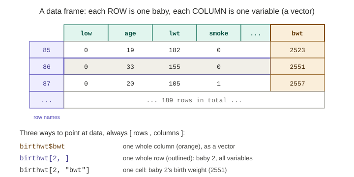

Lesson 14: Data Frames I — Exploring a Real Dataset
================
Dr. Sandeep Kumar Singh

> **The real question for today:** We have been taking single columns
> out of `birthwt` with `$`. But a researcher who receives a new dataset
> first asks broader questions: How many people and variables are there?
> What type is each variable? What does a typical record look like?
> Which mothers had the smallest babies, and what else do we know about
> them?

------------------------------------------------------------------------

## 1. Why this lesson matters

The **data frame** is the structure we will use for almost everything
from now on. Data read from a spreadsheet, a CSV file, a survey or a
database usually arrive in R as a data frame. Today we learn the
standard routine for **exploring** a new data frame, and how to pick out
any rows and columns we want. Changing a data frame comes in Lesson 15.

------------------------------------------------------------------------

## 2. The ideas, in plain words

### 2.1 What a data frame is

A **data frame** is a table in which:

- each **row** is one observation (here, one baby and its mother), and
- each **column** is one variable, stored as a **vector** (Lesson 7).

Different columns can have **different types**: a numeric column next to
a factor next to a character column. That is what makes it different
from a matrix (Lesson 12), where everything must be one type. Behind the
scenes, a data frame is a **list** of equal-length vectors (Lesson 13),
one per column, which is why `$` works on it.

Think of a clinic register: one line per patient, one column per piece
of information, with names, dates and measurements side by side.

<figure>

<figcaption aria-hidden="true">Anatomy of a data frame</figcaption>
</figure>

*Figure 14.1. `birthwt` as a data frame. Columns are vectors; rows are
babies; `[row, column]` points at any part of it.*

### 2.2 Pointing at data: `[rows, columns]`

Data frames use the same `[row, column]` rule as matrices. Each side of
the comma can contain anything we learned in Lesson 8: positions, names,
or a TRUE/FALSE condition. An empty side means “all”.

------------------------------------------------------------------------

## 3. Code, step by step: the exploration routine

``` r
library(MASS)
```

### 3.1 What is it?

``` r
class(birthwt)
```

    ## [1] "data.frame"

**How to read the output:** `"data.frame"`.

### 3.2 How big is it? `dim()`, `nrow()`, `ncol()`

``` r
dim(birthwt)
```

    ## [1] 189  10

**How to read the output:** 189 rows (babies) and 10 columns
(variables), the numbers we met in Lesson 5.

### 3.3 What are the variables called? `names()`

``` r
names(birthwt)
```

    ##  [1] "low"   "age"   "lwt"   "race"  "smoke" "ptl"   "ht"    "ui"    "ftv"  
    ## [10] "bwt"

**Why:** we need the exact column names (including case) to use `$` and
`[ , ]`. Compare them with the help page `?birthwt` to know what each
one means.

### 3.4 The structure: `str()`

``` r
str(birthwt)
```

    ## 'data.frame':    189 obs. of  10 variables:
    ##  $ low  : int  0 0 0 0 0 0 0 0 0 0 ...
    ##  $ age  : int  19 33 20 21 18 21 22 17 29 26 ...
    ##  $ lwt  : int  182 155 105 108 107 124 118 103 123 113 ...
    ##  $ race : int  2 3 1 1 1 3 1 3 1 1 ...
    ##  $ smoke: int  0 0 1 1 1 0 0 0 1 1 ...
    ##  $ ptl  : int  0 0 0 0 0 0 0 0 0 0 ...
    ##  $ ht   : int  0 0 0 0 0 0 0 0 0 0 ...
    ##  $ ui   : int  1 0 0 1 1 0 0 0 0 0 ...
    ##  $ ftv  : int  0 3 1 2 0 0 1 1 1 0 ...
    ##  $ bwt  : int  2523 2551 2557 2594 2600 2622 2637 2637 2663 2665 ...

**What it does:** the same `str()` as Lesson 13, now on a data frame.

**How to read the output:** “189 obs. of 10 variables” (obs. means
observations, i.e. rows). Then one line per column: its name, its type
(`int` for integer) and its first values. At a glance we see that every
column is stored as an integer, including the coded categories `race`,
`smoke`, `ht` and `ui`. That tells us we will need factors (Lesson 11)
before making readable tables.

### 3.5 The first and last rows: `head()` and `tail()`

``` r
head(birthwt, n = 3)
```

    ##    low age lwt race smoke ptl ht ui ftv  bwt
    ## 85   0  19 182    2     0   0  0  1   0 2523
    ## 86   0  33 155    3     0   0  0  0   3 2551
    ## 87   0  20 105    1     1   0  0  0   1 2557

``` r
tail(birthwt, n = 3)
```

    ##    low age lwt race smoke ptl ht ui ftv  bwt
    ## 82   1  23  94    3     1   0  0  0   0 2495
    ## 83   1  17 142    2     0   0  1  0   0 2495
    ## 84   1  21 130    1     1   0  1  0   3 2495

**What it does:** shows the first and last three rows.

**How to read the output:** the numbers on the left (85, 86, 87 …) are
**row names**, carried over from the original study’s ID numbers. Notice
the last rows have `low` equal to 1: the original researchers sorted the
data with normal-weight babies first.

### 3.6 Summaries of every column: `summary()`

``` r
summary(birthwt)
```

    ##       low              age             lwt             race      
    ##  Min.   :0.0000   Min.   :14.00   Min.   : 80.0   Min.   :1.000  
    ##  1st Qu.:0.0000   1st Qu.:19.00   1st Qu.:110.0   1st Qu.:1.000  
    ##  Median :0.0000   Median :23.00   Median :121.0   Median :1.000  
    ##  Mean   :0.3122   Mean   :23.24   Mean   :129.8   Mean   :1.847  
    ##  3rd Qu.:1.0000   3rd Qu.:26.00   3rd Qu.:140.0   3rd Qu.:3.000  
    ##  Max.   :1.0000   Max.   :45.00   Max.   :250.0   Max.   :3.000  
    ##      smoke             ptl               ht                ui        
    ##  Min.   :0.0000   Min.   :0.0000   Min.   :0.00000   Min.   :0.0000  
    ##  1st Qu.:0.0000   1st Qu.:0.0000   1st Qu.:0.00000   1st Qu.:0.0000  
    ##  Median :0.0000   Median :0.0000   Median :0.00000   Median :0.0000  
    ##  Mean   :0.3915   Mean   :0.1958   Mean   :0.06349   Mean   :0.1481  
    ##  3rd Qu.:1.0000   3rd Qu.:0.0000   3rd Qu.:0.00000   3rd Qu.:0.0000  
    ##  Max.   :1.0000   Max.   :3.0000   Max.   :1.00000   Max.   :1.0000  
    ##       ftv              bwt      
    ##  Min.   :0.0000   Min.   : 709  
    ##  1st Qu.:0.0000   1st Qu.:2414  
    ##  Median :0.0000   Median :2977  
    ##  Mean   :0.7937   Mean   :2945  
    ##  3rd Qu.:1.0000   3rd Qu.:3487  
    ##  Max.   :6.0000   Max.   :4990

**What it does:** applies the `summary()` of Lesson 10 to every column
at once.

**How to read the output:** for `bwt` we recognise the median of 2,977 g
and mean of 2,945 g. For the coded columns, such as `smoke`, the “mean”
of 0.39 is actually the proportion of smokers (39%), because smokers are
coded 1 (the TRUE-is-1 trick from Lesson 6). Summaries of coded columns
must be read with the codes in mind.

### 3.7 Looking at it like a spreadsheet: `View()`

``` r
View(birthwt)
```

**What it does:** opens the data in a spreadsheet-style tab in RStudio,
where you can scroll, sort and filter by clicking. It is only for
looking: nothing you do in that tab changes the data. (Note the capital
V.)

------------------------------------------------------------------------

## 4. Code, step by step: picking rows and columns

### 4.1 One column: `$` or `[ , "name"]`

``` r
head(birthwt$bwt)
```

    ## [1] 2523 2551 2557 2594 2600 2622

``` r
head(birthwt[, "bwt"])
```

    ## [1] 2523 2551 2557 2594 2600 2622

**What it does:** both take the `bwt` column as a vector.

### 4.2 Several columns

``` r
head(birthwt[, c("age", "smoke", "bwt")])
```

    ##    age smoke  bwt
    ## 85  19     0 2523
    ## 86  33     0 2551
    ## 87  20     1 2557
    ## 88  21     1 2594
    ## 89  18     1 2600
    ## 91  21     0 2622

**What it does:** a vector of column names on the right of the comma
keeps those columns, in that order. The result is still a data frame.

### 4.3 One row and several rows

``` r
birthwt[2, ]
```

    ##    low age lwt race smoke ptl ht ui ftv  bwt
    ## 86   0  33 155    3     0   0  0  0   3 2551

``` r
birthwt[1:3, c("age", "bwt")]
```

    ##    age  bwt
    ## 85  19 2523
    ## 86  33 2551
    ## 87  20 2557

**What it does:** the second row with all columns, then the first three
rows with two columns.

**How to read the output:** row 2 is the record of one baby (2,551 g)
and its mother (aged 33, 155 lb, non-smoker).

### 4.4 One cell

``` r
birthwt[2, "bwt"]
```

    ## [1] 2551

**How to read the output:** a single value, 2,551 g, as in Figure 14.1.

### 4.5 Rows chosen by a condition

This is the most important line of the lesson. We use a TRUE/FALSE
question (Lesson 8) on the **left** of the comma to choose **rows**:

``` r
very_low <- birthwt[birthwt$bwt < 1500, ]
very_low
```

    ##    low age lwt race smoke ptl ht ui ftv  bwt
    ## 4    1  28 120    3     1   1  0  1   0  709
    ## 10   1  29 130    1     0   0  0  1   2 1021
    ## 11   1  34 187    2     1   0  1  0   0 1135
    ## 13   1  25 105    3     0   1  1  0   0 1330
    ## 15   1  25  85    3     0   0  0  1   0 1474

**What it does:** `birthwt$bwt < 1500` gives 189 TRUE/FALSE answers.
Placed before the comma, it keeps only the rows where the answer is
TRUE, with **all** columns.

**How to read the output:** the 5 very-low-birth-weight babies (Lesson
11), with everything we know about them and their mothers. Because the
whole row comes with the baby, we can see, for example, which mothers
smoked or had a history of premature labour (`ptl`).

### 4.6 Condition on rows, choice of columns

``` r
birthwt[birthwt$bwt < 1500, c("age", "smoke", "ht", "bwt")]
```

    ##    age smoke ht  bwt
    ## 4   28     1  0  709
    ## 10  29     0  0 1021
    ## 11  34     1  1 1135
    ## 13  25     0  1 1330
    ## 15  25     0  0 1474

**What it does:** the same rows, but only the four columns we care
about. Rows on the left, columns on the right.

### 4.7 Two conditions together

``` r
lbw_smokers <- birthwt[birthwt$smoke == 1 & birthwt$bwt < 2500, ]
nrow(lbw_smokers)
```

    ## [1] 30

**What it does:** combines conditions with `&` (Lesson 8): mothers who
smoked **and** babies under 2,500 g.

**How to read the output:** 30 babies, matching our 2 × 2 table in
Lesson 12. Different routes, the same answer: a good sign.

### 4.8 Sorting rows: `order()` inside the brackets

``` r
lightest_first <- birthwt[order(birthwt$bwt), ]
head(lightest_first[, c("age", "lwt", "smoke", "bwt")], n = 5)
```

    ##    age lwt smoke  bwt
    ## 4   28 120     1  709
    ## 10  29 130     0 1021
    ## 11  34 187     1 1135
    ## 13  25 105     0 1330
    ## 15  25  85     0 1474

**What it does:** `order()` (Lesson 10) gives the row positions from
lightest to heaviest baby; putting them on the left of the comma
rearranges the whole data frame in that order.

**Why:** sorting whole rows keeps each baby’s information together.
Sorting one column on its own with `sort()` would separate the weights
from the mothers.

------------------------------------------------------------------------

## 5. Common errors

### Forgetting the comma

``` r
head(birthwt[birthwt$bwt < 1500])
```

    ## Error in `[.data.frame`:
    ## ! undefined columns selected

Without the comma, R treats the condition as choosing **columns**, not
rows, and stops with an error about “undefined columns”. When choosing
rows, always leave the comma: `birthwt[condition, ]`.

### Forgetting the data frame name inside the condition

``` r
birthwt[bwt < 1500, ]
```

    ## Error:
    ## ! object 'bwt' not found

`bwt` on its own is not an object; it lives **inside** `birthwt`. Write
`birthwt$bwt`. (In Level 2, the tidyverse will let us write column names
on their own.)

### A misspelled column name

``` r
head(birthwt$BWT)
```

    ## NULL

`$` returns `NULL` for a name that does not exist, just as with lists in
Lesson 13. Check `names(birthwt)`.

------------------------------------------------------------------------

## 6. Practice

1.  Run the exploration routine (`dim`, `names`, `str`, `head`,
    `summary`) on the Pima diabetes data, `Pima.tr2`. Which columns have
    missing values?
2.  From `birthwt`, show the age, race and birth weight of the babies
    born to mothers under 17 years old.
3.  How many mothers had at least one previous premature labour
    (`ptl > 0`)?
4.  Show the five heaviest babies with their mothers’ ages and smoking
    status.

<details>

<summary>

Show answers
</summary>

``` r
dim(Pima.tr2)
```

    ## [1] 300   8

``` r
summary(Pima.tr2)
```

    ##      npreg             glu              bp              skin      
    ##  Min.   : 0.000   Min.   : 56.0   Min.   : 38.00   Min.   : 7.00  
    ##  1st Qu.: 1.000   1st Qu.:101.0   1st Qu.: 64.00   1st Qu.:21.00  
    ##  Median : 3.000   Median :121.0   Median : 72.00   Median :29.00  
    ##  Mean   : 3.787   Mean   :123.7   Mean   : 72.32   Mean   :29.15  
    ##  3rd Qu.: 6.000   3rd Qu.:142.0   3rd Qu.: 80.00   3rd Qu.:36.00  
    ##  Max.   :14.000   Max.   :199.0   Max.   :114.00   Max.   :99.00  
    ##                                   NA's   :13       NA's   :98     
    ##       bmi             ped              age        type    
    ##  Min.   :18.20   Min.   :0.0780   Min.   :21.0   No :194  
    ##  1st Qu.:27.10   1st Qu.:0.2367   1st Qu.:24.0   Yes:106  
    ##  Median :32.00   Median :0.3360   Median :29.0            
    ##  Mean   :32.05   Mean   :0.4357   Mean   :33.1            
    ##  3rd Qu.:36.50   3rd Qu.:0.5867   3rd Qu.:40.0            
    ##  Max.   :52.90   Max.   :2.2880   Max.   :72.0            
    ##  NA's   :3

``` r
birthwt[birthwt$age < 17, c("age", "race", "bwt")]
```

    ##     age race  bwt
    ## 102  15    2 2778
    ## 143  16    3 3175
    ## 166  16    2 3374
    ## 167  16    1 3374
    ## 189  16    1 3643
    ## 206  16    2 3860
    ## 213  14    1 3941
    ## 216  16    3 3997
    ## 25   16    3 1899
    ## 57   15    1 2353
    ## 62   15    3 2381
    ## 78   14    3 2466
    ## 81   14    3 2495

``` r
nrow(birthwt[birthwt$ptl > 0, ])
```

    ## [1] 30

``` r
heaviest_first <- birthwt[order(birthwt$bwt, decreasing = TRUE), ]
head(heaviest_first[, c("age", "smoke", "bwt")], n = 5)
```

    ##     age smoke  bwt
    ## 226  45     0 4990
    ## 225  24     0 4593
    ## 224  19     1 4238
    ## 223  35     0 4174
    ## 222  31     0 4167

Question 1: `summary()` shows `NA's` for `bp`, `skin` and `bmi`, as in
Lesson 9.

</details>

------------------------------------------------------------------------

## 7. Recap

A data frame is a table of equal-length column vectors that can differ
in type. The exploration routine is `class()`, `dim()`, `names()`,
`str()`, `head()`/`tail()`, `summary()` and `View()`. We point at data
with `[rows, columns]`: positions, names or conditions on either side,
and an empty side for “all”. A condition on the left keeps whole rows,
so each baby’s information stays together, and `order()` on the left
sorts the whole table.

## 8. What comes next

So far we have only looked at `birthwt`. In **Lesson 15** we change it:
adding new columns (birth weight in kilograms, mothers’ weight in
kilograms), turning codes into factors inside the data frame, renaming
and removing columns, and building a small data frame of our own from
Snow’s table.
