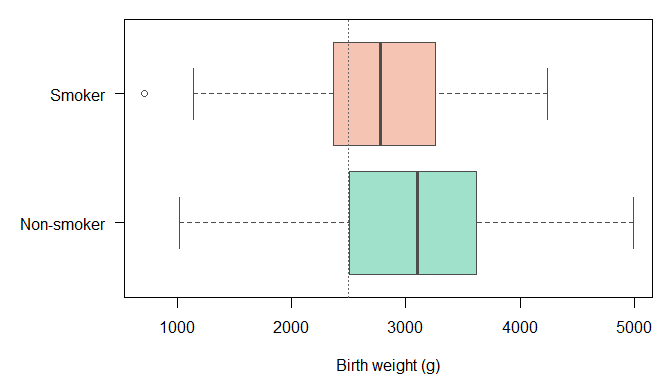

Lesson 15: Data Frames II — Changing a Data Frame
================
Dr. Sandeep Kumar Singh

> **The real question for today:** `birthwt` stores weights in grams and
> pounds, and categories as 0/1 codes. Before analysing it, a researcher
> would **prepare** it: add birth weight in kilograms, convert mothers’
> weights to kilograms, replace codes with labels, and give columns
> clear names. How do we make these changes safely, inside the data
> frame?

------------------------------------------------------------------------

## 1. Why this lesson matters

Real analysis is mostly **data preparation**: creating new variables,
recoding categories, renaming, dropping what we do not need. Doing this
**inside the data frame** keeps every baby’s values together in one row,
so nothing gets out of line. And because every change is a line of code,
anyone can see and repeat exactly how the analysis dataset was made from
the original.

------------------------------------------------------------------------

## 2. The ideas, in plain words

### 2.1 Never change the original

We always work on a **copy**. The original data are like the master copy
of a patient register: we photocopy it and write on the photocopy. If
anything goes wrong, the original is still there and we simply run our
script again.

### 2.2 Assignment works everywhere

Everything in this lesson uses one idea we already know, the arrow `<-`
from Lesson 3, but now on the **left** side we put a part of a data
frame:

| Code | Meaning |
|----|----|
| `df$new_col <- ...` | create (or replace) a whole column |
| `df$col[condition] <- ...` | change only the values where the condition is TRUE |
| `df$col <- NULL` | remove a column |
| `names(df)[position] <- "new name"` | rename a column |

------------------------------------------------------------------------

## 3. Code, step by step

### 3.1 Making a working copy

``` r
library(MASS)
births <- birthwt
dim(births)
```

    ## [1] 189  10

**What it does:** `births` is a copy of `birthwt`. Everything we do from
now on changes `births` only. `birthwt` stays as it came from the
package.

### 3.2 Adding a calculated column

``` r
births$bwt_kg <- births$bwt / 1000
births$lwt_kg <- round(births$lwt * 0.45359237, digits = 1)
head(births[, c("bwt", "bwt_kg", "lwt", "lwt_kg")], n = 4)
```

    ##     bwt bwt_kg lwt lwt_kg
    ## 85 2523  2.523 182   82.6
    ## 86 2551  2.551 155   70.3
    ## 87 2557  2.557 105   47.6
    ## 88 2594  2.594 108   49.0

**What it does:** assigning to a column name that does not exist yet
creates it. Each new column is calculated from an existing one, row by
row (vectorisation, Lesson 7).

**How to read the output:** the first baby weighed 2,523 g, which is
2.523 kg, and its mother 182 lb, which is 82.6 kg. Each new value sits
in the same row as the values it was made from.

### 3.3 A column from a yes/no question: `ifelse()`

``` r
births$lbw <- ifelse(births$bwt < 2500, "Low", "Normal")
table(births$lbw)
```

    ## 
    ##    Low Normal 
    ##     59    130

**What it does:** `ifelse()` asks a question of every row and gives one
of two answers: if the birth weight is under 2,500 g, “Low”; otherwise,
“Normal”. It takes three arguments: the question, the value for TRUE,
and the value for FALSE.

**How to read the output:** 59 “Low” and 130 “Normal”, as always.

### 3.4 Changing only some rows

`ifelse()` gives two groups. For three groups, a clear way is to start
with one value for everyone and then **overwrite** some rows:

``` r
births$bwt_cat <- "Normal"
births$bwt_cat[births$bwt < 2500] <- "Low"
births$bwt_cat[births$bwt < 1500] <- "Very low"
table(births$bwt_cat)
```

    ## 
    ##      Low   Normal Very low 
    ##       54      130        5

**What it does:** line 1 puts “Normal” in every row. Line 2 changes the
rows under 2,500 g to “Low”. Line 3 changes the rows under 1,500 g to
“Very low”. The order matters: the very-low babies were first set to
“Low”, then overwritten.

**How to read the output:** 54 “Low”, 130 “Normal” and 5 “Very low”, the
same counts `cut()` gave in Lesson 11. Notice the odd order: for a text
column, R sorts the groups **alphabetically**. We fix the order in the
next step by making it a factor. This pattern,
`column[condition] <- value`, is how we fix and recode data throughout
the course.

### 3.5 Replacing codes with factors, inside the data frame

``` r
births$smoke <- factor(births$smoke, levels = c(0, 1),
                       labels = c("Non-smoker", "Smoker"))
births$race <- factor(births$race, levels = c(1, 2, 3),
                      labels = c("White", "Black", "Other"))
births$bwt_cat <- factor(births$bwt_cat,
                         levels = c("Very low", "Low", "Normal"))
str(births[, c("smoke", "race", "bwt_cat")])
```

    ## 'data.frame':    189 obs. of  3 variables:
    ##  $ smoke  : Factor w/ 2 levels "Non-smoker","Smoker": 1 1 2 2 2 1 1 1 2 2 ...
    ##  $ race   : Factor w/ 3 levels "White","Black",..: 2 3 1 1 1 3 1 3 1 1 ...
    ##  $ bwt_cat: Factor w/ 3 levels "Very low","Low",..: 3 3 3 3 3 3 3 3 3 3 ...

**What it does:** replaces each coded column with a labelled factor
(Lesson 11), and puts our three weight groups in a sensible order.

**How to read the output:** `str()` now shows `Factor w/ 2 levels`,
`Factor w/ 3 levels` and so on, with the labels.

### 3.6 The pay-off: readable tables

``` r
table(births$smoke, births$lbw)
```

    ##             
    ##              Low Normal
    ##   Non-smoker  29     86
    ##   Smoker      30     44

**What it does:** the same 2 × 2 table as Lesson 12, but now built
straight from the data and labelled in words. Compare it with the 0/1
version: this one can go straight into a report.

<!-- -->

*Figure 15.1. Birth weight by mother’s smoking status. Because `smoke`
is now a labelled factor, the plot shows the labels automatically. (We
learn to draw this ourselves in Lesson 16.)*

### 3.7 Renaming a column

``` r
names(births)
```

    ##  [1] "low"     "age"     "lwt"     "race"    "smoke"   "ptl"     "ht"     
    ##  [8] "ui"      "ftv"     "bwt"     "bwt_kg"  "lwt_kg"  "lbw"     "bwt_cat"

``` r
names(births)[names(births) == "lwt"] <- "lwt_lb"
names(births)[names(births) == "ftv"] <- "visits_trimester1"
names(births)
```

    ##  [1] "low"               "age"               "lwt_lb"           
    ##  [4] "race"              "smoke"             "ptl"              
    ##  [7] "ht"                "ui"                "visits_trimester1"
    ## [10] "bwt"               "bwt_kg"            "lwt_kg"           
    ## [13] "lbw"               "bwt_cat"

**What it does:** `names(births)` is a character vector of column names.
On the left of the arrow, we choose the name equal to `"lwt"` and
replace it with `"lwt_lb"`, which says the unit in the name.

**Why choose by name and not by position?** `names(births)[3] <- ...`
would also work, but if the column order ever changes, position 3 might
be a different column. Choosing by name is safer.

### 3.8 Removing columns

``` r
births$lbw <- NULL
ncol(births)
```

    ## [1] 13

**What it does:** assigning `NULL` removes the column, as with lists in
Lesson 13. The `low` column already holds the same information, and
`bwt_cat` gives more detail, so we do not need `lbw`.

Another way is to **keep** only the columns we want:

``` r
analysis <- births[, c("age", "race", "smoke", "lwt_kg", "bwt", "bwt_cat")]
head(analysis, n = 3)
```

    ##    age  race      smoke lwt_kg  bwt bwt_cat
    ## 85  19 Black Non-smoker   82.6 2523  Normal
    ## 86  33 Other Non-smoker   70.3 2551  Normal
    ## 87  20 White     Smoker   47.6 2557  Normal

### 3.9 A friendlier way to choose rows and columns: `subset()`

``` r
subset(births, bwt < 1500, select = c(age, smoke, bwt))
```

    ##    age      smoke  bwt
    ## 4   28     Smoker  709
    ## 10  29 Non-smoker 1021
    ## 11  34     Smoker 1135
    ## 13  25 Non-smoker 1330
    ## 15  25 Non-smoker 1474

**What it does:** `subset()` does the same job as
`births[births$bwt < 1500, c("age", "smoke", "bwt")]` from Lesson 14,
but inside `subset()` we can write column names **without** `births$`.
The second argument chooses rows, `select` chooses columns.

**Why it matters:** it reads more like plain English. In Level 2, the
tidyverse takes this idea much further.

### 3.10 Building a data frame from scratch: `data.frame()`

``` r
snow_df <- data.frame(company = c("Southwark_Vauxhall", "Lambeth", "Rest_of_London"),
                      deaths = c(1263, 98, 1422),
                      houses = c(40046, 26107, 256423))
snow_df
```

    ##              company deaths houses
    ## 1 Southwark_Vauxhall   1263  40046
    ## 2            Lambeth     98  26107
    ## 3     Rest_of_London   1422 256423

``` r
str(snow_df)
```

    ## 'data.frame':    3 obs. of  3 variables:
    ##  $ company: chr  "Southwark_Vauxhall" "Lambeth" "Rest_of_London"
    ##  $ deaths : num  1263 98 1422
    ##  $ houses : num  40046 26107 256423

**What it does:** `data.frame()` builds a table from vectors of the same
length, one per column. Notice that it holds a **character** column next
to numeric columns, which a matrix (Lesson 12) could not do.

### 3.11 Adding a calculated column and sorting

``` r
snow_df$rate <- round(snow_df$deaths / snow_df$houses * 10000, digits = 1)
snow_df[order(snow_df$rate, decreasing = TRUE), ]
```

    ##              company deaths houses  rate
    ## 1 Southwark_Vauxhall   1263  40046 315.4
    ## 3     Rest_of_London   1422 256423  55.5
    ## 2            Lambeth     98  26107  37.5

**What it does:** adds the death rate per 10,000 houses, then shows the
table sorted from highest to lowest rate.

### 3.12 Adding a row: `rbind()`

``` r
total <- data.frame(company = "All_three",
                    deaths = sum(snow_df$deaths),
                    houses = sum(snow_df$houses),
                    rate = NA)
snow_df <- rbind(snow_df, total)
snow_df$rate <- round(snow_df$deaths / snow_df$houses * 10000, digits = 1)
snow_df
```

    ##              company deaths houses  rate
    ## 1 Southwark_Vauxhall   1263  40046 315.4
    ## 2            Lambeth     98  26107  37.5
    ## 3     Rest_of_London   1422 256423  55.5
    ## 4          All_three   2783 322576  86.3

**What it does:** builds a one-row data frame with the totals, with
**the same column names**, and stacks it under `snow_df` with `rbind()`.
We then recalculate the rate column so the new row gets its rate too.

------------------------------------------------------------------------

## 4. Common errors

### Overwriting the original data

`birthwt$bwt <- birthwt$bwt / 1000` replaces grams with kilograms in the
original copy in memory. If we run the line twice, the weights are
divided by 1,000 twice. Always work on a copy and create **new** columns
with new names.

### A new column of the wrong length

``` r
births$test <- c(1, 2, 3)
```

Every column must have one value per row (189). A vector of 3 does not
fit, and R stops with an error. (A single value is fine: it is recycled
to all 189 rows, as in `births$bwt_cat <- "Normal"` above.)

### `rbind()` with different column names

If the new row’s columns do not have exactly the same names as the data
frame, `rbind()` stops with an error about names not matching. Build the
new row with the same column names.

------------------------------------------------------------------------

## 5. Practice

Use the `births` data frame from this lesson.

1.  Add a column `age_group` using `cut()` (Lesson 11) with the groups
    “Under 20”, “20–29” and “30 and over”.
2.  Turn `ht` (hypertension, 0/1) into a factor with labels “No” and
    “Yes”.
3.  Use `subset()` to show the age, smoking status and birth weight of
    mothers with hypertension.
4.  Make a table of `bwt_cat` by `smoke`.

<details>

<summary>

Show answers
</summary>

``` r
births$age_group <- cut(births$age, breaks = c(0, 20, 30, Inf), right = FALSE,
                        labels = c("Under 20", "20-29", "30 and over"))
table(births$age_group)
```

    ## 
    ##    Under 20       20-29 30 and over 
    ##          51         111          27

``` r
births$ht <- factor(births$ht, levels = c(0, 1), labels = c("No", "Yes"))

subset(births, ht == "Yes", select = c(age, smoke, bwt))
```

    ##     age      smoke  bwt
    ## 98   22 Non-smoker 2751
    ## 138  22 Non-smoker 3100
    ## 187  19     Smoker 3629
    ## 197  19     Smoker 3756
    ## 202  25 Non-smoker 3790
    ## 11   34     Smoker 1135
    ## 13   25 Non-smoker 1330
    ## 19   24 Non-smoker 1729
    ## 20   21     Smoker 1790
    ## 75   26 Non-smoker 2442
    ## 83   17 Non-smoker 2495
    ## 84   21     Smoker 2495

``` r
table(births$bwt_cat, births$smoke)
```

    ##           
    ##            Non-smoker Smoker
    ##   Very low          3      2
    ##   Low              26     28
    ##   Normal           86     44

</details>

------------------------------------------------------------------------

## 6. Recap

We always change a **copy** of the data. `df$new <- ...` creates a
column, `ifelse()` makes a two-way column from a question, and
`df$col[condition] <- value` changes only some rows. Coded columns
become labelled factors inside the data frame, so tables and plots read
in words. We rename columns through `names()`, remove them with `NULL`,
choose rows and columns with `subset()`, build tables with
`data.frame()`, and add rows with `rbind()`.

## 7. What comes next

This completes **Module 3: Categories and structures**. We now know all
of R’s main data structures. In **Module 4** we put them to work.
**Lesson 16** shows how to draw the plots we have been glimpsing in the
figures, using R’s built-in graphics: histograms, box plots, bar charts
and scatter plots of real health data.
