Lesson 16: First Plots with Base R
================
Dr. Sandeep Kumar Singh

> **The real question for today:** A table of numbers tells us that
> babies of smoking mothers were lighter. A picture makes the same point
> in one second, to anyone. How do we draw the histograms, box plots,
> bar charts and scatter plots we have been glimpsing since Lesson 2,
> and save them for a report or a slide?

------------------------------------------------------------------------

## 1. Why this lesson matters

Plots are how we **check** data (a strange value jumps out of a
histogram immediately) and how we **communicate** results (a box plot
goes straight into a talk or a paper). R comes with a complete plotting
system built in, called **base graphics**, which needs no packages. In
Level 2 we will learn **ggplot2**, the most popular plotting package,
but base graphics remain the fastest way to take a quick look at data,
and they are what most of R’s help pages use.

------------------------------------------------------------------------

## 2. The ideas, in plain words

### 2.1 Four plots cover most needs

| Plot | Shows | Question it answers |
|----|----|----|
| **Histogram** | how one numeric variable is spread | “What do birth weights look like?” |
| **Box plot** | a numeric variable, group by group | “Are babies of smokers lighter?” |
| **Bar chart** | counts of a categorical variable | “How many babies in each weight group?” |
| **Scatter plot** | two numeric variables together | “Do heavier mothers have heavier babies?” |

Choosing the plot comes from the **type** of the variables (Lesson 6):
one numeric, numeric by group, one category, or two numerics.

### 2.2 Plotting is like painting on a canvas

In base R, the first plot command (`hist()`, `plot()` …) **creates a new
canvas** and paints the main picture. Later commands, such as `abline()`
and `legend()`, **paint on top** of the same canvas. Once something is
painted, it cannot be removed: to change it, we run the plot again from
the start. That is why plotting code is always kept in the script.

### 2.3 Arguments control the look

Every plotting function accepts arguments for its appearance. The same
few appear everywhere:

| Argument       | Controls             | Example                     |
|----------------|----------------------|-----------------------------|
| `main`         | title at the top     | `main = "Birth weight"`     |
| `xlab`, `ylab` | axis labels          | `xlab = "Birth weight (g)"` |
| `col`          | fill or point colour | `col = "steelblue"`         |
| `xlim`, `ylim` | axis range           | `ylim = c(0, 60)`           |

Colours can be names (`"steelblue"`, `"tomato"`, `"grey80"`; run
`colors()` to see all 657) or hex codes such as `"#1D9E75"`.

------------------------------------------------------------------------

## 3. Preparing the data

We start from the prepared data of Lesson 15:

``` r
library(MASS)
births <- birthwt
births$lwt_kg <- round(births$lwt * 0.45359237, digits = 1)
births$smoke <- factor(births$smoke, levels = c(0, 1),
                       labels = c("Non-smoker", "Smoker"))
births$bwt_cat <- cut(births$bwt, breaks = c(0, 1500, 2500, Inf), right = FALSE,
                      labels = c("Very low", "Low", "Normal"))
```

**What it does:** copies `birthwt`, adds mothers’ weights in kg, and
turns smoking and the weight groups into labelled factors. Every plot in
this lesson uses `births`.

------------------------------------------------------------------------

## 4. Code, step by step

### 4.1 A histogram in one line

``` r
hist(births$bwt)
```

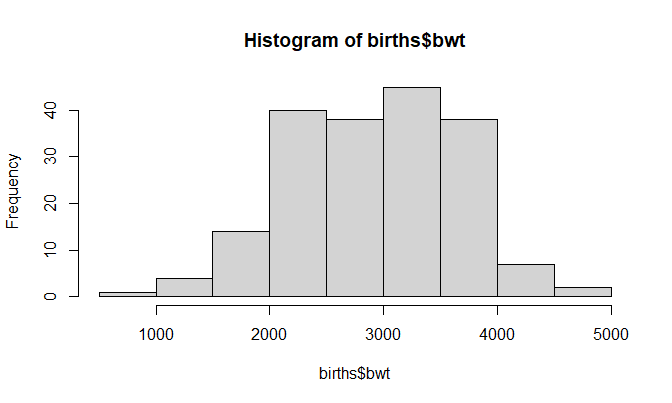<!-- -->

**What it does:** `hist()` divides the birth weights into bins (ranges
of equal width) and draws one bar per bin, as tall as the number of
babies in it.

**How to read the output:** most babies weighed between 2,000 g and
4,000 g, with a few very light babies on the left. R chose the bins, the
title and the labels automatically. The title “Histogram of births\$bwt”
is honest but not report-ready.

### 4.2 A report-ready histogram

``` r
hist(births$bwt,
     breaks = seq(500, 5000, by = 250),
     col = "grey85", border = "white",
     main = "Birth weight of 189 babies, Baystate Medical Center, 1986",
     xlab = "Birth weight (g)", ylab = "Number of babies")
abline(v = 2500, col = "tomato", lwd = 2, lty = 2)
```

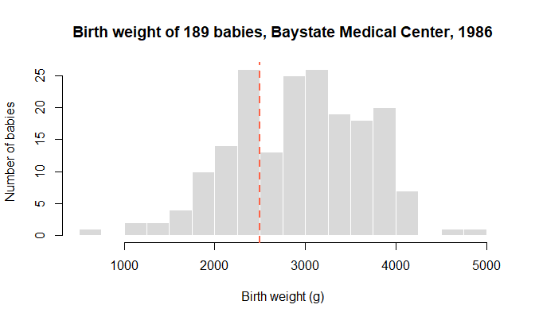<!-- -->

**What it does:** `breaks` sets the bin edges every 250 g (with `seq()`,
Lesson 7). `col` fills the bars and `border` colours their outlines.
`main`, `xlab` and `ylab` set the title and axis labels. Then `abline()`
paints a vertical line (`v = 2500`) on top: `lwd` is the line width and
`lty = 2` makes it dashed.

**Why:** the dashed line marks the 2,500 g cut-off, so the viewer sees
immediately how many babies fall below it.

### 4.3 Comparing groups: the box plot

``` r
boxplot(bwt ~ smoke, data = births,
        col = c("#9FE1CB", "#F5C4B3"),
        main = "Birth weight by mother's smoking status",
        xlab = "", ylab = "Birth weight (g)")
abline(h = 2500, col = "grey40", lty = 3)
```

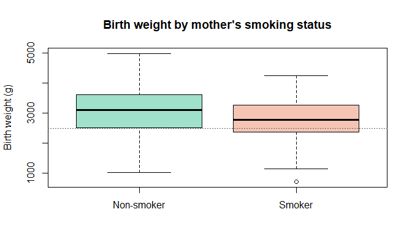<!-- -->

**What it does:** `bwt ~ smoke` is a **formula**. Read the `~` (tilde)
as **“by”**: “birth weight by smoking status”. `data = births` tells R
where to find both columns, so we do not need `births$`. One box is
drawn per level of the factor, in level order (Lesson 11), with the
labels taken from the factor. Then `abline(h = 2500)` adds a horizontal
line.

**How to read a box plot:** the thick line in the middle of each box is
the **median**. The box spans the middle half of the babies (from the
25% to the 75% point, the IQR of Lesson 10). The “whiskers” reach out to
the most extreme values that are not unusually far away, and any babies
beyond them are drawn as single circles (**outliers**). Here, the whole
box for smokers sits lower: the median, and the middle half, are
lighter.

### 4.4 Counting categories: the bar chart

``` r
counts <- table(births$bwt_cat)
counts
```

    ## 
    ## Very low      Low   Normal 
    ##        5       54      130

``` r
barplot(counts,
        col = c("#D85A30", "#F0997B", "#9FE1CB"),
        ylim = c(0, 150),
        main = "Babies in each birth-weight group",
        ylab = "Number of babies")
```

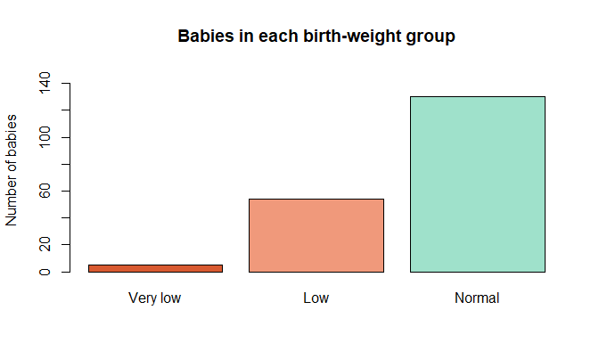<!-- -->

**What it does:** `barplot()` needs the **counts**, not the raw values,
so we first count with `table()` (Lesson 10), then draw one bar per
group. `ylim` sets the y-axis from 0 to 150 so the tallest bar fits with
some room.

**Why not `hist()`?** A histogram is for a **numeric** variable cut into
bins. A bar chart is for groups that already exist (categories).

### 4.5 Two groups side by side: a grouped bar chart

``` r
smoke_by_group <- table(births$bwt_cat, births$smoke)
smoke_by_group
```

    ##           
    ##            Non-smoker Smoker
    ##   Very low          3      2
    ##   Low              26     28
    ##   Normal           86     44

``` r
barplot(smoke_by_group, beside = TRUE,
        col = c("#D85A30", "#F0997B", "#9FE1CB"),
        ylim = c(0, 100),
        ylab = "Number of babies",
        main = "Birth-weight group by mother's smoking status")
legend("topright", legend = levels(births$bwt_cat),
       fill = c("#D85A30", "#F0997B", "#9FE1CB"), bty = "n")
```

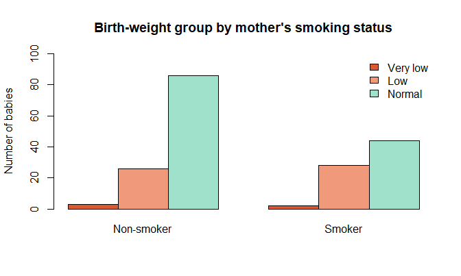<!-- -->

**What it does:** with a two-way table (Lesson 12), `barplot()` draws
one cluster per column (smoking group) and one bar per row (weight
group). `beside = TRUE` places the bars next to each other instead of
stacking them. `legend()` adds a key: its position (`"topright"`), the
labels, the matching colours, and `bty = "n"` for “no box around it”.

**Why we need the legend:** colours mean nothing until we say which is
which.

### 4.6 Two numeric variables: the scatter plot

``` r
plot(births$lwt_kg, births$bwt,
     xlab = "Mother's weight (kg)", ylab = "Birth weight (g)",
     main = "Mother's weight and baby's birth weight",
     pch = 19, col = "steelblue")
abline(h = 2500, col = "grey40", lty = 3)
```

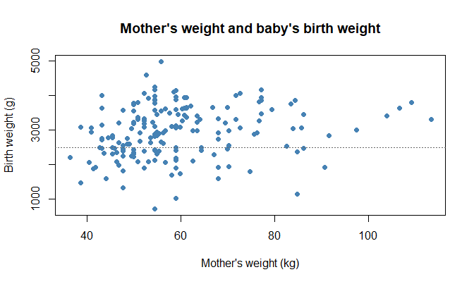<!-- -->

**What it does:** `plot(x, y)` draws one point per baby: the mother’s
weight across, the baby’s weight up. `pch = 19` (plotting character)
draws filled circles instead of the default open ones.

**How to read the output:** the cloud of points rises slightly from left
to right. There is a weak tendency for heavier mothers to have heavier
babies, but with lots of variation.

### 4.7 Colouring points by group

``` r
group_colours <- c("steelblue", "tomato")
plot(births$lwt_kg, births$bwt,
     xlab = "Mother's weight (kg)", ylab = "Birth weight (g)",
     main = "Mother's weight and birth weight, by smoking status",
     pch = 19, col = group_colours[births$smoke])
legend("topright", legend = levels(births$smoke),
       col = group_colours, pch = 19, bty = "n")
```

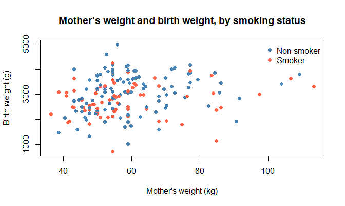<!-- -->

**What it does:** the key is `group_colours[births$smoke]`. Behind the
labels, a factor stores codes 1 and 2 (Lesson 11). Used inside square
brackets, those codes **pick** a colour for each baby: code 1
(non-smoker) picks `"steelblue"`, code 2 (smoker) picks `"tomato"`. So
we get a vector of 189 colours, one per point, in one short line.

**Why:** this is indexing from Lesson 8 doing useful work in a plot.

### 4.8 Several plots on one canvas: `par(mfrow = )`

``` r
par(mfrow = c(1, 2))
hist(births$bwt, col = "grey85", border = "white",
     main = "All babies", xlab = "Birth weight (g)")
boxplot(bwt ~ smoke, data = births, col = c("#9FE1CB", "#F5C4B3"),
        main = "By smoking", xlab = "", ylab = "Birth weight (g)")
```

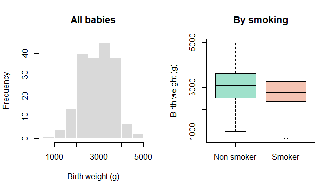<!-- -->

``` r
par(mfrow = c(1, 1))
```

**What it does:** `par()` sets **graphical parameters** for the canvas.
`mfrow = c(1, 2)` splits it into 1 row and 2 columns, so the next two
plots appear side by side. The last line sets it back to one plot per
canvas.

### 4.9 Reproducing Snow’s chart from Lesson 2

``` r
snow_rates <- c(Southwark_Vauxhall = 1263 / 40046,
                Lambeth = 98 / 26107,
                Rest_of_London = 1422 / 256423) * 10000
barplot(round(snow_rates, digits = 1),
        col = c("grey60", "#1D9E75", "#D85A30"),
        ylab = "Cholera deaths per 10,000 houses",
        main = "London cholera, first 7 weeks of 1854")
```

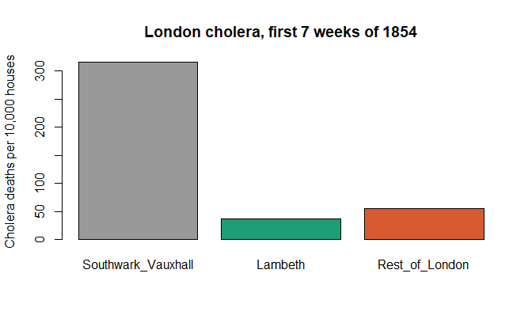<!-- -->

**What it does:** builds a named vector of the three rates in one step
(names can be written inside `c()`), and draws them as a bar chart.

**Why:** in Lesson 2 this chart was a mystery. Now every part of the
code is something we have learned.

### 4.10 Saving a plot to a file

To use a plot in a report or a slide, we save it as an image file. The
pattern has three steps: **open a file, draw, close the file.**

``` r
png("outputs/birthweight_by_smoking.png", width = 1600, height = 1000, res = 200)
boxplot(bwt ~ smoke, data = births, col = c("#9FE1CB", "#F5C4B3"),
        main = "Birth weight by mother's smoking status",
        xlab = "", ylab = "Birth weight (g)")
dev.off()
```

**What it does:** `png()` opens an image file instead of the Plots pane.
`width` and `height` are in pixels, and `res` is the resolution (200
dots per inch is sharp enough for slides and print). The plot is drawn
**into the file**, so nothing appears on screen. `dev.off()` (“device
off”) closes and saves the file.

**Why the `outputs/` folder:** keeping results apart from data and
scripts keeps a project tidy. We set up such folders properly in Lesson
17. (Create the folder first, with `dir.create("outputs")`, or by
clicking New Folder in the Files pane.)

Other formats work the same way: `pdf("file.pdf")` for a vector file
that stays sharp at any size, `jpeg()` and `svg()`. You can also click
**Export** in the Plots pane, but code is better: it saves the plot the
same way every time.

------------------------------------------------------------------------

## 5. Common errors

### “figure margins too large”

If the Plots pane is very small, R cannot fit the plot and stops with
`Error in plot.new(): figure margins too large`. Make the Plots pane
bigger, or save the plot to a file instead.

### Forgetting `dev.off()`

If we forget `dev.off()`, the file stays open and may be empty, and the
next plots keep going into the file instead of the Plots pane. If plots
stop appearing on screen, run `dev.off()` until R reports the “null
device”.

### Plotting a whole data frame by accident

`plot(births)` draws every column against every other column, a large
grid that takes time to draw. Usually we wanted
`plot(births$lwt_kg, births$bwt)`.

### `hist()` on a factor

``` r
hist(births$smoke)
```

    ## Error in `hist.default()`:
    ## ! 'x' must be numeric

A histogram needs numbers. For a categorical variable, count it with
`table()` and use `barplot()`.

------------------------------------------------------------------------

## 6. Practice

1.  Draw a histogram of the mothers’ ages (`births$age`) with bins 5
    years wide, from 10 to 50, and a clear title and axis labels.
2.  Draw a box plot of birth weight by **race**. (First turn `race` into
    a factor with labels, as in Lesson 11.)
3.  Draw a bar chart of the number of smokers and non-smokers.
4.  Save your box plot from question 2 as a PNG file in `outputs/`.

<details>

<summary>

Show answers
</summary>

``` r
hist(births$age, breaks = seq(10, 50, by = 5), col = "grey85", border = "white",
     main = "Age of mothers", xlab = "Age (years)", ylab = "Number of mothers")

births$race <- factor(births$race, levels = c(1, 2, 3),
                      labels = c("White", "Black", "Other"))
boxplot(bwt ~ race, data = births, col = "grey85",
        main = "Birth weight by race", xlab = "", ylab = "Birth weight (g)")

barplot(table(births$smoke), col = c("#9FE1CB", "#F5C4B3"),
        ylab = "Number of mothers", main = "Smoking during pregnancy")

png("outputs/birthweight_by_race.png", width = 1600, height = 1000, res = 200)
boxplot(bwt ~ race, data = births, col = "grey85",
        main = "Birth weight by race", xlab = "", ylab = "Birth weight (g)")
dev.off()
```

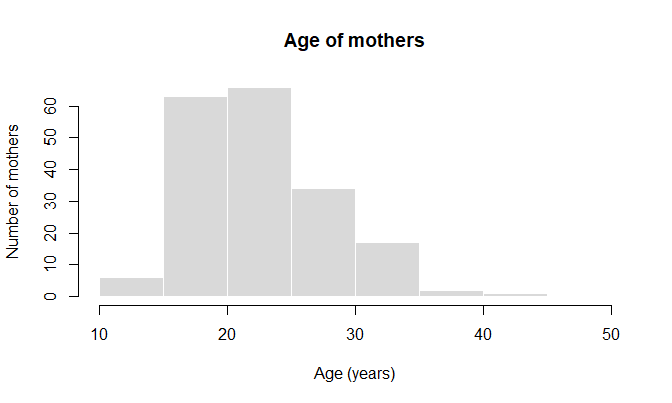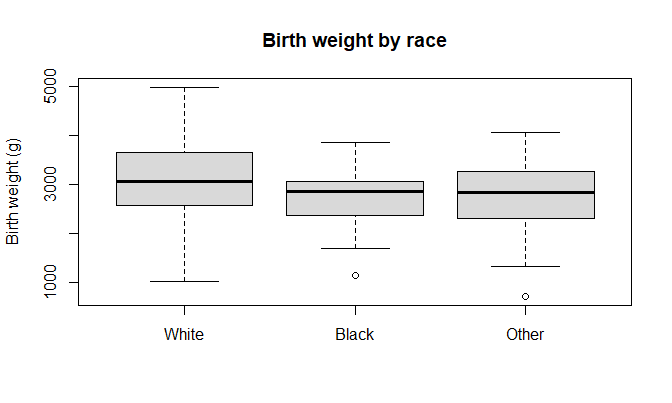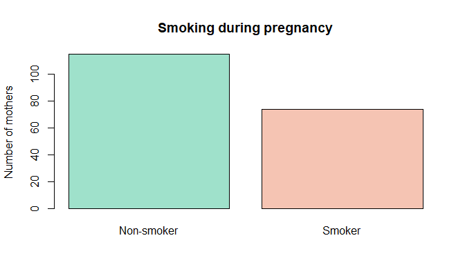

</details>

------------------------------------------------------------------------

## 7. Recap

The type of the variables chooses the plot: `hist()` for one numeric
variable, `boxplot(y ~ group)` for a numeric variable by group,
`barplot(table(x))` for categories, and `plot(x, y)` for two numeric
variables. The first command paints the canvas; `abline()` and
`legend()` paint on top. `main`, `xlab`, `ylab`, `col`, `xlim` and
`ylim` control the look, `par(mfrow = )` puts several plots together,
and `png()` … `dev.off()` saves a plot to a file.

## 8. What comes next

We saved our first file into an `outputs` folder. In **Lesson 17** we
learn how R finds files at all: working directories, paths and RStudio
Projects. Then we write our prepared data to a CSV file and an Excel
file, and read data back in, the way every real project begins.
