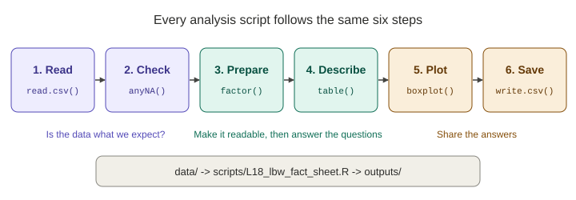
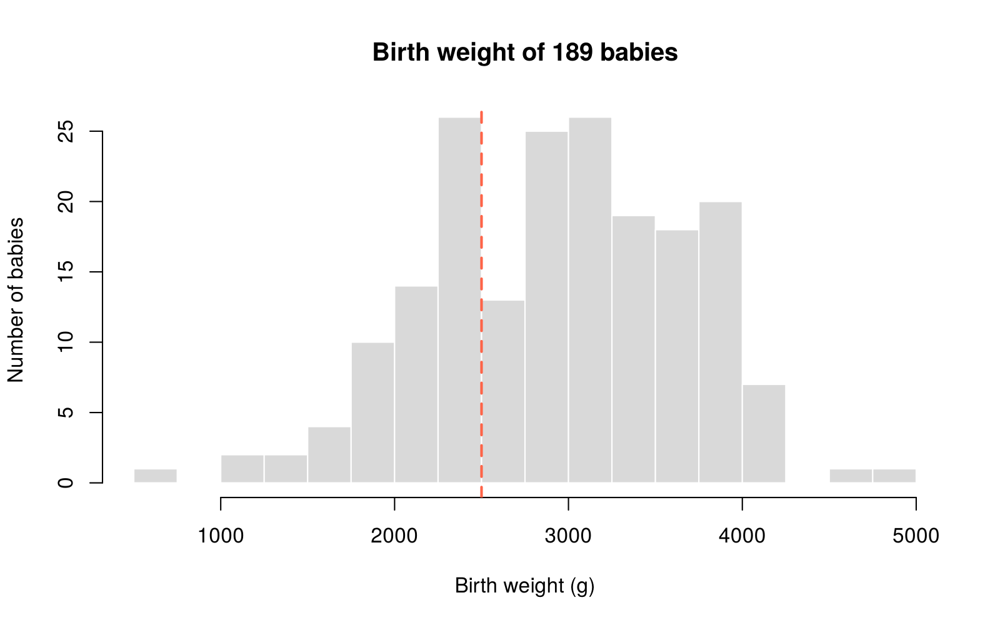
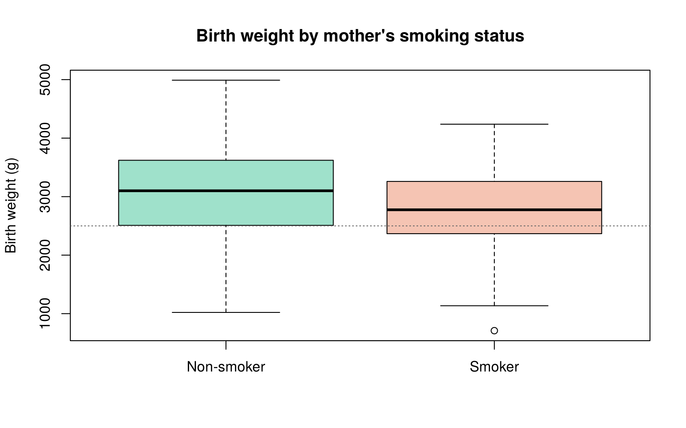

Lesson 18: Capstone 1 — A Low Birth Weight Fact Sheet
================
Dr. Sandeep Kumar Singh

> **The brief:** You have joined a maternal health team. Your manager
> hands you the Baystate birth records and asks for a one-page **fact
> sheet** on low birth weight: How many babies were studied? How common
> was low birth weight? How did babies of smoking and non-smoking
> mothers compare? She wants two figures, a results table, and a script
> that a colleague can re-run next year when new data arrive.

------------------------------------------------------------------------

## 1. Why this lesson matters

Until now, each lesson taught one skill. Real work needs all of them at
once, in the right order, in one script that runs from top to bottom.
This capstone uses **only what we have learned in Lessons 1–17**, with
one small new function, `cat()`, for printing the final sentences. If
you can build this script and explain every line, you have completed
Level 1.

------------------------------------------------------------------------

## 2. The plan before the code

### 2.1 Questions first

A good analysis starts from written questions, not from code. Ours are:

| \# | Question | Answered with |
|----|----|----|
| Q1 | How many babies, and are the data complete and plausible? | `dim()`, `anyNA()`, `range()` |
| Q2 | How common were low (\< 2,500 g) and very low (\< 1,500 g) birth weight? | `sum()`, `mean()`, `cut()` |
| Q3 | What was the typical birth weight? | `mean()`, `sd()`, `summary()` |
| Q4 | How did babies of smoking and non-smoking mothers compare? | `table()`, indexing, `mean()` |
| Q5 | What will we hand over? | `png()`, `write.csv()`, `cat()` |

### 2.2 Six steps, every time

<figure>

<figcaption aria-hidden="true">The six steps of an analysis
script</figcaption>
</figure>

*Figure 18.1. The structure of our script, and of almost every analysis
script you will ever write.*

### 2.3 The project

Create a new RStudio Project called `low-birth-weight` (Lesson 17), and
inside it a script `scripts/L18_lbw_fact_sheet.R`. Each section below
becomes one section of that script, with a heading comment (Lesson 3).
Run each section as you write it, and look at the result before moving
on.

------------------------------------------------------------------------

## 3. Building the script, section by section

### Section 0: Setup

``` r
# ---- 0. Setup ----
library(MASS)                                   # source of the birthwt data
dir.create("data", showWarnings = FALSE)        # project folders (no-op if present)
dir.create("outputs", showWarnings = FALSE)
```

**What it does:** loads `MASS` and makes sure the `data` and `outputs`
folders exist (Lessons 5 and 17). Packages and folders always come
first, so the rest of the script can rely on them.

### Section 1: Get the raw data into the project

``` r
# ---- 1. Get the raw data into the project ----
# In a real project the hospital would send this file; here we create it
# once from the package so that the analysis starts from a file.
write.csv(birthwt, "data/birthwt_raw.csv", row.names = FALSE)
```

**What it does:** writes the built-in `birthwt` data to a CSV file.

**Why:** in real life the hospital would send this file, and our script
would start at Section 2. Creating it once from the package lets us
practise the real workflow: **every analysis starts from a file in
`data/`**, never from data typed or edited by hand.

### Section 2: Read the raw data

``` r
# ---- 2. Read the raw data ----
raw <- read.csv("data/birthwt_raw.csv")
str(raw)
```

    ## 'data.frame':    189 obs. of  10 variables:
    ##  $ low  : int  0 0 0 0 0 0 0 0 0 0 ...
    ##  $ age  : int  19 33 20 21 18 21 22 17 29 26 ...
    ##  $ lwt  : int  182 155 105 108 107 124 118 103 123 113 ...
    ##  $ race : int  2 3 1 1 1 3 1 3 1 1 ...
    ##  $ smoke: int  0 0 1 1 1 0 0 0 1 1 ...
    ##  $ ptl  : int  0 0 0 0 0 0 0 0 0 0 ...
    ##  $ ht   : int  0 0 0 0 0 0 0 0 0 0 ...
    ##  $ ui   : int  1 0 0 1 1 0 0 0 0 0 ...
    ##  $ ftv  : int  0 3 1 2 0 0 1 1 1 0 ...
    ##  $ bwt  : int  2523 2551 2557 2594 2600 2622 2637 2637 2663 2665 ...

**What it does:** reads the file into a data frame called `raw`, and
shows its structure straight away (Lesson 17). We never change `raw`; it
is our untouched copy of what we received.

### Section 3: Check the data (Q1)

``` r
# ---- 3. Check the data ----
dim(raw)                                        # expect 189 rows, 10 columns
```

    ## [1] 189  10

``` r
anyNA(raw)                                      # any missing values at all?
```

    ## [1] FALSE

``` r
range(raw$bwt)                                  # plausible birth weights?
```

    ## [1]  709 4990

``` r
range(raw$age)                                  # plausible maternal ages?
```

    ## [1] 14 45

``` r
table(raw$smoke)                                # only codes 0 and 1?
```

    ## 
    ##   0   1 
    ## 115  74

**How to read the output:** 189 babies and 10 variables; no missing
values anywhere; birth weights from 709 g to 4,990 g and mothers’ ages
from 14 to 45, all plausible; and smoking coded only as 0 and 1. If any
of these checks had surprised us, we would stop here and ask the data
provider before analysing anything.

### Section 4: Prepare an analysis copy

``` r
# ---- 4. Prepare an analysis copy ----
births <- raw
births$smoke <- factor(births$smoke, levels = c(0, 1),
                       labels = c("Non-smoker", "Smoker"))
births$race <- factor(births$race, levels = c(1, 2, 3),
                      labels = c("White", "Black", "Other"))
births$bwt_cat <- cut(births$bwt, breaks = c(0, 1500, 2500, Inf), right = FALSE,
                      labels = c("Very low", "Low", "Normal"))
births$lbw <- births$bwt < 2500                 # TRUE = low birth weight
births$lwt_kg <- round(births$lwt * 0.45359237, digits = 1)
```

**What it does:** works on a copy, `births` (Lesson 15). Codes become
labelled factors (Lesson 11); `cut()` makes the three weight groups;
`lbw` stores TRUE/FALSE for low birth weight (Lesson 8); and mothers’
weights get a kilogram column (Lesson 7).

### Section 5: Describe (Q2 and Q3)

``` r
# ---- 5. Describe ----
n_babies   <- nrow(births)
n_lbw      <- sum(births$lbw)
pct_lbw    <- round(mean(births$lbw) * 100, digits = 1)
n_very_low <- sum(births$bwt_cat == "Very low")
mean_bwt   <- round(mean(births$bwt))
sd_bwt     <- round(sd(births$bwt))
median_age <- median(births$age)
pct_smoke  <- round(mean(births$smoke == "Smoker") * 100, digits = 1)

summary(births$bwt)
```

    ##    Min. 1st Qu.  Median    Mean 3rd Qu.    Max. 
    ##     709    2414    2977    2945    3487    4990

``` r
table(births$bwt_cat)
```

    ## 
    ## Very low      Low   Normal 
    ##        5       54      130

**What it does:** stores each key number in a clearly named object
(Lesson 3), so the fact sheet in Section 9 can use them, then prints the
summary of birth weight and the count of each weight group (Lesson 10).

**Why store the numbers?** If the data change next year, every number in
the fact sheet updates automatically. Nothing is copied by hand.

### Section 6: Compare by smoking status (Q4)

``` r
# ---- 6. Compare by smoking status ----
smoke_table <- table(births$smoke, births$bwt_cat)
smoke_table
```

    ##             
    ##              Very low Low Normal
    ##   Non-smoker        3  26     86
    ##   Smoker            2  28     44

``` r
lbw_by_smoke <- round(c(mean(births$lbw[births$smoke == "Non-smoker"]),
                        mean(births$lbw[births$smoke == "Smoker"])) * 100, digits = 1)
mean_by_smoke <- round(c(mean(births$bwt[births$smoke == "Non-smoker"]),
                         mean(births$bwt[births$smoke == "Smoker"])))
names(lbw_by_smoke) <- levels(births$smoke)
names(mean_by_smoke) <- levels(births$smoke)
lbw_by_smoke
```

    ## Non-smoker     Smoker 
    ##       25.2       40.5

``` r
mean_by_smoke
```

    ## Non-smoker     Smoker 
    ##       3056       2772

**What it does:** a table of weight group by smoking status (Lesson 12),
then the percentage of low-birth-weight babies and the mean birth weight
in each smoking group, using indexing by a factor label (Lessons 8 and
11). `names()` labels the results (Lesson 7).

**How to read the output:** 25.2% of babies of non-smokers and 40.5% of
babies of smokers had low birth weight; the mean birth weights were
3,056 g and 2,772 g.

### Section 7: Figures

``` r
# ---- 7. Figures ----
png("outputs/fig1_birthweight_histogram.png", width = 1600, height = 1000, res = 200)
hist(births$bwt, breaks = seq(500, 5000, by = 250), col = "grey85", border = "white",
     main = "Birth weight of 189 babies", xlab = "Birth weight (g)",
     ylab = "Number of babies")
abline(v = 2500, col = "tomato", lwd = 2, lty = 2)
dev.off()

png("outputs/fig2_birthweight_by_smoking.png", width = 1600, height = 1000, res = 200)
boxplot(bwt ~ smoke, data = births, col = c("#9FE1CB", "#F5C4B3"),
        main = "Birth weight by mother's smoking status",
        xlab = "", ylab = "Birth weight (g)")
abline(h = 2500, col = "grey40", lty = 3)
dev.off()
```

**What it does:** saves a histogram and a box plot as PNG files in
`outputs/` (Lesson 16): open a file, draw, close.

The two figures the script produces:

<figure>

<figcaption aria-hidden="true">Figure 1 of the fact sheet</figcaption>
</figure>

<figure>

<figcaption aria-hidden="true">Figure 2 of the fact sheet</figcaption>
</figure>

### Section 8: Save results

``` r
# ---- 8. Save results ----
results <- data.frame(group = levels(births$smoke),
                      n = as.vector(table(births$smoke)),
                      mean_bwt_g = as.vector(mean_by_smoke),
                      lbw_percent = as.vector(lbw_by_smoke))
write.csv(results, "outputs/table1_by_smoking.csv", row.names = FALSE)
saveRDS(births, "data/births_analysis.rds")
```

**What it does:** builds a small results table (Lesson 15) and saves it
as a CSV file for the report, and saves the prepared data as an RDS
file, factors and all, for the next analysis (Lesson 17).

### Section 9: The fact sheet

`cat()` is the one new function in this capstone. It **prints text and
values together**, joining everything we give it. `"\n"` means “start a
new line”, and `sep = ""` tells `cat()` not to add spaces of its own, so
we control the spacing exactly.

``` r
# ---- 9. The fact sheet ----
cat("LOW BIRTH WEIGHT FACT SHEET: Baystate Medical Center, 1986\n",
    "Babies studied: ", n_babies, "\n",
    "Low birth weight (under 2500 g): ", n_lbw, " babies (", pct_lbw, "%)\n",
    "Very low birth weight (under 1500 g): ", n_very_low, " babies\n",
    "Mean birth weight: ", mean_bwt, " g (SD ", sd_bwt, " g)\n",
    "Median age of mothers: ", median_age, " years\n",
    "Mothers who smoked in pregnancy: ", pct_smoke, "%\n",
    "Low birth weight: ", lbw_by_smoke["Non-smoker"], "% of babies of non-smokers, ",
    lbw_by_smoke["Smoker"], "% of babies of smokers\n",
    "Mean birth weight: ", mean_by_smoke["Non-smoker"], " g (non-smokers), ",
    mean_by_smoke["Smoker"], " g (smokers)\n",
    sep = "")
```

    ## LOW BIRTH WEIGHT FACT SHEET: Baystate Medical Center, 1986
    ## Babies studied: 189
    ## Low birth weight (under 2500 g): 59 babies (31.2%)
    ## Very low birth weight (under 1500 g): 5 babies
    ## Mean birth weight: 2945 g (SD 729 g)
    ## Median age of mothers: 23 years
    ## Mothers who smoked in pregnancy: 39.2%
    ## Low birth weight: 25.2% of babies of non-smokers, 40.5% of babies of smokers
    ## Mean birth weight: 3056 g (non-smokers), 2772 g (smokers)

**How to read the output:** this is the deliverable. Every number in it
was calculated by the script, from the file, in this run.

### Section 10: Record the software used

``` r
sessionInfo()
```

**What it does:** prints the version of R and of every loaded package
(Lesson 5). Keeping this at the end of a script means anyone can see
exactly which software produced the results. (We do not show its long
output here.)

------------------------------------------------------------------------

## 4. The complete script

Here is the whole script in one piece. You can also download it as
`scripts/L18_lbw_fact_sheet.R`. Restart R, open the project, and run it
from top to bottom with **Ctrl + Shift + Enter** (Mac: **Cmd + Shift +
Return**). If it produces the same fact sheet on a fresh session, your
work is **reproducible**.

``` r
# =====================================================================
# Low birth weight fact sheet: Baystate Medical Center, 1986
# R for Everyone, Level 1 capstone (Lesson 18)
# Author: Dr. Sandeep Kumar Singh
#
# Data: birthwt (MASS package), 189 births, Hosmer and Lemeshow (1989)
# Run this script from inside the RStudio Project, top to bottom,
# on a fresh R session (Session -> Restart R).
# =====================================================================

# ---- 0. Setup ----
library(MASS)                                   # source of the birthwt data
dir.create("data", showWarnings = FALSE)        # project folders (no-op if present)
dir.create("outputs", showWarnings = FALSE)

# ---- 1. Get the raw data into the project ----
# In a real project the hospital would send this file; here we create it
# once from the package so that the analysis starts from a file.
write.csv(birthwt, "data/birthwt_raw.csv", row.names = FALSE)

# ---- 2. Read the raw data ----
raw <- read.csv("data/birthwt_raw.csv")
str(raw)

# ---- 3. Check the data ----
dim(raw)                                        # expect 189 rows, 10 columns
anyNA(raw)                                      # any missing values at all?
range(raw$bwt)                                  # plausible birth weights?
range(raw$age)                                  # plausible maternal ages?
table(raw$smoke)                                # only codes 0 and 1?

# ---- 4. Prepare an analysis copy ----
births <- raw
births$smoke <- factor(births$smoke, levels = c(0, 1),
                       labels = c("Non-smoker", "Smoker"))
births$race <- factor(births$race, levels = c(1, 2, 3),
                      labels = c("White", "Black", "Other"))
births$bwt_cat <- cut(births$bwt, breaks = c(0, 1500, 2500, Inf), right = FALSE,
                      labels = c("Very low", "Low", "Normal"))
births$lbw <- births$bwt < 2500                 # TRUE = low birth weight
births$lwt_kg <- round(births$lwt * 0.45359237, digits = 1)

# ---- 5. Describe ----
n_babies   <- nrow(births)
n_lbw      <- sum(births$lbw)
pct_lbw    <- round(mean(births$lbw) * 100, digits = 1)
n_very_low <- sum(births$bwt_cat == "Very low")
mean_bwt   <- round(mean(births$bwt))
sd_bwt     <- round(sd(births$bwt))
median_age <- median(births$age)
pct_smoke  <- round(mean(births$smoke == "Smoker") * 100, digits = 1)

summary(births$bwt)
table(births$bwt_cat)

# ---- 6. Compare by smoking status ----
smoke_table <- table(births$smoke, births$bwt_cat)
smoke_table

lbw_by_smoke <- round(c(mean(births$lbw[births$smoke == "Non-smoker"]),
                        mean(births$lbw[births$smoke == "Smoker"])) * 100, digits = 1)
mean_by_smoke <- round(c(mean(births$bwt[births$smoke == "Non-smoker"]),
                         mean(births$bwt[births$smoke == "Smoker"])))
names(lbw_by_smoke) <- levels(births$smoke)
names(mean_by_smoke) <- levels(births$smoke)
lbw_by_smoke
mean_by_smoke

# ---- 7. Figures ----
png("outputs/fig1_birthweight_histogram.png", width = 1600, height = 1000, res = 200)
hist(births$bwt, breaks = seq(500, 5000, by = 250), col = "grey85", border = "white",
     main = "Birth weight of 189 babies", xlab = "Birth weight (g)",
     ylab = "Number of babies")
abline(v = 2500, col = "tomato", lwd = 2, lty = 2)
dev.off()

png("outputs/fig2_birthweight_by_smoking.png", width = 1600, height = 1000, res = 200)
boxplot(bwt ~ smoke, data = births, col = c("#9FE1CB", "#F5C4B3"),
        main = "Birth weight by mother's smoking status",
        xlab = "", ylab = "Birth weight (g)")
abline(h = 2500, col = "grey40", lty = 3)
dev.off()

# ---- 8. Save results ----
results <- data.frame(group = levels(births$smoke),
                      n = as.vector(table(births$smoke)),
                      mean_bwt_g = as.vector(mean_by_smoke),
                      lbw_percent = as.vector(lbw_by_smoke))
write.csv(results, "outputs/table1_by_smoking.csv", row.names = FALSE)
saveRDS(births, "data/births_analysis.rds")

# ---- 9. The fact sheet ----
cat("LOW BIRTH WEIGHT FACT SHEET: Baystate Medical Center, 1986\n",
    "Babies studied: ", n_babies, "\n",
    "Low birth weight (under 2500 g): ", n_lbw, " babies (", pct_lbw, "%)\n",
    "Very low birth weight (under 1500 g): ", n_very_low, " babies\n",
    "Mean birth weight: ", mean_bwt, " g (SD ", sd_bwt, " g)\n",
    "Median age of mothers: ", median_age, " years\n",
    "Mothers who smoked in pregnancy: ", pct_smoke, "%\n",
    "Low birth weight: ", lbw_by_smoke["Non-smoker"], "% of babies of non-smokers, ",
    lbw_by_smoke["Smoker"], "% of babies of smokers\n",
    "Mean birth weight: ", mean_by_smoke["Non-smoker"], " g (non-smokers), ",
    mean_by_smoke["Smoker"], " g (smokers)\n",
    sep = "")

# ---- 10. Record the software used ----
sessionInfo()
```

------------------------------------------------------------------------

## 5. Check your work

| ✔ | Your script… | Lesson |
|----|----|----|
|  | runs top to bottom on a fresh R session without errors | 3, 17 |
|  | uses only relative paths (`data/…`, `outputs/…`), no `setwd()` | 17 |
|  | never changes the raw data; works on a copy | 15 |
|  | checks size, missing values and ranges before analysing | 9, 10, 14 |
|  | turns every coded category into a labelled factor | 11 |
|  | stores key numbers in named objects; nothing is typed in by hand | 3 |
|  | saves figures and tables to `outputs/` | 16, 17 |
|  | has a heading comment for every section | 3 |

------------------------------------------------------------------------

## 6. Your own capstone: a diabetes fact sheet

Now repeat the whole process on your own with the **Pima diabetes
data**, `Pima.tr2` (Lesson 9). Write `scripts/diabetes_fact_sheet.R`
that:

1.  writes `Pima.tr2` to `data/pima_raw.csv` and reads it back;
2.  checks the size and counts the missing values in every measurement;
3.  reports how many women had diabetes (`type == "Yes"`) and what
    percentage that is;
4.  compares the mean BMI and mean glucose (`glu`) of women with and
    without diabetes (remember `na.rm = TRUE`, and report how many
    values were missing);
5.  saves a box plot of glucose by diabetes status and a results table;
6.  prints a short fact sheet with `cat()`.

<details>

<summary>

Show key numbers to check your answers
</summary>

``` r
library(MASS)
pima <- Pima.tr2
sum(pima$type == "Yes")
```

    ## [1] 106

``` r
round(mean(pima$type == "Yes") * 100, digits = 1)
```

    ## [1] 35.3

``` r
round(mean(pima$bmi[pima$type == "Yes"], na.rm = TRUE), digits = 1)
```

    ## [1] 34.6

``` r
round(mean(pima$bmi[pima$type == "No"], na.rm = TRUE), digits = 1)
```

    ## [1] 30.7

``` r
round(mean(pima$glu[pima$type == "Yes"]), digits = 1)
```

    ## [1] 143.4

``` r
round(mean(pima$glu[pima$type == "No"]), digits = 1)
```

    ## [1] 113

</details>

------------------------------------------------------------------------

## 7. Level 1 recap

In eighteen lessons we went from `1 + 1` to a reproducible analysis
project. We learned to:

| Module | What we can now do |
|----|----|
| 1\. Meeting R | use RStudio, calculate, store objects, call functions, read help, install packages |
| 2\. Vectors with real data | handle types, build vectors, filter with conditions, deal with `NA`, summarise |
| 3\. Categories and structures | use factors, matrices, lists and data frames, and prepare data |
| 4\. First mini-analysis | plot, read and write files, organise a project, deliver results |

And we did it all with real data: John Snow’s cholera table, 189 births
from 1986, and 300 women in a diabetes study.

## 8. What comes next: Level 2

Level 2, **“Working with data like a pro”**, starts with **Lesson 19:
conditions**, then loops and writing our own functions, so that R can
make decisions and repeat work for us. After that comes the
**tidyverse**, a family of packages that makes data preparation much
faster and more readable, and **ggplot2** for publication-quality
figures, using larger real datasets such as the US NHANES survey and the
WHO tuberculosis records.
